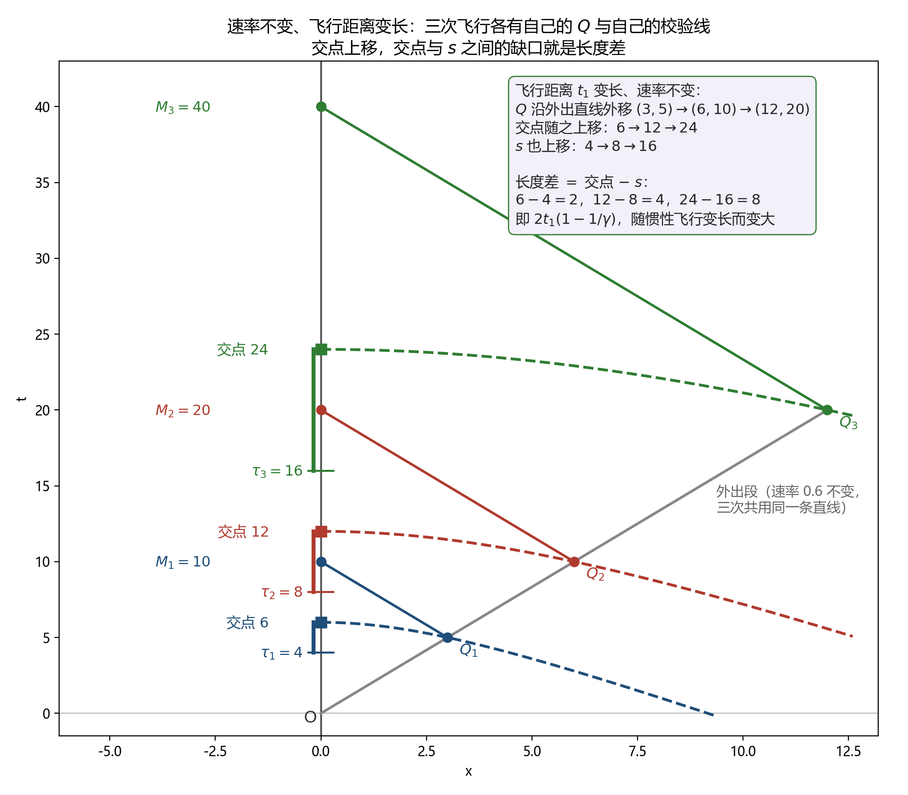
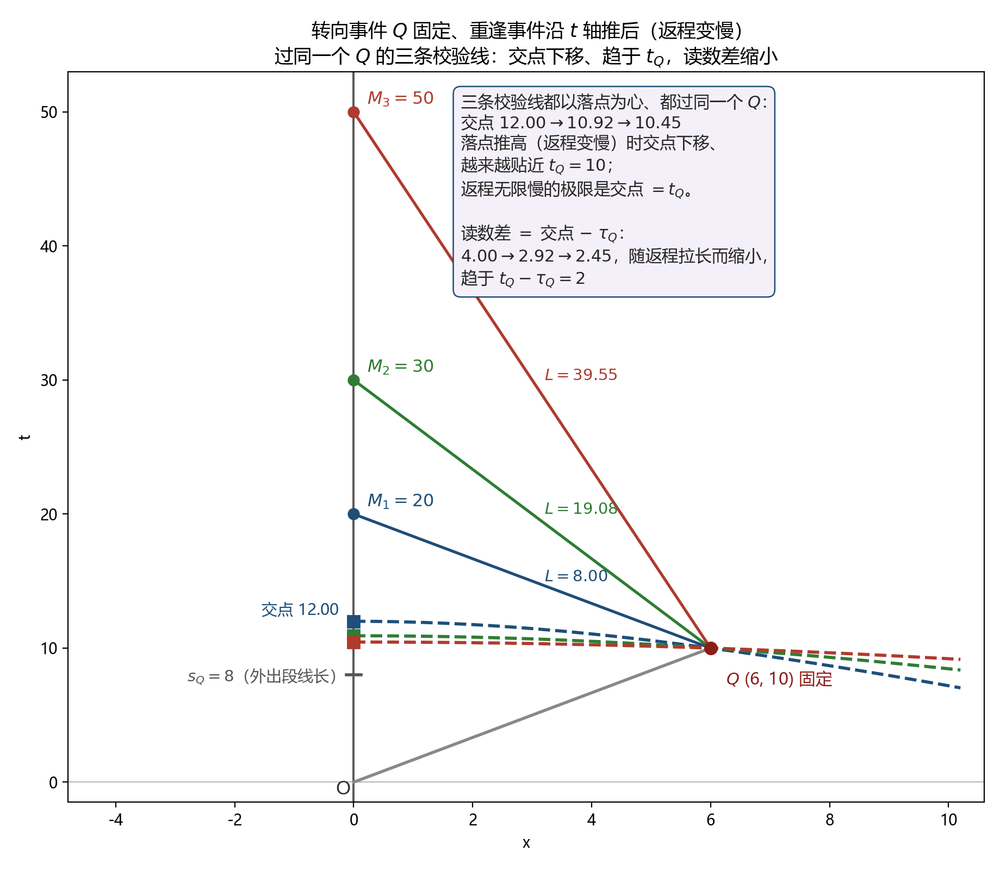
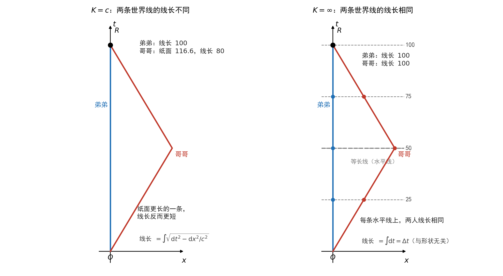

# 非对称双生子实验 {#sec-asymmetric-twins}

## 本章做什么 {#sec-at-scope}

@sec-twins-comparison 章用镜像对称的设定问“配对的两段各累积了多少线长，之比是多少”，@sec-twins-noninertial 章用同一对曲线换坐标核长度。本章换的是**设定**：**非对称双生子实验**（又称地球版双生子）——$D$ 留在原地，$G$ 一个人飞出去一圈再回来。这是一个**不对称**的实验，转向的只有一个人，两条世界线不互为镜像。

本章把同一个实验放进恒速群的两端：$K=c$ 与 $K=\infty$。两支各列其公理，各推其结果，并列摆放。另回答一个可以逐步核对的问题：**把转向段固定住，只改变惯性飞行的时长与速率，两侧长度之差如何变化。**

**本章在链条上的位置**：输入只有三项——取定 $K$（(P1)）、指定谁在哪条曲线上（(P2)）、由几何算出两条曲线的长度差（第 3 步）。本章**不补**关于钟的两项——弱的一项 (P3a)（互为镜像的过程读数相同）与强的一项 (P3b)（线长等于钟的读数），也**不补** (P4)（把两条曲线上的事件配成对）。所以本章得到的每一个数都是长度或长度之差，不是任何钟的读数，也不涉及“同一时刻两边各读到多少”。登记见 @sec-layers 章。

## 实验设定 {#sec-at-setup}

::: {#def-at-setup}
## 非对称双生子实验

在承载坐标系中，$D$ 始终停留在 $x=0$；$G$ 以速率 $v$ 沿直线飞离到 $x=d$，转向后以同样速率飞回，在事件 $M$ 与 $D$ 重逢。记 $O$ 为分离事件，取承载坐标全程时间 $T$。

分段记法：$G$ 的段 I 为飞离的惯性段，占坐标时 $t_1$（其中 $d=vt_1$）；段 II 为转向段，占坐标时 $\Delta$，线长为 $\varepsilon$；段 III 为飞回的惯性段，占坐标时 $t_1$。于是

$$
T=2t_1+\Delta .
$$
:::

分离与重逢发生在同一地点（两个事件的空间坐标同为 $x=0$）；这与 @sec-twins-comparison 章的镜像实验一致——镜像对称要求对折轴同时经过 $O$ 与 $M$，故两者的空间坐标相同。

与镜像实验相比，差别只有一条：**转向的只有一个人**。$D$ 的世界线是一条直线（$D$ 全程惯性），$G$ 的世界线是三段（惯性—转向—惯性），两者不互为镜像。

## 第一支：$K=c$ {#sec-at-branch-c}

::: {#cnj-ta-lorentz}
## 洛伦兹公设（$K=c$）

恒速群取 $K=c$，即存在有限的不变速度 $c$。据此：

1. **变换**：$t'=\gamma_u\bigl(t-ux/c^{2}\bigr)$，$x'=\gamma_u(x-ut)$，其中 $\gamma_u=1/\sqrt{1-u^{2}/c^{2}}$。
2. **同时**：同时性随参考系改变，同时面为 $t-ux/c^{2}=\text{常数}$。
3. **线元**：$\mathrm{d}s^{2}=\mathrm{d}t^{2}-\mathrm{d}x^{2}/c^{2}$。
:::

::: {#prp-ta-lorentz-result}
## 在该公设下：线长沿各自的路径累积

$$
\Delta s=\int_{\gamma}\mathrm{d}s=\int_{\gamma}\sqrt{\mathrm{d}t^{2}-\mathrm{d}x^{2}/c^{2}}
$$

对 $D$（$x\equiv0$，全程惯性）：$\Delta s_D=T=2t_1+\Delta$。对 $G$：两段惯性段的线长各由校准引理给出（@prp-tn-calibration），均为 $t_1/\gamma$，转向段的线长记为 $\varepsilon$，由 (M4) 沿该段积分给出。记 $\gamma=1/\sqrt{1-v^{2}/c^{2}}$，则

$$
\Delta s_D=2t_1+\Delta,\qquad \Delta s_G=\frac{2t_1}{\gamma}+\varepsilon .
$$
:::

两侧长度之差为

$$
\Delta s_D-\Delta s_G=2t_1\Bigl(1-\frac{1}{\gamma}\Bigr)+(\Delta-\varepsilon) .
$$ {#eq-at-diff}

### 按运动类型归堆比较 {#sec-at-pile}

把两侧线长各自按运动类型分成两堆：

| | $D$ | $G$ | 差 |
|---|---|---|---|
| 惯性部分 | $2t_1+\Delta$ | $2t_1/\gamma$ | $2t_1(1-1/\gamma)+\Delta$ |
| 转向部分 | $0$ | $\varepsilon$ | $-\varepsilon$ |
| 合计 | $2t_1+\Delta$ | $2t_1/\gamma+\varepsilon$ | @eq-at-diff |

: 两侧线长按运动类型归堆 {#tbl-at-pile}

本设定中 $D$ 没有转向段，故 $D$ 的转向部分线长为 $0$。

### 转向段的贡献 {#sec-at-turn}

@eq-at-diff 由两项组成，第二项 $(\Delta-\varepsilon)$ 来自转向段所在的那一段坐标时：在这段坐标时内，$D$ 全程惯性、线长为 $\Delta$；$G$ 转向、线长为 $\varepsilon$。转向期间 $G$ 仍在运动，$\varepsilon<\Delta$ 严格成立，故该项大于 $0$——**转向段对两侧长度之差有贡献**。

把转向段理想化为瞬时（$\Delta\to0$、$\varepsilon\to0$）时，该项趋于 $0$，@eq-at-diff 成为

$$
\Delta s_D-\Delta s_G=T\Bigl(1-\frac{1}{\gamma}\Bigr),\qquad T=2t_1 .
$$

掉头段只通过它占用的 $\mathrm{d}t$ 进入积分；令掉头段历时趋于零，上式不变。取 $v=0.6c$、$T=100$ 年（$\gamma=1.25$）：$\Delta s_D=100$ 年、$\Delta s_G=80$ 年，差 $20$ 年。

### 固定转向段，只延长惯性飞行 {#sec-at-scan}

把转向段完全固定住——$\Delta$ 与 $\varepsilon$ 都取定值——只改变惯性飞行的时长 $t_1$。取 $v=0.6$（$\gamma=1.25$），转向段理想化为瞬时（$\Delta=\varepsilon=0$）：

| $t_1$ | $T$ | $D$ 线长 | $G$ 线长 | $\Delta s_D-\Delta s_G$ |
|---|---|---|---|---|
| $5$ | $10$ | $10$ | $8$ | $2$ |
| $10$ | $20$ | $20$ | $16$ | $4$ |
| $20$ | $40$ | $40$ | $32$ | $8$ |

: 转向段固定、只延长惯性飞行 {#tbl-at-scan}

三行的转向段是同一个（$\Delta=\varepsilon=0$，线长为 $0$），只有惯性飞行的时长不同；两侧长度之差随 $t_1$ 线性增长。一般地，由 @eq-at-diff 对 $t_1$ 求导：

$$
\frac{\partial}{\partial t_1}\bigl(\Delta s_D-\Delta s_G\bigr)=2\Bigl(1-\frac{1}{\gamma}\Bigr)>0 ,
$$

右端不含 $\Delta$ 与 $\varepsilon$。也就是说：**在转向段固定时，两侧长度之差的改变量由惯性飞行段决定**——改变惯性飞行的时长 $t_1$ 或速率 $v$，差随之改变。@eq-at-diff 的常数项 $(\Delta-\varepsilon)$ 由转向段给出，不随 $t_1$ 改变。

延长惯性飞行有两种方式，两种方式都改变两侧长度之差；差别在固定了什么。记 $G$ 的转向事件为 $Q$（两阶段记号，见 @sec-tc-setup），外出段的线长为 $s_Q=t_1/\gamma$。两条配图（@fig-at-extend、@fig-at-fixq）都取 $c=1$、$v=0.6$、转向段瞬时（$\Delta=\varepsilon=0$）。

方式一：**速率不变，延长飞行距离**（@fig-at-extend）。三次飞行取 $t_1=5,10,20$，即 @tbl-at-scan 的三行。转向事件沿外出直线外移：$Q=(3,5),(6,10),(12,20)$；以各次重逢事件 $M_i$ 为心、过该次 $Q_i$ 的校验线与 $t$ 轴的交点随之上移（$6\to12\to24$），$s_i$ 也上移（$4\to8\to16$）。

{#fig-at-extend width=100%}

方式二：**转向事件固定，只把重逢事件沿 $t$ 轴推后**（@fig-at-fixq）。$Q$ 固定在 $(6,10)$（$t_1=10$），重逢推后到 $M=20,30,50$，返程速率依次降低（$0.6,0.3,0.15$）。三条返程段的线长为 $L=8.00,19.08,39.55$；以各 $M_i$ 为心、过同一个 $Q$ 的校验线与 $t$ 轴的交点为 $12.00\to10.92\to10.45$——落点越推高（返程越慢），交点越贴近 $t_Q=10$。

{#fig-at-fixq width=100%}

两张图的读法相同。校验线上每一点与 $M$ 的线长距离都等于返程段线长 $L$（校准引理），故它与 $t$ 轴的交点把 $L$ 切到 $D$ 的世界线上；于是

$$
\Delta s_D-\Delta s_G=t_M-(s_Q+L)=\text{交点}-s_Q ,
$$

交点与 $s_Q$ 之间那段轴长就是两侧长度之差。方式一给出 $2\to4\to8$，随惯性飞行变长而变大；方式二给出 $4.00\to2.92\to2.45$，随返程拉长而缩小，趋于 $t_Q-s_Q=2$。两种方式共同说明：改变任何一段惯性运动，两侧长度之差都随之改变——惯性飞行对长度之差有贡献；差的变化方向由固定的是什么决定。

两处核对：$v\to0$ 时 $\gamma\to1$，@eq-at-diff 给出差 $\to\Delta-\varepsilon$；转向段取瞬时（$\Delta=\varepsilon=0$）时差 $\to0$，两条路径的线长相同。

## 第二支：$K=\infty$ {#sec-at-branch-infty}

::: {#cnj-ta-absolute-time}
## 绝对时间公设（$K=\infty$）

恒速群取 $K=\infty$，即不变速度为无穷大（不存在有限的不变速度）。据此：

1. **变换**：$t'=t$，$x'=x-vt$。时间坐标不随参考系改变。
2. **同时**：同时是绝对的，所有参考系共享同一族同时面 $t=\text{常数}$。
3. **线元**：$\mathrm{d}s^{2}=\mathrm{d}t^{2}-\mathrm{d}x^{2}/K^{2}$ 中 $1/K^{2}\to0$，变为 $\mathrm{d}s^{2}=\mathrm{d}t^{2}$。
:::

::: {#prp-ta-equal}
## 在该公设下：两条世界线的线长相同

$$
\Delta s=\int_{\gamma}\mathrm{d}s=\int_{\gamma}\mathrm{d}t=t(M)-t(O)=T
$$ {#eq-ta-integral}

右端只含两端事件的时间坐标，与路径 $\gamma$ 的形状无关。$D$ 与 $G$ 的世界线都从 $O$ 到 $M$，故

$$
\Delta s_D=\Delta s_G=T
$$
:::

由此得到三点：

1. **转向不进入结果。** 加速、减速、转向只改变空间坐标 $x(t)$，而 @eq-ta-integral 中被积的是 $\mathrm{d}t$。
2. **速率不进入结果。** $v$ 只出现在 $T=2t_1+\Delta$ 这一关系里，不在 $\Delta s$ 的表达式中。
3. **不需要对称这个前提。** @eq-ta-integral 对任意两条从 $O$ 到 $M$ 的路径都成立，包括不对称的。

## 同一场景中的第三条世界线 {#sec-at-three}

在对称实验的场景中，还有一个天然在场的人：停在分离与重逢地点、全程惯性的 $C$。这样同一个场景里就有三条世界线，可以两两配对：

| 配对 | 结构 | $K=c$ 下的长度之差 |
|---|---|---|
| $(A,B)$：两个互为镜像的飞行者 | 对称双生子（@sec-twins-comparison 章） | $0$ |
| $(C,A)$ 或 $(C,B)$：原地的人与一个飞行者 | 非对称双生子（本章） | $2t_1(1-1/\gamma)+(\Delta-\varepsilon)$ |

: 同一场景中的三种两两组对 {#tbl-at-three}

三条世界线的线长分别为 $s[A]=s[B]=2t_1/\gamma+\varepsilon$、$s[C]=2t_1+\Delta$；$v\neq0$ 时

$$
s[A]=s[B]\;<\;s[C] .
$$

本章的 $D$ 扮演的正是 $C$ 的角色，$G$ 扮演的正是 $A$（或 $B$）的角色。三点说明：

1. $C$ 不在对称实验的设定里，是加进去的第三条世界线；$s[A]=s[B]$ 这个结论不需要 $C$。
2. 比较不经过任何坐标系与同时定义：三条曲线在 $M$ 上各有一个长度值，两两相减即可。要把这些数字读成三人各自钟面（或年龄）上的数，需补一项本章计算之外的输入（@sec-layers 章 (P3)）；本章只比较长度。加进来的是一条世界线，不是一个参考系。
3. 两个结论同时成立、互不冲突：两个飞行者彼此线长相同；他们各自都比留在原地的人少。同一条转向段，在 $(A,B)$ 配对里两侧各贡献 $\varepsilon$、相减消去；在 $(C,A)$ 配对里 $C$ 侧没有转向段（贡献 $0$）、$A$ 侧贡献 $\varepsilon$，相减后留下 $-\varepsilon$。线长不随配对改变，随配对改变的是拿谁跟谁比。

## 两支并排 {#sec-at-compare}

{#fig-ta-two-branches width=100%}

左图中，留在原地的人的世界线纸面长 $100$、线长 $100$；飞行者的折线纸面长 $2\sqrt{50^{2}+30^{2}}=116.6$、线长 $2\sqrt{50^{2}-30^{2}}=80$——**纸面更长的一条，线长反而更短**。右图中，等长线是水平直线 $t=s$，两条世界线被同一族水平线扫描，线长处处相同。

取 $v=0.6c$、$d=30$ 光年、$T=100$ 年，同一设定在两支下：

| | $K=c$ | $K=\infty$ |
|------|------|------|
| 留在原地者的线长 | $100$ 年 | $100$ 年 |
| 飞行者的线长 | $100/\gamma=80$ 年 | $100$ 年 |
| 重逢长度之差 | $20$ 年 | $0$ |
| 线长是否依赖路径 | 依赖 | 不依赖 |
| 变换因子 $\gamma$ | $\gamma=1.25$ | $\gamma=1$ |

: 同一设定在两支下的结果 {#tbl-ta-numbers}

### 同时面与配对 {#sec-at-simultaneity}

两支的差别在几何上表现为同时面的形状：

- **$K=c$**：等长轨迹是校准双曲线 $t^{2}-x^{2}/c^{2}=s^{2}$（见 @sec-tc-geometry），同时面随参考系倾斜。
- **$K=\infty$**：该双曲线变为水平直线 $t=s$，与同时面重合，所有参考系共享。

@tbl-tc-ratios 里“过程对应给 $1$、伽利略变换也给 $1$”这两件事，在 $K=\infty$ 一支里落在同一族水平线上，数值自然相同；但两者的来源不同——前者由两条曲线之间的映射给出，后者由全局时间给出。来源的区分见 @sec-layers 章 (P4) 的三种来源。本章只用前者（两条曲线之间的映射），不用任何一种同时面配对。

（坐标非惯性时的处理，见 @sec-twins-noninertial 章。）

### 适用域 {#sec-at-domain}

两支的变换各有适用域：$K=c$ 一支要求 $v\le c$——$c$ 是该结构的不变速度，同时是它的速度上界；超出时 $\gamma$ 出虚数，该结构不再适用。$K=\infty$ 一支的变换 $t'=t$、$x'=x-vt$ 对 $v$ 没有限制，$v$ 取多大都成立。两行并入 @tbl-ta-conclusion 末行。

## 两支公设及其结果 {#sec-at-conclusion}

| | $K=c$ | $K=\infty$ |
|------|------|------|
| 不变速度 | 有限（$c$） | 无穷（不存在有限的不变速度） |
| 时间坐标 | 随参考系改变 | 不随参考系改变 |
| 线元 | $\mathrm{d}s^{2}=\mathrm{d}t^{2}-\mathrm{d}x^{2}/c^{2}$ | $\mathrm{d}s^{2}=\mathrm{d}t^{2}$ |
| 同时面 | 随参考系倾斜 | 水平，所有系共享 |
| 线长是否依赖路径 | 依赖 | 不依赖 |
| 两侧长度之差 | $2t_1(1-1/\gamma)+(\Delta-\varepsilon)$ | $0$ |
| 转向段对长度之差 | 贡献 $(\Delta-\varepsilon)$；取瞬时转向时该项为 $0$ | 不贡献 |
| 适用域 | $v\le c$ | 对 $v$ 无限制 |

: 两支公设及其结果 {#tbl-ta-conclusion}

两列都由该支的公设给出，而本章得到的全部结果是**两条曲线的长度之差**。按 @sec-layers 章的登记，本章用到的是 (P1)（两支各自的公设：@cnj-ta-lorentz、@cnj-ta-absolute-time）、(P2)（谁留在原地、谁飞出去：@def-at-setup，以及 @sec-at-three 中加进来的第三条世界线）与第 3 步的几何计算；**未用的是 (P3a)、(P3b) 与 (P4)**——既不把线长读作钟的读数，也不把两条曲线上的事件配成对。要由上面的差进一步说出“谁的钟少走了多少”，缺的正是 (P3b)。
