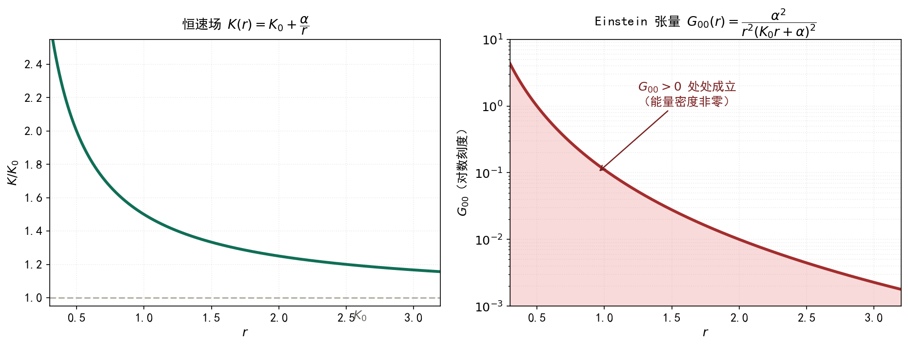

# 恒速群丛的动力学 {#sec-invariant-speed-dynamics}

@sec-invariant-speed-field-group 章在对角约定下得到 $G_{00}\equiv0$。本章把对角约定换成tetrad 约定，使 $K$ 场同时参与时间与空间的局部几何变形，得到 $G_{00}\neq0$，然后算出曲率、Einstein 张量与非相对论极限。

## 记号约定

本章签名 $\eta=\mathrm{diag}(1,-1,-1,-1)$：

$$
\partial^{\mu}K:=\eta^{\mu\nu}\partial_\nu K,\qquad
\Box_\eta:=\eta^{\mu\nu}\partial_\mu\partial_\nu=\partial_t^{2}-\nabla^{2},
$$ {#eq-tcg-dalembert-def}

$$
\nabla^{2}:=\delta^{ij}\partial_i\partial_j,\qquad
\lvert\nabla K\rvert^{2}:=\delta^{ij}\partial_iK\,\partial_jK,\qquad
\lvert\nabla K\rvert^{2}_{\eta}:=\eta^{\mu\nu}\partial_{\mu}K\,\partial_{\nu}K.
$$ {#eq-tcg-gradient-def}

拉丁指标 $i,j,k$ 取 $1,2,3$，希腊指标取 $0,1,2,3$。

## Tetrad 约定与度规 {#sec-isd-metric}

本节使用 tetrad（局部标准正交标架）约定重建度规：先给标架，再写度规分量。

### 局部标准正交标架

::: {#def-isd-tetrad}
## Tetrad 约定
在 $3+1$ 维时空上取局部标架

$$
e^{0}=K\,\mathrm{d}t,\qquad e^{i}=K\,\mathrm{d}x^{i}.
$$ {#eq-isd-tetrad}

由 $g_{\mu\nu}=e^{a}{}_{\mu}\,e^{b}{}_{\nu}\,\eta_{ab}$，度规的二次型为

$$
\mathrm{d}s^{2}=K^{2}\,\mathrm{d}t^{2}-K^{2}\delta_{ij}\,\mathrm{d}x^{i}\mathrm{d}x^{j}.
$$ {#eq-isd-metric-tetrad}

其中 $K=K(t,x^{1},x^{2},x^{3})$ 即恒速场，$\delta_{ij}$ 为欧氏度规分量。@sec-invariant-speed-field-group 章的对角约定取 $g_{ij}=-\delta_{ij}$，空间标架与 $K$ 无关；本约定取 $g_{ij}=-K^{2}\delta_{ij}$，局部时间尺度与局部空间尺度由同一个 $K$ 给出。两种约定的差别只在这一项。

把标架写成一般形式 $e^{a}=e^{a}{}_{\mu}\,\mathrm{d}x^{\mu}$，其非零分量为

$$
e^{0}{}_{0}=K,\qquad e^{i}{}_{j}=K\,\delta^{i}{}_{j},\qquad \text{其余为 }0.
$$ {#eq-isd-tetrad-components}
:::

把标架分量排成矩阵（行指标为局部平直指标 $a$，列指标为时空坐标 $\mu$），协变标架 $e^{a}{}_{\mu}$ 是 $K$ 乘单位矩阵：

$$
e^{a}{}_{\mu} =
\begin{pmatrix}
K & 0 & 0 & 0 \\
0 & K & 0 & 0 \\
0 & 0 & K & 0 \\
0 & 0 & 0 & K
\end{pmatrix}.
$$ {#eq-isd-tetrad-matrix}

其逆矩阵，即局部基矢量 $\mathbf{e}_{a} = e^{\mu}{}_{a}\partial_{\mu}$ 的系数为：

$$
e^{\mu}{}_{a} =
\begin{pmatrix}
\dfrac{1}{K} & 0 & 0 & 0 \\[1ex]
0 & \dfrac{1}{K} & 0 & 0 \\[1ex]
0 & 0 & \dfrac{1}{K} & 0 \\[1ex]
0 & 0 & 0 & \dfrac{1}{K}
\end{pmatrix}.
$$ {#eq-isd-tetrad-inverse}

### 度规分量及其逆

由 @eq-isd-metric-tetrad 读出度规张量及其逆：

$$
g_{\mu\nu}=K^{2}\,\eta_{\mu\nu},
$$ {#eq-isd-g}

$$
g^{\mu\nu}=K^{-2}\eta^{\mu\nu}.
$$ {#eq-isd-ginv}

逐分量写出：

$$
g_{00}=K^{2},\qquad g_{0i}=0,\qquad g_{ij}=-K^{2}\delta_{ij}.
$$ {#eq-isd-g-comp}

$$
g^{00}=\frac{1}{K^{2}},\qquad g^{0i}=0,\qquad g^{ij}=-\frac{1}{K^{2}}\delta^{ij}.
$$ {#eq-isd-ginv-comp}

按坐标次序 $(t,x^1,x^2,x^3)$ 排列，将上述分量写成矩阵形式，协变度规及逆度规分别为：

$$
g_{\mu\nu} =
\begin{pmatrix}
K^{2} & 0 & 0 & 0 \\
0 & -K^{2} & 0 & 0 \\
0 & 0 & -K^{2} & 0 \\
0 & 0 & 0 & -K^{2}
\end{pmatrix},
\qquad
g^{\mu\nu} =
\begin{pmatrix}
\frac{1}{K^{2}} & 0 & 0 & 0 \\
0 & -\frac{1}{K^{2}} & 0 & 0 \\
0 & 0 & -\frac{1}{K^{2}} & 0 \\
0 & 0 & 0 & -\frac{1}{K^{2}}
\end{pmatrix}.
$$ {#eq-isd-metric-matrix}

行列式与度规体积元：

$$
\det g=K^{8}\det\eta=-K^{8},\qquad \sqrt{-g}=K^{4}.
$$ {#eq-isd-det}

$g_{ij}=-K^{2}\delta_{ij}$ 不再是常数，故 $\partial_\mu g_{ij}=-2K\,\partial_\mu K\,\delta_{ij}$ 与 $\partial_\mu g_{00}=2K\,\partial_\mu K$ 均非零。后续各项计算以此为基础。

## Christoffel 符号 {#sec-isd-christoffel}

度规取定后，本节先由度规代入定义导出闭式，再由闭式读出全部非零分量。

### 闭式

$$
\Gamma^{\rho}{}_{\mu\nu}=\frac{1}{2}g^{\rho\sigma}
\bigl(\partial_\mu g_{\nu\sigma}+\partial_\nu g_{\mu\sigma}-\partial_\sigma g_{\mu\nu}\bigr).
$$

由 @eq-isd-g 得 $\partial_\mu g_{\nu\sigma}=2K(\partial_{\mu}K)\eta_{\nu\sigma}$。代入：

$$
\Gamma^{\rho}{}_{\mu\nu}=\frac{1}{2}K^{-2}\eta^{\rho\sigma}\cdot 2K
\bigl[(\partial_{\mu}K)\eta_{\nu\sigma}+(\partial_{\nu}K)\eta_{\mu\sigma}-(\partial_{\sigma}K)\eta_{\mu\nu}\bigr].
$$

$\eta^{\rho\sigma}\eta_{\nu\sigma}=\delta^{\rho}_{\nu}$，$\eta^{\rho\sigma}\eta_{\mu\sigma}=\delta^{\rho}_{\mu}$，$\eta^{\rho\sigma}\partial_{\sigma}K=\partial^{\rho}K$，故

$$
\boxed{\Gamma^{\rho}{}_{\mu\nu}=\frac{1}{K}
\Bigl(\delta^{\rho}_{\nu}\,\partial_{\mu}K+\delta^{\rho}_{\mu}\,\partial_{\nu}K-\eta_{\mu\nu}\,\partial^{\rho}K\Bigr)}.
$$ {#eq-isd-gamma}

等价地，用 $u:=\ln K$（$\partial_\mu u=\partial_{\mu}K/K$）：

$$
\Gamma^{\rho}{}_{\mu\nu}=\delta^{\rho}_{\nu}\,\partial_\mu u+\delta^{\rho}_{\mu}\,\partial_\nu u-\eta_{\mu\nu}\,\partial^{\rho}u.
$$ {#eq-isd-gamma-u}

### 非零分量

把 @eq-isd-gamma 逐项代入（$\delta^{0}_{i}=\delta^{k}_{0}=0$、$\delta^{0}_{0}=\delta^{k}_{i}=1$；$\eta_{00}=1$、$\eta_{0i}=0$、$\eta_{ij}=-\delta_{ij}$；$\partial^{0}K=\partial_0K$、$\partial^{k}K=-\partial_kK$）。

**(a) $\Gamma^{0}{}_{00}$**

$$
\Gamma^{0}{}_{00}=\frac{1}{K}\bigl(\delta^{0}_{0}\,\partial_0K+\delta^{0}_{0}\,\partial_0K-\eta_{00}\,\partial^{0}K\bigr)
=\frac{1}{K}\bigl(\partial_0K+\partial_0K-\partial_0K\bigr)
=\frac{\partial_0K}{K}.
$$

**(b) $\Gamma^{0}{}_{0i}=\Gamma^{0}{}_{i0}$**

$$
\Gamma^{0}{}_{0i}=\frac{1}{K}\bigl(\delta^{0}_{i}\,\partial_0K+\delta^{0}_{0}\,\partial_iK-\eta_{0i}\,\partial^{0}K\bigr)
=\frac{1}{K}\bigl(0+\partial_iK-0\bigr)
=\frac{\partial_iK}{K}.
$$

**(c) $\Gamma^{0}{}_{ij}$**

$$
\Gamma^{0}{}_{ij}=\frac{1}{K}\bigl(\delta^{0}_{j}\,\partial_iK+\delta^{0}_{i}\,\partial_jK-\eta_{ij}\,\partial^{0}K\bigr)
=\frac{1}{K}\bigl(0+0+\delta_{ij}\,\partial_0K\bigr)
=\frac{\delta_{ij}\,\partial_0K}{K}.
$$

**(d) $\Gamma^{k}{}_{00}$**

$$
\Gamma^{k}{}_{00}=\frac{1}{K}\bigl(\delta^{k}_{0}\,\partial_0K+\delta^{k}_{0}\,\partial_0K-\eta_{00}\,\partial^{k}K\bigr)
=\frac{1}{K}\bigl(0+0+\partial_kK\bigr)
=\frac{\partial_kK}{K}.
$$

**(e) $\Gamma^{k}{}_{0i}=\Gamma^{k}{}_{i0}$**

$$
\Gamma^{k}{}_{0i}=\frac{1}{K}\bigl(\delta^{k}_{i}\,\partial_0K+\delta^{k}_{0}\,\partial_iK-\eta_{0i}\,\partial^{k}K\bigr)
=\frac{1}{K}\bigl(\delta^{k}_{i}\,\partial_0K+0-0\bigr)
=\frac{\delta^{k}_{i}\,\partial_0K}{K}.
$$

**(f) $\Gamma^{k}{}_{ij}$**

$$
\Gamma^{k}{}_{ij}=\frac{1}{K}\bigl(\delta^{k}_{j}\,\partial_iK+\delta^{k}_{i}\,\partial_jK-\eta_{ij}\,\partial^{k}K\bigr)
=\frac{1}{K}\bigl(\delta^{k}_{j}\,\partial_iK+\delta^{k}_{i}\,\partial_jK-\delta_{ij}\,\partial_kK\bigr).
$$

汇总（其余为零：$\mu\neq\nu$ 且 $\rho\notin\{\mu,\nu\}$ 时 @eq-isd-gamma 的三项全为零）：

$$
\begin{aligned}
&\Gamma^{0}{}_{00}=\frac{\partial_0K}{K},\qquad
\Gamma^{0}{}_{0i}=\Gamma^{0}{}_{i0}=\frac{\partial_iK}{K},\qquad
\Gamma^{0}{}_{ij}=\frac{\delta_{ij}\,\partial_0K}{K},\\[1ex]
&\Gamma^{k}{}_{00}=\frac{\partial_kK}{K},\qquad
\Gamma^{k}{}_{0i}=\Gamma^{k}{}_{i0}=\frac{\delta^{k}_{i}\,\partial_0K}{K},\qquad
\Gamma^{k}{}_{ij}=\frac{1}{K}\bigl(\delta^{k}_{j}\,\partial_iK+\delta^{k}_{i}\,\partial_jK-\delta_{ij}\,\partial_kK\bigr).
\end{aligned}
$$ {#eq-isd-gamma-components}

全部非零分量只含 $\partial_\mu K$ 与度规分量。与 @sec-invariant-speed-field-group 章的对角约定相比，$\Gamma^{0}{}_{ij}$ 与 $\Gamma^{k}{}_{ij}$ 不再为零：那里 $g_{ij}=-\delta_{ij}$ 与 $K$ 无关，这里 $g_{ij}=-K^{2}\delta_{ij}$ 随点变化，联络须同时补偿空间标架的伸缩。后续曲率计算以此为基础。

## Ricci 张量与 Ricci 标量 {#sec-isd-ricci}

Christoffel 符号就位后，按收缩顺序给出 Ricci 张量与 Ricci 标量。

### Ricci 张量

$$
R_{\sigma\nu}=\partial_\rho\Gamma^{\rho}{}_{\nu\sigma}
-\partial_\nu\Gamma^{\rho}{}_{\rho\sigma}
+\Gamma^{\rho}{}_{\rho\lambda}\Gamma^{\lambda}{}_{\nu\sigma}
-\Gamma^{\rho}{}_{\nu\lambda}\Gamma^{\lambda}{}_{\rho\sigma}.
$$

自由指标改记为 $(\mu,\nu)$。推导用 $u=\ln K$ 形式（@eq-isd-gamma-u），中间式只含 $u$ 的一、二阶导数，最后一步换回 $K$。记号沿用 @eq-tcg-gradient-def（把 $K$ 换成 $u$）：$\lvert\nabla u\rvert^{2}_{\eta}:=\eta^{\mu\nu}\partial_{\mu}u\,\partial_{\nu}u$。

**预备：联络的迹。** 在 @eq-isd-gamma-u 中把 $(\mu,\nu)$ 换成 $(\rho,\mu)$ 并对 $\rho$ 求和：

$$
\Gamma^{\rho}{}_{\rho\mu}
=\delta^{\rho}_{\mu}\,\partial_{\rho}u+\delta^{\rho}_{\rho}\,\partial_{\mu}u-\eta_{\rho\mu}\,\partial^{\rho}u
=\partial_{\mu}u+4\,\partial_{\mu}u-\partial_{\mu}u
=4\,\partial_{\mu}u.
$$ {#eq-isd-trace}

（第二个等号用 $\delta^{\rho}_{\mu}$ 使求和只剩 $\rho=\mu$、$\delta^{\rho}_{\rho}=4$、$\eta_{\rho\mu}\partial^{\rho}u=\partial_{\mu}u$ 三件事。）

**第一项。**

$$
\begin{aligned}
\partial_\rho\Gamma^{\rho}{}_{\nu\mu}
&=\partial_\rho\Bigl(\delta^{\rho}_{\mu}\,\partial_{\nu}u+\delta^{\rho}_{\nu}\,\partial_{\mu}u-\eta_{\mu\nu}\,\partial^{\rho}u\Bigr)\\
&=\partial_{\mu}\partial_{\nu}u+\partial_{\nu}\partial_{\mu}u-\eta_{\mu\nu}\,\Box_\eta u\\
&=2\,\partial_{\mu}\partial_{\nu}u-\eta_{\mu\nu}\,\Box_\eta u.
\end{aligned}
$$

（$\delta^{\rho}_{\mu}$ 与 $\delta^{\rho}_{\nu}$ 各自把求和压成一项；混合偏导可交换。）

**第二项。** 由 @eq-isd-trace：

$$
\partial_\nu\Gamma^{\rho}{}_{\rho\mu}
=\partial_\nu\bigl(4\,\partial_{\mu}u\bigr)
=4\,\partial_{\nu}\partial_{\mu}u.
$$

**第三项。** 由 @eq-isd-trace 与 @eq-isd-gamma-u：

$$
\begin{aligned}
\Gamma^{\rho}{}_{\rho\lambda}\Gamma^{\lambda}{}_{\nu\mu}
&=4\,\partial_{\lambda}u\Bigl(\delta^{\lambda}_{\mu}\,\partial_{\nu}u+\delta^{\lambda}_{\nu}\,\partial_{\mu}u-\eta_{\mu\nu}\,\partial^{\lambda}u\Bigr)\\
&=4\Bigl(\partial_{\mu}u\,\partial_{\nu}u+\partial_{\nu}u\,\partial_{\mu}u-\eta_{\mu\nu}\,\partial_{\lambda}u\,\partial^{\lambda}u\Bigr)\\
&=8\,\partial_{\mu}u\,\partial_{\nu}u-4\,\eta_{\mu\nu}\,\lvert\nabla u\rvert^{2}_{\eta}.
\end{aligned}
$$

**第四项。** 两个因子各含三段，乘积共九项。行取 $\Gamma^{\rho}{}_{\nu\lambda}=\delta^{\rho}_{\lambda}\,\partial_{\nu}u+\delta^{\rho}_{\nu}\,\partial_{\lambda}u-\eta_{\nu\lambda}\,\partial^{\rho}u$ 的三段，列取 $\Gamma^{\lambda}{}_{\rho\mu}=\delta^{\lambda}_{\mu}\,\partial_{\rho}u+\delta^{\lambda}_{\rho}\,\partial_{\mu}u-\eta_{\rho\mu}\,\partial^{\lambda}u$ 的三段：

| 乘积 | $\delta^{\lambda}_{\mu}\,\partial_{\rho}u$ | $\delta^{\lambda}_{\rho}\,\partial_{\mu}u$ | $-\eta_{\rho\mu}\,\partial^{\lambda}u$ |
|---|---|---|---|
| $\delta^{\rho}_{\lambda}\,\partial_{\nu}u$ | $\partial_{\mu}u\,\partial_{\nu}u$ | $4\,\partial_{\mu}u\,\partial_{\nu}u$ | $-\partial_{\mu}u\,\partial_{\nu}u$ |
| $\delta^{\rho}_{\nu}\,\partial_{\lambda}u$ | $\partial_{\mu}u\,\partial_{\nu}u$ | $\partial_{\mu}u\,\partial_{\nu}u$ | $-\eta_{\mu\nu}\,\lvert\nabla u\rvert^{2}_{\eta}$ |
| $-\eta_{\nu\lambda}\,\partial^{\rho}u$ | $-\eta_{\mu\nu}\,\lvert\nabla u\rvert^{2}_{\eta}$ | $-\partial_{\mu}u\,\partial_{\nu}u$ | $\partial_{\mu}u\,\partial_{\nu}u$ |

（第一行第二格用 $\delta^{\rho}_{\lambda}\delta^{\lambda}_{\rho}=4$；三个含 $\eta$ 的格子各用一次 $\eta$ 的升降指标。）

九项相加：

$$
\Gamma^{\rho}{}_{\nu\lambda}\Gamma^{\lambda}{}_{\rho\mu}
=(1+4-1+1+1-1+1)\,\partial_{\mu}u\,\partial_{\nu}u-2\,\eta_{\mu\nu}\,\lvert\nabla u\rvert^{2}_{\eta}
=6\,\partial_{\mu}u\,\partial_{\nu}u-2\,\eta_{\mu\nu}\,\lvert\nabla u\rvert^{2}_{\eta}.
$$

**合并四项。** 第三项取正号、第四项取负号：

$$
\begin{aligned}
R_{\mu\nu}
&=\bigl(2\,\partial_{\mu}\partial_{\nu}u-\eta_{\mu\nu}\,\Box_\eta u\bigr)
-4\,\partial_{\mu}\partial_{\nu}u\\
&\quad+\bigl(8\,\partial_{\mu}u\,\partial_{\nu}u-4\,\eta_{\mu\nu}\,\lvert\nabla u\rvert^{2}_{\eta}\bigr)
-\bigl(6\,\partial_{\mu}u\,\partial_{\nu}u-2\,\eta_{\mu\nu}\,\lvert\nabla u\rvert^{2}_{\eta}\bigr)\\
&=-2\,\partial_{\mu}\partial_{\nu}u+2\,\partial_{\mu}u\,\partial_{\nu}u-\eta_{\mu\nu}\,\Box_\eta u-2\,\eta_{\mu\nu}\,\lvert\nabla u\rvert^{2}_{\eta}.
\end{aligned}
$$ {#eq-isd-ric-u}

**换回 $K$。** 由 $\partial_{\mu}u=\partial_{\mu}K/K$ 与商规则：

$$
\partial_{\mu}\partial_{\nu}u=\frac{\partial_{\mu}\partial_{\nu}K}{K}-\frac{\partial_{\mu}K\,\partial_{\nu}K}{K^{2}},
\qquad
\Box_\eta u=\frac{\Box_\eta K}{K}-\frac{\lvert\nabla K\rvert^{2}_{\eta}}{K^{2}},
\qquad
\lvert\nabla u\rvert^{2}_{\eta}=\frac{\lvert\nabla K\rvert^{2}_{\eta}}{K^{2}}.
$$

（第二式是第一式与 $\eta^{\mu\nu}$ 的缩并。）代入 @eq-isd-ric-u 并逐段合并——$-2\,\partial_{\mu}\partial_{\nu}u$ 的第二段与 $+2\,\partial_{\mu}u\,\partial_{\nu}u$ 合并为 $+4\,\partial_{\mu}K\,\partial_{\nu}K/K^{2}$，$-\eta_{\mu\nu}\Box_\eta u$ 的第二段与 $-2\,\eta_{\mu\nu}\lvert\nabla u\rvert^{2}_{\eta}$ 合并为 $-\eta_{\mu\nu}\lvert\nabla K\rvert^{2}_{\eta}/K^{2}$：

$$
\boxed{R_{\mu\nu}=
-\frac{2\,\partial_\mu\partial_{\nu}K}{K}
+\frac{4\,\partial_{\mu}K\,\partial_{\nu}K}{K^{2}}
-\eta_{\mu\nu}\frac{\Box_\eta K}{K}
-\eta_{\mu\nu}\frac{\lvert\nabla K\rvert^{2}_{\eta}}{K^{2}}}.
$$ {#eq-isd-ric}

（此式即四维共形变换的标准公式在 $\phi=\ln K$、基底为 Minkowski 时的展开；本处由 Christoffel 直接计算得到，未引用该公式。）

### Ricci 标量

$$
R=g^{\mu\nu}R_{\mu\nu}=K^{-2}\eta^{\mu\nu}R_{\mu\nu}.
$$

由 @eq-isd-ric，对四段分别缩并（$\eta^{\mu\nu}\partial_{\mu}\partial_{\nu}K=\Box_\eta K$，$\eta^{\mu\nu}\partial_{\mu}K\,\partial_{\nu}K=\lvert\nabla K\rvert^{2}_{\eta}$，$\eta^{\mu\nu}\eta_{\mu\nu}=4$）：

$$
\begin{aligned}
\eta^{\mu\nu}R_{\mu\nu}
&=-\frac{2}{K}\,\eta^{\mu\nu}\partial_{\mu}\partial_{\nu}K
+\frac{4}{K^{2}}\,\eta^{\mu\nu}\partial_{\mu}K\,\partial_{\nu}K
-\frac{1}{K}\,\eta^{\mu\nu}\eta_{\mu\nu}\,\Box_\eta K
-\frac{1}{K^{2}}\,\eta^{\mu\nu}\eta_{\mu\nu}\,\lvert\nabla K\rvert^{2}_{\eta}\\
&=-\frac{2\Box_\eta K}{K}+\frac{4\lvert\nabla K\rvert^{2}_{\eta}}{K^{2}}
-\frac{4\Box_\eta K}{K}-\frac{4\lvert\nabla K\rvert^{2}_{\eta}}{K^{2}}
=-\frac{6\Box_\eta K}{K}.
\end{aligned}
$$

（含 $\lvert\nabla K\rvert^{2}_{\eta}$ 的两项精确抵消，含 $\Box_\eta K$ 的两项合并。）

$$
\boxed{R=-\frac{6\,\Box_\eta K}{K^{3}}
=\frac{6\,\bigl(\nabla^{2}K-\partial_t^{2}K\bigr)}{K^{3}}}.
$$ {#eq-isd-R}

把 @eq-isd-R 按 $\Box_\eta=\partial_t^{2}-\nabla^{2}$、$\nabla^{2}=\partial_x^{2}+\partial_y^{2}+\partial_z^{2}$ 展开，得 $R=\dfrac{6\,(-\partial_t^{2}K+\partial_x^{2}K+\partial_y^{2}K+\partial_z^{2}K)}{K^{3}}$，与由 $R_{\mu\nu}$ 的定义直接缩并所得一致。

**自检**：$K$ 为常数时 $\Box_\eta K=0$，故 $R=0$，度规平坦。

## Einstein 张量 {#sec-isd-einstein}

本节给出 Einstein 张量：先列通式，再分列 $G_{00}$、$G_{0i}$ 与 $G_{ij}$ 的显式表达。

### 通式

$$
G_{\mu\nu}=R_{\mu\nu}-\frac{1}{2}R\,g_{\mu\nu}
=R_{\mu\nu}-\frac{1}{2}\left(-\frac{6\Box_\eta K}{K^{3}}\right)K^{2}\eta_{\mu\nu}
=R_{\mu\nu}+\frac{3\Box_\eta K}{K}\eta_{\mu\nu}.
$$

代入 @eq-isd-ric：

$$
G_{\mu\nu}=
-\frac{2\partial_\mu\partial_{\nu}K}{K}
+\frac{4\partial_{\mu}K\,\partial_{\nu}K}{K^{2}}
+\eta_{\mu\nu}\frac{2\Box_\eta K}{K}
-\eta_{\mu\nu}\frac{\lvert\nabla K\rvert^{2}_{\eta}}{K^{2}}.
$$ {#eq-isd-G}

用 $u=\ln K$ 改写。所需恒等式在 @sec-isd-ricci 中已备好：$\partial_{\mu}\partial_{\nu}K/K=\partial_{\mu}\partial_{\nu}u+\partial_{\mu}u\,\partial_{\nu}u$、$\Box_\eta K/K=\Box_\eta u+\lvert\nabla u\rvert^{2}_{\eta}$、$\lvert\nabla K\rvert^{2}_{\eta}/K^{2}=\lvert\nabla u\rvert^{2}_{\eta}$。代入 @eq-isd-G 逐段替换：

$$
\begin{aligned}
G_{\mu\nu}
&=-2\bigl(\partial_{\mu}\partial_{\nu}u+\partial_{\mu}u\,\partial_{\nu}u\bigr)
+4\,\partial_{\mu}u\,\partial_{\nu}u
+2\,\eta_{\mu\nu}\bigl(\Box_\eta u+\lvert\nabla u\rvert^{2}_{\eta}\bigr)
-\eta_{\mu\nu}\,\lvert\nabla u\rvert^{2}_{\eta}\\
&=-2\,\partial_{\mu}\partial_{\nu}u
+2\,\partial_{\mu}u\,\partial_{\nu}u
+\eta_{\mu\nu}\bigl(2\Box_\eta u+\lvert\nabla u\rvert^{2}_{\eta}\bigr),
\end{aligned}
$$

即

$$
\boxed{G_{\mu\nu}=
-2\,\partial_\mu\partial_\nu u
+2\,\partial_\mu u\,\partial_\nu u
+\eta_{\mu\nu}\bigl(2\Box_\eta u+\lvert\nabla u\rvert^{2}_{\eta}\bigr)}.
$$ {#eq-isd-G-u}

@eq-isd-G 的 $16$ 个分量由 $G_{\mu\nu}=R_{\mu\nu}-\tfrac12 R\,g_{\mu\nu}$ 逐分量展开得到。

### $G_{00}$ 非零

取 $\mu=\nu=0$，$\eta_{00}=1$，由 @eq-isd-G：

$$
G_{00}=
-\frac{2\partial_0^{2}K}{K}
+\frac{4(\partial_0K)^{2}}{K^{2}}
+\frac{2\Box_\eta K}{K}
-\frac{\lvert\nabla K\rvert^{2}_{\eta}}{K^{2}}.
$$

代入 $\Box_\eta K=\partial_0^{2}K-\nabla^{2}K$ 与 $\lvert\nabla K\rvert^{2}_{\eta}=(\partial_0K)^{2}-\lvert\nabla K\rvert^{2}$：

$$
G_{00}=
\underbrace{-\frac{2\partial_0^{2}K}{K}+\frac{2\partial_0^{2}K}{K}}_{=\,0}
-\frac{2\nabla^{2}K}{K}
+\frac{4(\partial_0K)^{2}-(\partial_0K)^{2}+\lvert\nabla K\rvert^{2}}{K^{2}},
$$

$$
\boxed{G_{00}=
\frac{3(\partial_tK)^{2}+\lvert\nabla K\rvert^{2}}{K^{2}}
-\frac{2\,\nabla^{2}K}{K}}.
$$ {#eq-isd-G00}

**这就是要的结果：$G_{00}$ 是非零函数，且显含 $K$ 的空间梯度。**

**静态情形**（$\partial_tK=0$）：

$$
\boxed{G_{00}\bigr|_{\partial_tK=0}=
\frac{\lvert\nabla K\rvert^{2}}{K^{2}}-\frac{2\,\nabla^{2}K}{K}}.
$$ {#eq-isd-G00-static}

用 $u=\ln K$ 写（由 @eq-isd-G-u 或 @eq-isd-G00）：

$$
G_{00}=3(\partial_tu)^{2}-\lvert\nabla u\rvert^{2}-2\nabla^{2}u.
$$ {#eq-isd-G00-u}

### $G_{0i}$ 与 $G_{ij}$

由 @eq-isd-G（$\eta_{0i}=0$、$\eta_{ij}=-\delta_{ij}$）：

$$
G_{0i}=-\frac{2\,\partial_0\partial_iK}{K}+\frac{4\,\partial_0K\,\partial_iK}{K^{2}}
=\frac{2\bigl(2\,\partial_tK\,\partial_iK-K\,\partial_t\partial_iK\bigr)}{K^{2}},
$$ {#eq-isd-G0i}

$$
G_{ij}=
-\frac{2\partial_i\partial_jK}{K}
+\frac{4\partial_iK\,\partial_jK}{K^{2}}
-\delta_{ij}\frac{2\Box_\eta K}{K}
+\delta_{ij}\frac{\lvert\nabla K\rvert^{2}_{\eta}}{K^{2}}.
$$ {#eq-isd-Gij}

在 @eq-isd-G 中取 $(\mu,\nu)=(0,1)$，得 $G_{01}=\dfrac{2\bigl(2\,\partial_tK\,\partial_xK-K\,\partial_t\partial_xK\bigr)}{K^{2}}$，即 @eq-isd-G0i。

## $G_{00}>0$ 的一个显式例子 {#sec-isd-density}

取球对称静态的 $K(r)$，$G_{00}$ 可显式算出；本节给出这个解，并补上同一例子的 Ricci 标量。

### 球对称静态解

取

$$
K(r)=K_0+\frac{\alpha}{r},\qquad r=\sqrt{x^{2}+y^{2}+z^{2}}.
$$ {#eq-isd-example}

其中 $K_0$、$\alpha$ 为常数。

逐项计算。一阶导数：

$$
\partial_iK=-\frac{\alpha}{r^{2}}\cdot\frac{x_i}{r}=-\frac{\alpha\,x_i}{r^{3}},
$$

$$
\lvert\nabla K\rvert^{2}=\frac{\alpha^{2}}{r^{6}}\sum_i x_i^{2}=\frac{\alpha^{2}}{r^{4}}.
$$

二阶导数（利用 $\nabla^{2}(1/r)=0$，$r>0$）：

$$
\nabla^{2}K=K_0\underbrace{\nabla^{2}(1)}_{=\,0}+\alpha\underbrace{\nabla^{2}\!\left(\frac{1}{r}\right)}_{=\,0}=0.
$$

代入 @eq-isd-G00-static（$\partial_tK=0$）：

$$
G_{00}=\frac{\alpha^{2}/r^{4}}{\bigl(K_0+\alpha/r\bigr)^{2}}-0
=\frac{\alpha^{2}}{r^{4}}\cdot\frac{r^{2}}{(K_0r+\alpha)^{2}},
$$

$$
\boxed{G_{00}(r)=\frac{\alpha^{2}}{r^{2}\,(K_0r+\alpha)^{2}}>0\qquad(\alpha\neq0)}.
$$ {#eq-isd-density}

**这是严格正的，不含任何近似。**

若写 Einstein 方程 $G_{\mu\nu}=\kappa T_{\mu\nu}$（$\kappa=8\pi G/K_0^{4}$ 或按量纲另定），则

$$
T_{00}=\frac{1}{\kappa}G_{00}=\frac{\alpha^{2}}{\kappa\,r^{2}(K_0r+\alpha)^{2}}>0,
$$

即**在外加 $G_{\mu\nu}=\kappa T_{\mu\nu}$、并把 $T_{00}$ 读作能量密度之后，该 $K$ 场对应 $T_{00}>0$**。这与 @sec-invariant-speed-field-group 章对角约定下 $G_{00}\equiv0$ 的结论相反——那个零是约定造成的；两处的 $G_{00}$ 都是几何量，其正负不依赖物质侧假设。

### 同一个例子的 Ricci 标量

由 @eq-isd-R，静态且 $\nabla^{2}K=0$：

$$
R=\frac{6\,\nabla^{2}K}{K^{3}}=0,
$$

即此例 $R\equiv0$ 但 $R_{00}=G_{00}\neq0$：Ricci 张量非零而迹为零，两者不矛盾。

@fig-isd-density 给出 $K(r)$ 与 $G_{00}(r)$ 的图像。

{#fig-isd-density width=80%}

## 与对角约定的对照 {#sec-isd-diag}

曲率各闭式已由前几节推出，此处回过头把本章的 tetrad 约定与 @sec-invariant-speed-field-group 章的对角约定作一对照。

取 $K$ 为常数，@eq-isd-metric-tetrad 的二次型为 $K^{2}(t^{2}-\lvert\mathbf{x}\rvert^{2})$；@sec-invariant-speed-field-group 章对角约定的二次型为 $K^{2}t^{2}-\lvert\mathbf{x}\rvert^{2}$，即 @sec-invariant-speed-group 章的不变量 $Q_K$。二者相差一次空间坐标重标度。令 $\mathbf{y}:=K\mathbf{x}$，则

$$
K^{2}\bigl(t^{2}-\lvert\mathbf{x}\rvert^{2}\bigr)=K^{2}t^{2}-\lvert\mathbf{y}\rvert^{2},
$$

右端即 $Q_K$ 的形式，故常数 $K$ 时二者经这一坐标变换互化：零锥方程由 $t=\lvert\mathbf{x}\rvert$ 变为 $Kt=\lvert\mathbf{y}\rvert$，描述同一个零锥。该重标度只在 $K$ 为常数时是整体线性变换；$K$ 为场时 $K(p)$ 逐点取值，$\mathbf{y}=K(p)\mathbf{x}$ 不再是整体坐标变换。

两种约定在 $K$ 为场时给出不同的联络与曲率。本章由 @eq-isd-gamma 出发，经 @sec-isd-ricci 节与 @sec-isd-einstein 节的推导得到 @eq-isd-R，即 $R=-6\Box_\eta K/K^{3}$；@sec-invariant-speed-field-group 章的对角约定则给出 $R=2\Delta K/K$。常数 $K$ 时两式一并归零、两种约定由上述重标度互化；$K$ 为场时联络与曲率标量都不相同，坐标互化不再成立。@sec-isd-limit 节另把本章与对角约定、一般度规并排对照，列出 $G_{00}$ 与 Weyl 张量的差别。

## 闭式的推导结构 {#sec-isd-structure}

前三节对共形度规 $g_{\mu\nu}=K^{2}\eta_{\mu\nu}$ 完成了从定义到闭式的逐项代入。本节退回一般度规，说明这条推导链的结构性质：它对任何度规都成立，因而也覆盖后续各章所列的闭式。

**定义链。** 设 $g_{\mu\nu}$ 为任一光滑度规，$g^{\mu\nu}$ 为其逆。无挠相容联络由

$$
\Gamma^{\rho}{}_{\mu\nu}=\frac{1}{2}g^{\rho\sigma}\bigl(\partial_{\mu}g_{\nu\sigma}+\partial_{\nu}g_{\mu\sigma}-\partial_{\sigma}g_{\mu\nu}\bigr),
$$

唯一确定：右端只含 $g^{\rho\sigma}$ 与 $g_{\alpha\beta}$ 的一阶偏导，是它们的有理式（分母为 $\det g$ 的幂），不含积分，也不含微分算子的逆。按 @sec-isd-ricci 节的曲率约定，$R_{\mu\nu}$ 是 $\Gamma$ 的一阶偏导与 $\Gamma$ 的二次式之和；再经 $R=g^{\mu\nu}R_{\mu\nu}$、$G_{\mu\nu}=R_{\mu\nu}-\tfrac12 g_{\mu\nu}R$，以及把同一组量代入 Weyl 张量的定义，所得都是 $g$、$\partial g$、$\partial^{2}g$ 的有限步代数式。

于是有一条对各章一律成立的结论：任一曲率闭式都是上述定义经有限次代入与合并同类项所得的恒等式。每一步是定义代入或代数恒等变形，故闭式对度规所含的任意函数及其各阶偏导恒成立；过程中没有截断项，也没有待定的余项。这一结论只依赖各定义的形式，与度规的具体取法无关，@sec-invariant-speed-field-group 章—@sec-flat-space-gravity 章所列闭式都属此列。本章 @sec-isd-christoffel—@sec-isd-einstein 各节即这条链在共形度规下的完整展开，中间只用了对数换元 $u=\ln K$ 的商规则。

**适用范围。** 上面的显式展开针对共形度规。@sec-invariant-speed-geometry 章与 @sec-flat-space-gravity 章采用带剪切与拖曳的度规族（含非对角的时空拖曳项 $g_{0i}\neq0$；前一章并给出其 Weyl 张量非零的证明），不属于共形类。它们的曲率闭式由同一条定义链代入各自的 $g_{\mu\nu}$ 与 $g^{\mu\nu}$ 逐项展开得到，各章正文已按分量列出；此处不重复那批分量展开，是分量数目较多且与正文重复所致，并非推导上有缺口。最后，把 $K$ 取为常数，$u$ 的各阶偏导全为零，$\Gamma^{\rho}{}_{\mu\nu}$、$R_{\mu\nu}$、$R$ 与 $G_{\mu\nu}$ 一并归零，度规退化为常数倍的 Minkowski 度规——这是已证闭式在平直极限的直接推论，而非附加的假设。

## 存在的局限 {#sec-isd-limit}

这一约定下的全部度规共形平坦、Weyl 张量恒为零；本节先证明这一点，再把三个约定并排对照。

### Weyl 张量恒为零

@eq-isd-g 的度规共形于 Minkowski：$g_{\mu\nu}=K^{2}\eta_{\mu\nu}$。Weyl 张量在共形变换下不变，而 Minkowski 的 Weyl 张量为零，故

$$
C^{\rho}{}_{\sigma\mu\nu}\equiv0.
$$

**这不只是性质，而是硬限制**：一切真空外解（其 Weyl 张量非零）都不在这一类度规之内。特别地，Schwarzschild 解的 Weyl 张量非零，**因此 Schwarzschild 解不能由任何 $K$ 场给出**。

### 三个约定的对照

| 约定 | 度规 | $G_{00}$ | Weyl 张量 | 能容纳什么 |
|---|---|---|---|---|
| 对角（@sec-invariant-speed-field-group 章） | $K^{2}\mathrm{d}t^{2}-\delta_{ij}\mathrm{d}x^{i}\mathrm{d}x^{j}$ | $\equiv0$ | 一般非零 | 曲率，但 $G_{00}\equiv0$ |
| 共形 / tetrad（本章） | $K^{2}\eta_{\mu\nu}$ | **非零**（@eq-isd-G00） | $\equiv0$ | $T_{00}>0$（须外加 $G=\kappa T$），但无真空外解 |
| 一般度规（3+1 维） | $g_{\mu\nu}$，$10$ 个分量 | 任意 | 任意 | 全部 |

表里对角那一行的“一般非零”说的是**非真空**的一般 $K$：Weyl 分量只由 $K$ 的二阶空间导数组成，$K$ 在空间上弯曲时它们不为零。但真空条件恰把二阶导数压成零（$\partial_i\partial_jK=0$，见 @sec-ifg-vacuum），此时 Weyl 随之恒零、度规本身平坦。两处不矛盾：**有曲率的 $K$ 一定不在真空里；在真空里的 $K$ 只作空间仿射。**

**因此本章的定位仍是“切片”而非“生成”**：共形约定比对角约定前进了一步（$G_{00}$ 非零，外加 $G_{\mu\nu}=\kappa T_{\mu\nu}$ 后可给出 $T_{00}>0$），但仍不是广义相对论的全部——它只覆盖共形平坦的那一部分。

## 波动力学：局域李代数 {#sec-isd-lie}

从本节起回到波动力学视角，共四节；第一节在每一点上恢复恒速群的李代数，并说明群收缩就是参数极限。

### 逐点的李代数

@sec-invariant-speed-field-group 章在 1+1 维用向量场逐项算出了括号；本节把同一计算推到 3+1 维。$K$ 视为该点的常数 $K(p)$，生成元取向量场

$$
H=\partial_t,\qquad
P_i=\partial_i,\qquad
B_i=-\frac{x^{i}}{K^{2}}\,\partial_t-t\,\partial_i,
$$ {#eq-isd-generators}

（$B_i$ 是该章 $B=-\frac{x}{K^{2}}\partial_t-t\,\partial_x$ 的逐方向推广：每个空间方向一个 boost。）括号对试验函数 $f$ 取值。

**$[B_i,H]$。**

$$
\begin{aligned}
B_i(Hf)&=-\frac{x^{i}}{K^{2}}\,\partial_t^{2}f-t\,\partial_i\partial_t f,\\
H(B_if)&=\partial_t\!\Bigl(-\frac{x^{i}}{K^{2}}\,\partial_tf-t\,\partial_if\Bigr)
=-\frac{x^{i}}{K^{2}}\,\partial_t^{2}f-\partial_if-t\,\partial_t\partial_if,
\end{aligned}
$$

两式相减，$[B_i,H]f=\partial_if$，故 $[B_i,H]=P_i$。

**$[B_i,P_j]$。**

$$
\begin{aligned}
B_i(P_jf)&=-\frac{x^{i}}{K^{2}}\,\partial_j\partial_tf-t\,\partial_j\partial_if,\\
P_j(B_if)&=\partial_j\!\Bigl(-\frac{x^{i}}{K^{2}}\,\partial_tf-t\,\partial_if\Bigr)
=-\frac{\delta_{ij}}{K^{2}}\,\partial_tf-\frac{x^{i}}{K^{2}}\,\partial_j\partial_tf-t\,\partial_j\partial_if,
\end{aligned}
$$

两式相减，$[B_i,P_j]f=\frac{\delta_{ij}}{K^{2}}\partial_tf$，故 $[B_i,P_j]=\delta_{ij}\frac{1}{K(p)^{2}}H$。（$K$ 是该点常数，$\partial_j\bigl(x^{i}/K^{2}\bigr)=\delta_{ij}/K^{2}$。）$[H,P_i]=0$：两个常系数平移算子交换，直接验算。

合并写：

$$
[B_i,H]=P_i,\qquad [B_i,P_j]=\delta_{ij}\frac{1}{K(p)^{2}}\,H,\qquad [H,P_i]=0.
$$ {#eq-isd-lie}

**旋转。** 取 $J_{ij}=x^{i}\partial_j-x^{j}\partial_i$（与 $K$ 无关）。逐项验证的样本：

$$
[J_{12},P_1]f
=x^{1}\,\partial_2(\partial_1f)-x^{2}\,\partial_1(\partial_1f)-\partial_1\bigl(x^{1}\partial_2f-x^{2}\partial_1f\bigr)
=-\partial_2f,
$$

即 $[J_{12},P_1]=-P_2$；同法得 $[J_{12},B_1]=-B_2$——$B$ 的两段各自按空间指标旋转，$K^{2}$ 是标量不受影响。全部旋转括号归结为 $\mathfrak{so}(3)$ 自身的括号加上 $P_i$、$B_i$ 的三维向量变换规则，结构常数中不含 $K$，不随收缩改变。

**与 $K$ 有关的只有第二个括号的结构常数 $1/K(p)^{2}$**：

- $K(p)$ 有限 $\Longrightarrow$ $[B_i,P_j]\neq0$，庞加莱型；
- $K(p)\to\infty$ $\Longrightarrow$ $[B_i,P_j]\to0$，伽利略型。

### 群收缩即参数极限

$$
\frac{1}{K^{2}}\longrightarrow0\qquad (K\to\infty).
$$

收缩在这一步归结为一条极限。这仍是 @sec-invariant-speed-field-group 章的结论，此处只补上 3+1 维的显式括号。

## 波动力学：变系数波动方程 {#sec-isd-wave}

第二节把波动方程从常数 $K$ 推广到 $K$ 场：先写局域方程，再写变系数方程。

### 局域方程

在 $p$ 点的邻域取 $K=K(p)$ 为常数，协变的 Klein–Gordon 方程为

$$
\Box_g\psi+\frac{m^{2}K^{2}}{\hbar^{2}}\psi=0,\qquad
\Box_g:=g^{\mu\nu}\nabla_\mu\nabla_\nu.
$$

**与标准形式的一致性检验**：$K$ 常数时 $\Box_g=K^{-2}\eta^{\mu\nu}\partial_\mu\partial_\nu=K^{-2}(\partial_t^{2}-\nabla^{2})$，方程化为

$$
\partial_t^{2}\psi-K^{2}\nabla^{2}\psi+\frac{m^{2}K^{4}}{\hbar^{2}}\psi=0.
$$

取 $K=c$ 并除以 $c^{2}$：

$$
\frac{1}{c^{2}}\partial_t^{2}\psi-\nabla^{2}\psi+\frac{m^{2}c^{2}}{\hbar^{2}}\psi=0,
$$

即标准 Klein–Gordon 方程。

### $K$ 为场时的变系数方程

由 @eq-isd-det，$\sqrt{-g}=K^{4}$，故

$$
\Box_g\psi=\frac{1}{\sqrt{-g}}\partial_\mu\Bigl(\sqrt{-g}\,g^{\mu\nu}\partial_\nu\psi\Bigr)
=\frac{1}{K^{4}}\partial_\mu\Bigl(K^{4}\cdot K^{-2}\eta^{\mu\nu}\partial_\nu\psi\Bigr)
=\frac{1}{K^{4}}\partial_\mu\Bigl(K^{2}\,\partial^{\mu}\psi\Bigr).
$$

展开（乘积求导，逐项）：

$$
\Box_g\psi=\frac{1}{K^{4}}\Bigl[2K(\partial_{\mu}K)\partial^{\mu}\psi+K^{2}\partial_\mu\partial^{\mu}\psi\Bigr]
=\frac{2}{K^{3}}(\partial_{\mu}K)\partial^{\mu}\psi+\frac{1}{K^{2}}\Box_\eta\psi.
$$

代入方程并乘以 $K^{2}$，得**变系数 Klein–Gordon 方程**：

$$
\boxed{\Box_\eta\psi+\frac{2}{K}(\partial_{\mu}K)\,\partial^{\mu}\psi+\frac{m^{2}K^{4}}{\hbar^{2}}\psi=0}.
$$ {#eq-isd-kg}

第二项 $\frac{2}{K}(\partial_{\mu}K)\partial^{\mu}\psi$ 是 $K$ 变场带来的附加项；$K$ 常数时它消失，方程回到上节的标准形式。

## 波动力学：非相对论极限 {#sec-isd-nr}

第三节考察非相对论极限：$K$ 为常数时等式严格成立，$\nabla K\neq0$ 时极限不再存在。

### $K$ 为常数时等式严格成立

设 $K$ 为常数 $K_0$。方程为

$$
\frac{1}{K_0^{2}}\partial_t^{2}\psi-\nabla^{2}\psi+\frac{m^{2}K_0^{2}}{\hbar^{2}}\psi=0.
$$

（即上一节方程除以 $K_0^{2}$。）

**第一步：抽出快变相位。** 令

$$
\psi=e^{i\theta}\varphi,\qquad \theta:=-\frac{mK_0^{2}t}{\hbar}.
$$

**第二步：逐项代入。**

$$
\partial_t\psi=e^{i\theta}\Bigl(\partial_t\varphi+i(\partial_t\theta)\varphi\Bigr)
=e^{i\theta}\Bigl(\partial_t\varphi-\frac{imK_0^{2}}{\hbar}\varphi\Bigr),
$$

$$
\partial_t^{2}\psi=e^{i\theta}\Bigl(\partial_t^{2}\varphi
-\frac{2imK_0^{2}}{\hbar}\partial_t\varphi
-\frac{m^{2}K_0^{4}}{\hbar^{2}}\varphi\Bigr).
$$

空间导数为 $\nabla^{2}\psi=e^{i\theta}\nabla^{2}\varphi$（$K_0$ 常数，$\theta$ 与空间无关）。

**第三步：代回并消去质量项。**

$$
\frac{1}{K_0^{2}}\partial_t^{2}\varphi
-\frac{2im}{\hbar}\partial_t\varphi
-\frac{m^{2}K_0^{2}}{\hbar^{2}}\varphi
-\nabla^{2}\varphi
+\frac{m^{2}K_0^{2}}{\hbar^{2}}\varphi=0.
$$

含 $m^{2}K_0^{2}/\hbar^{2}$ 的两项精确抵消：

$$
\frac{1}{K_0^{2}}\partial_t^{2}\varphi-\frac{2im}{\hbar}\partial_t\varphi-\nabla^{2}\varphi=0.
$$

**第四步：取 $K_0\to\infty$。** 第一项 $\to0$：

$$
-\frac{2im}{\hbar}\partial_t\varphi-\nabla^{2}\varphi=0
\quad\Longrightarrow\quad
\partial_t\varphi=\frac{i\hbar}{2m}\nabla^{2}\varphi,
$$

即

$$
\boxed{i\hbar\,\partial_t\varphi=-\frac{\hbar^{2}}{2m}\nabla^{2}\varphi}.
$$ {#eq-isd-sch}

**薛定谔方程。** 这一步是严格的，未作任何近似。

### $\nabla K\neq0$ 时极限不存在

现在问：当 $K$ 依赖位置时，@eq-isd-sch 还成不成立？

仍取静态 $K=K(\mathbf{x})$（$\partial_tK=0$），目的是把空间梯度的效应隔离出来。令

$$
\psi=e^{i\theta}\varphi,\qquad \theta=-\frac{mK^{2}(\mathbf{x})\,t}{\hbar}.
$$

此时 $\theta$ 依赖 $\mathbf{x}$，故

$$
\partial_t\theta=-\frac{mK^{2}}{\hbar},\qquad
\partial_i\theta=-\frac{2mKt}{\hbar}\,\partial_iK.
$$ {#eq-isd-theta}

注意 $\partial_i\theta$ **随 $t$ 线性增长**——这一项在常数 $K$ 情形中不存在，是全部麻烦的来源。

**出发点。** @eq-isd-kg 除以 $K^{2}$（与常数情形第三步的出发点同形，便于对照极限）。静态 $K$ 下 $\partial_tK=0$，一阶项只剩空间部分：

$$
\frac{1}{K^{2}}\Bigl(\partial_t^{2}\psi-\nabla^{2}\psi\Bigr)
-\frac{2}{K^{3}}\,\partial_iK\,\partial_i\psi
+\frac{m^{2}K^{2}}{\hbar^{2}}\,\psi=0.
$$ {#eq-isd-nr-start}

**$\theta$ 的二阶空间导数。** 除 @eq-isd-theta 外还需 $\partial_i\partial_i\theta$（对 $i$ 求和）：

$$
\partial_i\partial_i\theta
=-\frac{2mt}{\hbar}\,\partial_i\bigl(K\,\partial_iK\bigr)
=-\frac{2mt}{\hbar}\Bigl(\lvert\nabla K\rvert^{2}+K\,\nabla^{2}K\Bigr).
$$ {#eq-isd-theta2}

**三个导数恒等式。** 相位求导（$\theta$ 依赖 $\mathbf{x}$，空间导数不再是纯平移）：

$$
\partial_t^{2}\psi=e^{i\theta}\Bigl(\partial_t^{2}\varphi-\frac{2imK^{2}}{\hbar}\,\partial_t\varphi-\frac{m^{2}K^{4}}{\hbar^{2}}\,\varphi\Bigr),
$$

（$\partial_t\theta$ 只含 $K(\mathbf{x})$ 与常数，$\partial_t^{2}\theta=0$。）

$$
\nabla^{2}\psi=e^{i\theta}\Bigl(\nabla^{2}\varphi+2i\,\partial_i\theta\,\partial_i\varphi-\bigl(\partial_i\theta\bigr)\bigl(\partial_i\theta\bigr)\varphi+i\,\bigl(\partial_i\partial_i\theta\bigr)\varphi\Bigr),
$$

$$
\partial_i\psi=e^{i\theta}\Bigl(\partial_i\varphi+i\,\partial_i\theta\,\varphi\Bigr).
$$

**逐段代入 @eq-isd-nr-start。** 约去公共因子 $e^{i\theta}$，三段各给出若干项。时间段给出三项：

$$
\frac{1}{K^{2}}\partial_t^{2}\varphi
-\frac{2im}{\hbar}\,\partial_t\varphi
-\frac{m^{2}K^{2}}{\hbar^{2}}\,\varphi,
$$

空间段给出四项：

$$
-\frac{1}{K^{2}}\nabla^{2}\varphi
-\frac{2i}{K^{2}}\,\partial_i\theta\,\partial_i\varphi
+\frac{1}{K^{2}}\bigl(\partial_i\theta\bigr)\bigl(\partial_i\theta\bigr)\varphi
-\frac{i}{K^{2}}\,\partial_i\partial_i\theta\,\varphi,
$$

一阶项给出两项：

$$
-\frac{2}{K^{3}}\,\partial_iK\,\partial_i\varphi
-\frac{2i}{K^{3}}\,\partial_iK\,\partial_i\theta\,\varphi,
$$

质量段一项 $+\frac{m^{2}K^{2}}{\hbar^{2}}\varphi$，与时间段末项精确抵消。

**代入 $\theta$ 的导数并合并。** 由 @eq-isd-theta 与 @eq-isd-theta2：

$$
-\frac{2i}{K^{2}}\,\partial_i\theta\,\partial_i\varphi
=+\frac{4imt}{\hbar K}\,\partial_iK\,\partial_i\varphi,
\qquad
\frac{1}{K^{2}}\bigl(\partial_i\theta\bigr)\bigl(\partial_i\theta\bigr)
=\frac{4m^{2}t^{2}}{\hbar^{2}}\,\lvert\nabla K\rvert^{2},
$$

$$
-\frac{i}{K^{2}}\,\partial_i\partial_i\theta
=+\frac{2imt}{\hbar}\Bigl(\frac{\nabla^{2}K}{K}+\frac{\lvert\nabla K\rvert^{2}}{K^{2}}\Bigr),
\qquad
-\frac{2i}{K^{3}}\,\partial_iK\,\partial_i\theta
=+\frac{4imt}{\hbar K^{2}}\,\lvert\nabla K\rvert^{2}.
$$

末两式中含 $\lvert\nabla K\rvert^{2}\varphi$ 的系数合并：$\frac{2imt}{\hbar K^{2}}+\frac{4imt}{\hbar K^{2}}=\frac{6imt}{\hbar K^{2}}$。汇总：

$$
\begin{aligned}
&\frac{1}{K^{2}}\partial_t^{2}\varphi
-\frac{2im}{\hbar}\partial_t\varphi
-\frac{1}{K^{2}}\nabla^{2}\varphi
-\frac{2}{K^{3}}(\nabla K)\!\cdot\!(\nabla\varphi)\\[4pt]
&\quad+\frac{4imt}{\hbar K}(\nabla K)\!\cdot\!(\nabla\varphi)
+\frac{2imt}{\hbar K}\nabla^{2}K\,\varphi\\[4pt]
&\quad+\frac{6imt}{\hbar K^{2}}\lvert\nabla K\rvert^{2}\varphi
+\frac{4m^{2}t^{2}}{\hbar^{2}}\lvert\nabla K\rvert^{2}\varphi=0.
\end{aligned}
$$ {#eq-isd-nr-field}

**现在考察 $K\to\infty$ 的极限。** 把 $K$ 写成 $K=K_0f(\mathbf{x})$，$K_0\to\infty$。则

$$
\partial_iK=K_0\,\partial_if,\qquad
\lvert\nabla K\rvert^{2}=K_0^{2}\lvert\nabla f\rvert^{2},\qquad
\nabla^{2}K=K_0\nabla^{2}f.
$$

逐项看 @eq-isd-nr-field 在 $K_0\to\infty$ 时的行为：

| 项 | 用 $f$ 写出 | $K_0\to\infty$ |
|---|---|---|
| $\dfrac{1}{K^{2}}\partial_t^{2}\varphi$ | $\dfrac{1}{K_0^{2}f^{2}}\partial_t^{2}\varphi$ | $\to0$ |
| $-\dfrac{1}{K^{2}}\nabla^{2}\varphi$ | $-\dfrac{1}{K_0^{2}f^{2}}\nabla^{2}\varphi$ | $\to0$ |
| $-\dfrac{2}{K^{3}}(\nabla K)\!\cdot\!(\nabla\varphi)$ | $-\dfrac{2}{K_0^{2}f^{3}}(\nabla f)\!\cdot\!(\nabla\varphi)$ | $\to0$ |
| $\dfrac{4imt}{\hbar K}(\nabla K)\!\cdot\!(\nabla\varphi)$ | $\dfrac{4imt}{\hbar f}(\nabla f)\!\cdot\!(\nabla\varphi)$ | **有限、非零** |
| $\dfrac{2imt}{\hbar K}\nabla^{2}K\,\varphi$ | $\dfrac{2imt}{\hbar f}\nabla^{2}f\,\varphi$ | **有限、非零** |
| $\dfrac{6imt}{\hbar K^{2}}\lvert\nabla K\rvert^{2}\varphi$ | $\dfrac{6imt}{\hbar f^{2}}\lvert\nabla f\rvert^{2}\varphi$ | **有限、非零** |
| $\dfrac{4m^{2}t^{2}}{\hbar^{2}}\lvert\nabla K\rvert^{2}\varphi$ | $\dfrac{4m^{2}t^{2}}{\hbar^{2}}K_0^{2}\lvert\nabla f\rvert^{2}\varphi$ | **发散** |

**结论（严格）**：

- 若 $\nabla K\equiv0$（$K$ 空间均匀），表中所有含 $\nabla f$ 的项恒为零，极限严格存在，得到 @eq-isd-sch；
- 若 $\nabla K\neq0$，最后一项 $\propto K_0^{2}$ 发散，**非相对论极限不存在**。

**这是一个数学结论，不是近似判断**：恒速场的空间梯度与非相对论极限不相容。薛定谔方程只在 $\nabla K=0$ 的点上严格成立。

## 波动力学：中央扩张 {#sec-isd-bargmann}

最后补上中央扩张：两端在质量参数上的身份差异，如何与上一节的极限结论合流，以及在方程层面的对位。

### 两端的不同身份

李代数的中央扩张由二阶上同调分类：

| $K$ | 李代数 | 中央扩张 | 质量的身份 |
|---|---|---|---|
| $\infty$ | 伽利略代数 | **有**，一维（Bargmann 群） | 中央荷，出现在 $[B_i,P_j]=m\,\delta_{ij}$ |
| 有限 | 庞加莱型 | 无（$H^{2}=0$） | Casimir 算符 $P^{\mu}P_{\mu}$ 的本征值 |

即：**“质量是中央荷”这件事只在 $K=\infty$ 一端成立。**

### 与上一节结论的合流

由 @sec-isd-nr，非相对论极限只在 $\nabla K=0$ 处存在。而中央扩张（Bargmann 群）是非相对论端的结构，因此：

**Bargmann 中央扩张只在 $\nabla K=0$ 的那些点上良定义。** 在 $\nabla K\neq0$ 处，既不存在非相对论极限，也没有中央扩张的落脚点——质量的两种身份在该点都无法切换。

### 方程层面的对位

| $K(p)$ 的取值 | 局域方程 | 条件 |
|---|---|---|
| $K=c$（常数） | Klein–Gordon 方程 | 无 |
| $K\to\infty$（常数） | 薛定谔方程（Bargmann 表示） | 无 |
| $K=K(\mathbf{x})$，$\nabla K=0$ | 同上，逐点成立 | 需空间均匀 |
| $K=K(\mathbf{x})$，$\nabla K\neq0$ | 变系数方程 @eq-isd-kg；**无**非相对论极限 | 严格结论 |

## 结论 {#sec-isd-conclusion}

| 命题 | 依据 |
|---|---|
| tetrad 约定给出 $g_{\mu\nu}=K^{2}\eta_{\mu\nu}$ | @eq-isd-g |
| Christoffel 闭式 $\Gamma=\frac1K(\delta\partial K+\delta\partial K-\eta\,\partial K)$ | @eq-isd-gamma |
| Ricci 标量 $R=-6\Box_\eta K/K^{3}$ | @eq-isd-R |
| $G_{00}=\dfrac{3(\partial_tK)^{2}+\lvert\nabla K\rvert^{2}}{K^{2}}-\dfrac{2\nabla^{2}K}{K}\neq0$ | @eq-isd-G00 |
| $G_{\mu\nu}$ 通式（$u=\ln K$ 形式） | @eq-isd-G-u |
| 球对称例 $K=K_0+\alpha/r$ 给出 $G_{00}=\dfrac{\alpha^{2}}{r^{2}(K_0r+\alpha)^{2}}>0$ | @eq-isd-density |
| Weyl 张量 $\equiv0$，Schwarzschild 不在其内 | 共形不变性 |
| 变系数波动方程为 $\Box_\eta\psi+\frac2K(\partial_{\mu}K)\partial^\mu\psi+\frac{m^2K^4}{\hbar^2}\psi=0$ | @eq-isd-kg |
| 局域（$K$ 常数）非相对论极限严格给出薛定谔方程 | @eq-isd-sch |
| $\nabla K\neq0$ 时非相对论极限不存在 | @eq-isd-nr-field 末项 $\propto K_0^{2}$ 发散 |
| Bargmann 中央扩张只在 $\nabla K=0$ 处良定义 | @sec-isd-bargmann |

: 本章各命题及其依据 {#tbl-isd-conclusion}

换用 tetrad 约定后，$K$ 场给出非零的 $G_{00}=\frac{3(\partial_tK)^{2}+\lvert\nabla K\rvert^{2}}{K^{2}}-\frac{2\nabla^{2}K}{K}$（外加 $G_{\mu\nu}=\kappa T_{\mu\nu}$ 并把 $T_{00}$ 读作能量密度时，对应 $T_{00}>0$）；但这类度规共形平坦、Weyl 张量恒为零，仍不能容纳真空外解。方程一端，变系数波动方程严格成立，而它的非相对论极限只在 $\nabla K=0$ 处存在——恒速场的空间梯度与非相对论极限不相容。

