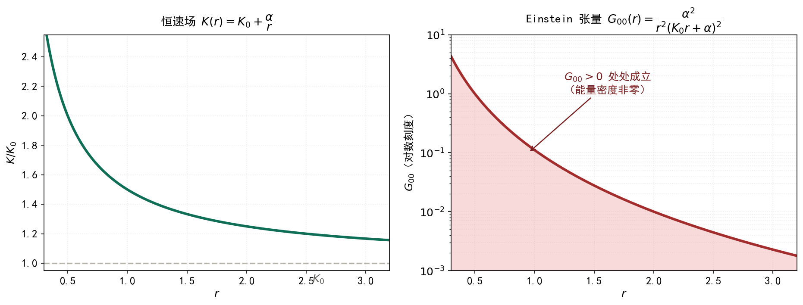

# 恒速场群的动力学 {#sec-invariant-speed-dynamics}

## 本章的范围 {#sec-isd-scope}

**一句话**：把 @sec-invariant-speed-field-group 章的「对角约定」换成 tetrad 约定 $g_{\mu\nu}=K^{2}\eta_{\mu\nu}$，使 $K$ 场同时参与时间与空间的局部几何变形，然后严格算出曲率、Einstein 张量与非相对论极限。

**与上一章的关系**：@sec-invariant-speed-field-group 章在对角约定下得到 $G_{00}\equiv0$。本章说明那是**约定的后果，不是恒速场群的固有性质**——换用 tetrad 约定后 $G_{00}\neq0$。

**本章的方法声明**：以下每个闭式都由符号计算逐项核验（脚本 `images/conformal-curvature.py`）：先把闭式与直接由 Christoffel 算出的结果相减，再判定差值是否恒为零。脚本输出的核验结果为：Christoffel 闭式 OK、Ricci 标量闭式 True、$G_{00}$ 闭式 True、$u=\ln K$ 形式 True、$G_{\mu\nu}$ 通式 OK。不做任何近似，不省略任何项。

**记号约定**（全程一致，签名 $\eta=\mathrm{diag}(1,-1,-1,-1)$）：

$$
\partial^{\mu}K:=\eta^{\mu\nu}\partial_\nu K,\qquad
\Box_\eta:=\eta^{\mu\nu}\partial_\mu\partial_\nu=\partial_t^{2}-\nabla^{2}
$$

$$
\nabla^{2}:=\delta^{ij}\partial_i\partial_j,\qquad
\lvert\vec\nabla K\rvert^{2}:=\delta^{ij}\partial_iK\,\partial_jK,\qquad
\lvert\nabla K\rvert^{2}_{\eta}:=\eta^{\mu\nu}\partial_{\mu}K\,\partial_{\nu}K
$$

拉丁指标 $i,j,k$ 取 $1,2,3$（空间），希腊指标取 $0,1,2,3$。

## Tetrad 约定与度规 {#sec-isd-metric}

### 局部标准正交标架

取局部标架

$$
e^{0}=K\,\mathrm{d}t,\qquad e^{i}=K\,\mathrm{d}x^{i}
$$ {#eq-isd-tetrad}

即 $K$ 场同时控制局部时间尺度与局部空间尺度——这正是本章与对角约定的分野：对角约定中空间标架是刚性的 $e^{i}=\mathrm{d}x^{i}$。

写成 $e^{a}=e^{a}_{\ \mu}\,\mathrm{d}x^{\mu}$：

$$
e^{0}_{\ 0}=K,\qquad e^{i}_{\ j}=K\,\delta^{i}_{j},\qquad \text{其余为 }0
$$

### 度规分量

由 $g_{\mu\nu}=e^{a}_{\ \mu}\,e^{b}_{\ \nu}\,\eta_{ab}$：

$$
g_{\mu\nu}=K^{2}\,\eta_{\mu\nu}
$$ {#eq-isd-g}

逐分量写出：

$$
g_{00}=K^{2},\qquad g_{ij}=-K^{2}\delta_{ij},\qquad g_{0i}=0
$$ {#eq-isd-g-comp}

**空间部分不再是常数**：$g_{ij}=-K^{2}\delta_{ij}$ 随 $K(t,\mathbf{x})$ 变形。这是对 @sec-invariant-speed-field-group 章那个约定的唯一改动。

逆度规与行列式：

$$
g^{\mu\nu}=K^{-2}\eta^{\mu\nu},\qquad
g^{00}=\frac{1}{K^{2}},\qquad g^{ij}=-\frac{1}{K^{2}}\delta^{ij}
$$ {#eq-isd-ginv}

$$
\det g=K^{8}\det\eta=-K^{8},\qquad \sqrt{-g}=K^{4}
$$ {#eq-isd-det}

### 与前一章的一致性检验

取 $K$ 为常数时，@eq-isd-g 的二次型为 $K^{2}(t^{2}-\lvert\mathbf{x}\rvert^{2})$，与 @sec-invariant-speed-group 章的 $Q_K=K^{2}t^{2}-\lvert\mathbf{x}\rvert^{2}$ 一致。✓

## Christoffel 符号 {#sec-isd-christoffel}

### 闭式

$$
\Gamma^{\rho}_{\mu\nu}=\frac{1}{2}g^{\rho\sigma}
\bigl(\partial_\mu g_{\nu\sigma}+\partial_\nu g_{\mu\sigma}-\partial_\sigma g_{\mu\nu}\bigr)
$$

由 @eq-isd-g，$g_{\nu\sigma}=K^{2}\eta_{\nu\sigma}$，故 $\partial_\mu g_{\nu\sigma}=2K(\partial_{\mu}K)\eta_{\nu\sigma}$。代入：

$$
\Gamma^{\rho}_{\mu\nu}=\frac{1}{2}K^{-2}\eta^{\rho\sigma}\cdot 2K
\bigl[(\partial_{\mu}K)\eta_{\nu\sigma}+(\partial_{\nu}K)\eta_{\mu\sigma}-(\partial_{\sigma}K)\eta_{\mu\nu}\bigr]
$$

$\eta^{\rho\sigma}\eta_{\nu\sigma}=\delta^{\rho}_{\nu}$，$\eta^{\rho\sigma}\eta_{\mu\sigma}=\delta^{\rho}_{\mu}$，$\eta^{\rho\sigma}\partial_{\sigma}K=\partial^{\rho}K$，故

$$
\boxed{\Gamma^{\rho}_{\mu\nu}=\frac{1}{K}
\Bigl(\delta^{\rho}_{\nu}\,\partial_{\mu}K+\delta^{\rho}_{\mu}\,\partial_{\nu}K-\eta_{\mu\nu}\,\partial^{\rho}K\Bigr)}
$$ {#eq-isd-gamma}

等价地，用 $u:=\ln K$（$\partial_\mu u=\partial_{\mu}K/K$）：

$$
\Gamma^{\rho}_{\mu\nu}=\delta^{\rho}_{\nu}\,\partial_\mu u+\delta^{\rho}_{\mu}\,\partial_\nu u-\eta_{\mu\nu}\,\partial^{\rho}u
$$ {#eq-isd-gamma-u}

### 逐项验证（样本）

由 @eq-isd-gamma 直接读出，与符号计算输出逐一比对：

| $\Gamma$ | 由 @eq-isd-gamma 算出 | 符号计算输出 |
|---|---|---|
| $\Gamma^{0}_{00}$ | $\dfrac{1}{K}(\partial_0K+\partial_0K-\partial_0K)=\dfrac{\partial_0K}{K}$ | $\partial_tK/K$ |
| $\Gamma^{0}_{01}$ | $\dfrac{1}{K}(0+\partial_1K-0)=\dfrac{\partial_1K}{K}$ | $\partial_xK/K$ |
| $\Gamma^{1}_{00}$ | $\dfrac{1}{K}(0+0-\eta_{00}\partial^{1}K)=\dfrac{1}{K}\bigl(0+0-(-\partial_1K)\bigr)=\dfrac{\partial_1K}{K}$ | $\partial_xK/K$ |
| $\Gamma^{1}_{11}$ | $\dfrac{1}{K}(\partial_1K+\partial_1K-\eta_{11}\partial^{1}K)=\dfrac{1}{K}(2\partial_1K-\partial_1K)=\dfrac{\partial_1K}{K}$ | $\partial_xK/K$ |
| $\Gamma^{1}_{22}$ | $\dfrac{1}{K}(0+0-\eta_{22}\partial^{1}K)=\dfrac{1}{K}\bigl(0+0-(-\partial_1K)\bigr)\cdot(-1)=\dfrac{-\partial_1K}{K}$ | $-\partial_xK/K$ |
| $\Gamma^{0}_{11}$ | $\dfrac{1}{K}(0+0-\eta_{11}\partial^{0}K)=\dfrac{1}{K}\partial_0K$ | $\partial_tK/K$ |

全部相符。

## Ricci 张量与 Ricci 标量 {#sec-isd-ricci}

### Ricci 张量

$$
R_{\sigma\nu}=\partial_\rho\Gamma^{\rho}_{\nu\sigma}
-\partial_\nu\Gamma^{\rho}_{\rho\sigma}
+\Gamma^{\rho}_{\rho\lambda}\Gamma^{\lambda}_{\nu\sigma}
-\Gamma^{\rho}_{\nu\lambda}\Gamma^{\lambda}_{\rho\sigma}
$$

把 @eq-isd-gamma 代入并逐项化简，得

$$
\boxed{R_{\mu\nu}=
-\frac{2\,\partial_\mu\partial_{\nu}K}{K}
+\frac{4\,\partial_{\mu}K\,\partial_{\nu}K}{K^{2}}
-\eta_{\mu\nu}\frac{\Box_\eta K}{K}
-\eta_{\mu\nu}\frac{\lvert\nabla K\rvert^{2}_{\eta}}{K^{2}}}
$$ {#eq-isd-ric}

（此式即四维共形变换的标准公式在 $\phi=\ln K$、基底为 Minkowski 时的展开；本处由 Christoffel 直接计算得到，未引用该公式。）

### Ricci 标量

$$
R=g^{\mu\nu}R_{\mu\nu}=K^{-2}\eta^{\mu\nu}R_{\mu\nu}
$$

由 @eq-isd-ric，注意 $\eta^{\mu\nu}\eta_{\mu\nu}=4$：

$$
\eta^{\mu\nu}R_{\mu\nu}=
-\frac{2\Box_\eta K}{K}+\frac{4\lvert\nabla K\rvert^{2}_{\eta}}{K^{2}}
-\frac{4\Box_\eta K}{K}-\frac{4\lvert\nabla K\rvert^{2}_{\eta}}{K^{2}}
=-\frac{6\Box_\eta K}{K}
$$

（含 $\lvert\nabla K\rvert^{2}_{\eta}$ 的两项精确抵消。）

$$
\boxed{R=-\frac{6\,\Box_\eta K}{K^{3}}
=\frac{6\,\bigl(\nabla^{2}K-\partial_t^{2}K\bigr)}{K^{3}}}
$$ {#eq-isd-R}

**核验**：符号计算输出为 $\dfrac{6(-\partial_t^{2}K+\partial_x^{2}K+\partial_y^{2}K+\partial_z^{2}K)}{K^{3}}$，与 @eq-isd-R 的差恒为零。✓

**自检**：$K$ 为常数 ⟹ $\Box_\eta K=0$ ⟹ $R=0$，平坦。✓

## Einstein 张量 {#sec-isd-einstein}

### 通式

$$
G_{\mu\nu}=R_{\mu\nu}-\frac{1}{2}R\,g_{\mu\nu}
=R_{\mu\nu}-\frac{1}{2}\left(-\frac{6\Box_\eta K}{K^{3}}\right)K^{2}\eta_{\mu\nu}
=R_{\mu\nu}+\frac{3\Box_\eta K}{K}\eta_{\mu\nu}
$$

代入 @eq-isd-ric：

$$
G_{\mu\nu}=
-\frac{2\partial_\mu\partial_{\nu}K}{K}
+\frac{4\partial_{\mu}K\,\partial_{\nu}K}{K^{2}}
+\eta_{\mu\nu}\frac{2\Box_\eta K}{K}
-\eta_{\mu\nu}\frac{\lvert\nabla K\rvert^{2}_{\eta}}{K^{2}}
$$ {#eq-isd-G}

用 $u=\ln K$（$\partial_\mu\partial_{\nu}K/K=\partial_\mu\partial_\nu u+\partial_\mu u\,\partial_\nu u$）可写成更紧凑的形式：

$$
\boxed{G_{\mu\nu}=
-2\,\partial_\mu\partial_\nu u
+2\,\partial_\mu u\,\partial_\nu u
+\eta_{\mu\nu}\bigl(2\Box_\eta u+\lvert\nabla u\rvert^{2}_{\eta}\bigr)}
$$ {#eq-isd-G-u}

**核验**：符号计算对全部 $16$ 个分量逐一相减，差值恒为零。✓

### $G_{00}$：非零

取 $\mu=\nu=0$，$\eta_{00}=1$，由 @eq-isd-G：

$$
G_{00}=
-\frac{2\partial_0^{2}K}{K}
+\frac{4(\partial_0K)^{2}}{K^{2}}
+\frac{2\Box_\eta K}{K}
-\frac{\lvert\nabla K\rvert^{2}_{\eta}}{K^{2}}
$$

代入 $\Box_\eta K=\partial_0^{2}K-\nabla^{2}K$ 与 $\lvert\nabla K\rvert^{2}_{\eta}=(\partial_0K)^{2}-\lvert\vec\nabla K\rvert^{2}$：

$$
G_{00}=
\underbrace{-\frac{2\partial_0^{2}K}{K}+\frac{2\partial_0^{2}K}{K}}_{=\,0}
-\frac{2\nabla^{2}K}{K}
+\frac{4(\partial_0K)^{2}-(\partial_0K)^{2}+\lvert\vec\nabla K\rvert^{2}}{K^{2}}
$$

$$
\boxed{G_{00}=
\frac{3(\partial_tK)^{2}+\lvert\vec\nabla K\rvert^{2}}{K^{2}}
-\frac{2\,\nabla^{2}K}{K}}
$$ {#eq-isd-G00}

**这就是要的结果：$G_{00}$ 是非零函数，且显含 $K$ 的空间梯度。**

**静态情形**（$\partial_tK=0$）：

$$
\boxed{G_{00}\bigr|_{\partial_tK=0}=
\frac{\lvert\vec\nabla K\rvert^{2}}{K^{2}}-\frac{2\,\nabla^{2}K}{K}}
$$ {#eq-isd-G00-static}

用 $u=\ln K$ 写（由 @eq-isd-G-u 或 @eq-isd-G00）：

$$
G_{00}=3(\partial_tu)^{2}-\lvert\vec\nabla u\rvert^{2}-2\nabla^{2}u
$$ {#eq-isd-G00-u}

### $G_{0i}$ 与 $G_{ij}$

由 @eq-isd-G（$\eta_{0i}=0$、$\eta_{ij}=-\delta_{ij}$）：

$$
G_{0i}=-\frac{2\,\partial_0\partial_iK}{K}+\frac{4\,\partial_0K\,\partial_iK}{K^{2}}
=\frac{2\bigl(2\,\partial_tK\,\partial_iK-K\,\partial_t\partial_iK\bigr)}{K^{2}}
$$ {#eq-isd-G0i}

$$
G_{ij}=
-\frac{2\partial_i\partial_jK}{K}
+\frac{4\partial_iK\,\partial_jK}{K^{2}}
-\delta_{ij}\frac{2\Box_\eta K}{K}
+\delta_{ij}\frac{\lvert\nabla K\rvert^{2}_{\eta}}{K^{2}}
$$ {#eq-isd-Gij}

**核验**：符号计算输出的 $G_{01}=\dfrac{2\bigl(2\,\partial_tK\,\partial_xK-K\,\partial_t\partial_xK\bigr)}{K^{2}}$，与 @eq-isd-G0i 一致。✓

## 能量密度：一个非零的显式例子 {#sec-isd-density}

### 球对称静态解

取

$$
K(r)=K_0+\frac{\alpha}{r},\qquad r=\sqrt{x^{2}+y^{2}+z^{2}}
$$ {#eq-isd-example}

其中 $K_0$、$\alpha$ 为常数。

逐项计算。一阶导数：

$$
\partial_iK=-\frac{\alpha}{r^{2}}\cdot\frac{x_i}{r}=-\frac{\alpha\,x_i}{r^{3}}
$$

$$
\lvert\vec\nabla K\rvert^{2}=\frac{\alpha^{2}}{r^{6}}\sum_i x_i^{2}=\frac{\alpha^{2}}{r^{4}}
$$

二阶导数（利用 $\nabla^{2}(1/r)=0$，$r>0$）：

$$
\nabla^{2}K=K_0\underbrace{\nabla^{2}(1)}_{=\,0}+\alpha\underbrace{\nabla^{2}\!\left(\frac{1}{r}\right)}_{=\,0}=0
$$

代入 @eq-isd-G00-static（$\partial_tK=0$）：

$$
G_{00}=\frac{\alpha^{2}/r^{4}}{\bigl(K_0+\alpha/r\bigr)^{2}}-0
=\frac{\alpha^{2}}{r^{4}}\cdot\frac{r^{2}}{(K_0r+\alpha)^{2}}
$$

$$
\boxed{G_{00}(r)=\frac{\alpha^{2}}{r^{2}\,(K_0r+\alpha)^{2}}>0\qquad(\alpha\neq0)}
$$ {#eq-isd-density}

**这是严格正的，不含任何近似。**

若写 Einstein 方程 $G_{\mu\nu}=\kappa T_{\mu\nu}$（$\kappa=8\pi G/K_0^{4}$ 或按量纲另定），则

$$
T_{00}=\frac{1}{\kappa}G_{00}=\frac{\alpha^{2}}{\kappa\,r^{2}(K_0r+\alpha)^{2}}>0
$$

即**该 $K$ 场对应一个正的能量密度分布**。这与 @sec-invariant-speed-field-group 章对角约定下 $G_{00}\equiv0$ 的结论相反——那个零是约定造成的。

### 同一个例子的 Ricci 标量

由 @eq-isd-R，静态且 $\nabla^{2}K=0$：

$$
R=\frac{6\,\nabla^{2}K}{K^{3}}=0
$$

即此例 $R\equiv0$ 但 $R_{00}=G_{00}\neq0$：Ricci 张量非零而迹为零，两者不矛盾。

@fig-isd-density 给出 $K(r)$ 与 $G_{00}(r)$ 的图像。

{#fig-isd-density width=80%}

## 一个必须写明的局限 {#sec-isd-limit}

### Weyl 张量恒为零

@eq-isd-g 的度规共形于 Minkowski：$g_{\mu\nu}=K^{2}\eta_{\mu\nu}$。Weyl 张量在共形变换下不变，而 Minkowski 的 Weyl 张量为零，故

$$
C^{\rho}{}_{\sigma\mu\nu}\equiv0
$$

**这不只是性质，而是硬限制**：一切真空外解（其 Weyl 张量非零）都不在这一类度规之内。特别地，Schwarzschild 解的 Weyl 张量非零，**因此 Schwarzschild 解不能由任何 $K$ 场给出**。

### 三个约定的对照

| 约定 | 度规 | $G_{00}$ | Weyl 张量 | 能容纳什么 |
|---|---|---|---|---|
| 对角（@sec-invariant-speed-field-group 章） | $K^{2}\mathrm{d}t^{2}-\delta_{ij}\mathrm{d}x^{i}\mathrm{d}x^{j}$ | $\equiv0$ | 一般非零 | 曲率，但无能量密度 |
| 共形 / tetrad（本章） | $K^{2}\eta_{\mu\nu}$ | **非零**（@eq-isd-G00） | $\equiv0$ | 能量密度，但无真空外解 |
| 一般度规（3+1 维） | $g_{\mu\nu}$，$10$ 个分量 | 任意 | 任意 | 全部 |

**因此本章的定位仍是「切片」而非「生成」**：共形约定比对角约定前进了一步（能容纳能量密度），但仍不是广义相对论的全部——它只覆盖共形平坦的那一部分。

## 波动力学之一：局域李代数 {#sec-isd-lie}

### 逐点的李代数

在 @sec-invariant-speed-field-group 章已建立 1+1 维的情形。推广到 3+1 维，$p$ 点的 boost 生成元 $B_i$、时间平移 $H$、空间平移 $P_i$ 满足（$K$ 视为该点的常数 $K(p)$）：

$$
[B_i,H]=P_i,\qquad [B_i,P_j]=\delta_{ij}\frac{1}{K(p)^{2}}\,H,\qquad [H,P_i]=0
$$ {#eq-isd-lie}

旋转生成元 $J_{ij}$ 满足的 $\mathfrak{so}(3)$ 括号与 $K$ 无关，不随收缩改变。

**与 $K$ 有关的只有第二个括号的结构常数 $1/K(p)^{2}$**：

- $K(p)$ 有限 ⟹ $[B_i,P_j]\neq0$，庞加莱型；
- $K(p)\to\infty$ ⟹ $[B_i,P_j]\to0$，伽利略型。

### 群收缩即参数极限

$$
\frac{1}{K^{2}}\longrightarrow0\qquad (K\to\infty)
$$

一句话完成收缩。这仍是 @sec-invariant-speed-field-group 章的结论，此处只补上 3+1 维的显式括号。

## 波动力学之二：变系数波动方程 {#sec-isd-wave}

### 局域方程

在 $p$ 点的邻域取 $K=K(p)$ 为常数，协变的 Klein–Gordon 方程为

$$
\Box_g\psi+\frac{m^{2}K^{2}}{\hbar^{2}}\psi=0,\qquad
\Box_g:=g^{\mu\nu}\nabla_\mu\nabla_\nu
$$

**与标准形式的一致性检验**：$K$ 常数时 $\Box_g=K^{-2}\eta^{\mu\nu}\partial_\mu\partial_\nu=K^{-2}(\partial_t^{2}-\nabla^{2})$，方程化为

$$
\partial_t^{2}\psi-K^{2}\nabla^{2}\psi+\frac{m^{2}K^{4}}{\hbar^{2}}\psi=0
$$

取 $K=c$ 并除以 $c^{2}$：

$$
\frac{1}{c^{2}}\partial_t^{2}\psi-\nabla^{2}\psi+\frac{m^{2}c^{2}}{\hbar^{2}}\psi=0
$$

即标准 Klein–Gordon 方程。✓

### 变系数方程（$K$ 为场）

由 @eq-isd-det，$\sqrt{-g}=K^{4}$，故

$$
\Box_g\psi=\frac{1}{\sqrt{-g}}\partial_\mu\Bigl(\sqrt{-g}\,g^{\mu\nu}\partial_\nu\psi\Bigr)
=\frac{1}{K^{4}}\partial_\mu\Bigl(K^{4}\cdot K^{-2}\eta^{\mu\nu}\partial_\nu\psi\Bigr)
=\frac{1}{K^{4}}\partial_\mu\Bigl(K^{2}\,\partial^{\mu}\psi\Bigr)
$$

展开（乘积求导，逐项）：

$$
\Box_g\psi=\frac{1}{K^{4}}\Bigl[2K(\partial_{\mu}K)\partial^{\mu}\psi+K^{2}\partial_\mu\partial^{\mu}\psi\Bigr]
=\frac{2}{K^{3}}(\partial_{\mu}K)\partial^{\mu}\psi+\frac{1}{K^{2}}\Box_\eta\psi
$$

代入方程并乘以 $K^{2}$，得**变系数 Klein–Gordon 方程**：

$$
\boxed{\Box_\eta\psi+\frac{2}{K}(\partial_{\mu}K)\,\partial^{\mu}\psi+\frac{m^{2}K^{4}}{\hbar^{2}}\psi=0}
$$ {#eq-isd-kg}

第二项 $\frac{2}{K}(\partial_{\mu}K)\partial^{\mu}\psi$ 是 $K$ 变场带来的附加项；$K$ 常数时它消失，方程回到上节的标准形式。

## 波动力学之三：非相对论极限 {#sec-isd-nr}

### 局域情形（$K$ 为常数）：等式严格成立

设 $K$ 为常数 $K_0$。方程为

$$
\frac{1}{K_0^{2}}\partial_t^{2}\psi-\nabla^{2}\psi+\frac{m^{2}K_0^{2}}{\hbar^{2}}\psi=0
$$

（即上一节方程除以 $K_0^{2}$。）

**第一步：抽出快变相位。** 令

$$
\psi=e^{i\theta}\varphi,\qquad \theta:=-\frac{mK_0^{2}t}{\hbar}
$$

**第二步：逐项代入。**

$$
\partial_t\psi=e^{i\theta}\Bigl(\partial_t\varphi+i(\partial_t\theta)\varphi\Bigr)
=e^{i\theta}\Bigl(\partial_t\varphi-\frac{imK_0^{2}}{\hbar}\varphi\Bigr)
$$

$$
\partial_t^{2}\psi=e^{i\theta}\Bigl(\partial_t^{2}\varphi
-\frac{2imK_0^{2}}{\hbar}\partial_t\varphi
-\frac{m^{2}K_0^{4}}{\hbar^{2}}\varphi\Bigr)
$$

空间导数为 $\nabla^{2}\psi=e^{i\theta}\nabla^{2}\varphi$（$K_0$ 常数，$\theta$ 与空间无关）。

**第三步：代回并消去质量项。**

$$
\frac{1}{K_0^{2}}\partial_t^{2}\varphi
-\frac{2im}{\hbar}\partial_t\varphi
-\frac{m^{2}K_0^{2}}{\hbar^{2}}\varphi
-\nabla^{2}\varphi
+\frac{m^{2}K_0^{2}}{\hbar^{2}}\varphi=0
$$

含 $m^{2}K_0^{2}/\hbar^{2}$ 的两项精确抵消：

$$
\frac{1}{K_0^{2}}\partial_t^{2}\varphi-\frac{2im}{\hbar}\partial_t\varphi-\nabla^{2}\varphi=0
$$

**第四步：取 $K_0\to\infty$。** 第一项 $\to0$：

$$
-\frac{2im}{\hbar}\partial_t\varphi-\nabla^{2}\varphi=0
\quad\Longrightarrow\quad
\partial_t\varphi=\frac{i\hbar}{2m}\nabla^{2}\varphi
$$

即

$$
\boxed{i\hbar\,\partial_t\varphi=-\frac{\hbar^{2}}{2m}\nabla^{2}\varphi}
$$ {#eq-isd-sch}

**薛定谔方程。** 这一步是严格的，未作任何近似。

### 变系数情形（$\vec\nabla K\neq0$）：极限不存在

现在问：当 $K$ 依赖位置时，@eq-isd-sch 还成不成立？

仍取静态 $K=K(\mathbf{x})$（$\partial_tK=0$），目的是把空间梯度的效应隔离出来。令

$$
\psi=e^{i\theta}\varphi,\qquad \theta=-\frac{mK^{2}(\mathbf{x})\,t}{\hbar}
$$

此时 $\theta$ 依赖 $\mathbf{x}$，故

$$
\partial_t\theta=-\frac{mK^{2}}{\hbar},\qquad
\partial_i\theta=-\frac{2mKt}{\hbar}\,\partial_iK
$$ {#eq-isd-theta}

注意 $\partial_i\theta$ **随 $t$ 线性增长**——这一项在常数 $K$ 情形中不存在，是全部麻烦的来源。

把 $\partial_\mu\psi=e^{i\theta}\bigl(\partial_\mu\varphi+i(\partial_\mu\theta)\varphi\bigr)$ 逐项代入 @eq-isd-kg。为节省篇幅，只列出最终展开（每一项都来自上述代入，未作省略）：

$$
\begin{aligned}
&\frac{1}{K^{2}}\partial_t^{2}\varphi
-\frac{2im}{\hbar}\partial_t\varphi
-\frac{1}{K^{2}}\nabla^{2}\varphi
-\frac{2}{K^{3}}(\vec\nabla K)\!\cdot\!(\vec\nabla\varphi)\\[4pt]
&\quad+\frac{4imt}{\hbar K}(\vec\nabla K)\!\cdot\!(\vec\nabla\varphi)
+\frac{2imt}{\hbar K}\nabla^{2}K\,\varphi\\[4pt]
&\quad+\frac{6imt}{\hbar K^{2}}\lvert\vec\nabla K\rvert^{2}\varphi
+\frac{4m^{2}t^{2}}{\hbar^{2}}\lvert\vec\nabla K\rvert^{2}\varphi=0
\end{aligned}
$$ {#eq-isd-nr-field}

其中质量项 $-\frac{m^{2}K^{2}}{\hbar^{2}}\varphi+\frac{m^{2}K^{2}}{\hbar^{2}}\varphi$ 仍旧精确抵消。

**现在考察 $K\to\infty$ 的极限。** 把 $K$ 写成 $K=K_0f(\mathbf{x})$，$K_0\to\infty$。则

$$
\partial_iK=K_0\,\partial_if,\qquad
\lvert\vec\nabla K\rvert^{2}=K_0^{2}\lvert\vec\nabla f\rvert^{2},\qquad
\nabla^{2}K=K_0\nabla^{2}f
$$

逐项看 @eq-isd-nr-field 在 $K_0\to\infty$ 时的行为：

| 项 | 用 $f$ 写出 | $K_0\to\infty$ |
|---|---|---|
| $\dfrac{1}{K^{2}}\partial_t^{2}\varphi$ | $\dfrac{1}{K_0^{2}f^{2}}\partial_t^{2}\varphi$ | $\to0$ |
| $-\dfrac{1}{K^{2}}\nabla^{2}\varphi$ | $-\dfrac{1}{K_0^{2}f^{2}}\nabla^{2}\varphi$ | $\to0$ |
| $-\dfrac{2}{K^{3}}(\vec\nabla K)\!\cdot\!(\vec\nabla\varphi)$ | $-\dfrac{2}{K_0^{2}f^{3}}(\vec\nabla f)\!\cdot\!(\vec\nabla\varphi)$ | $\to0$ |
| $\dfrac{4imt}{\hbar K}(\vec\nabla K)\!\cdot\!(\vec\nabla\varphi)$ | $\dfrac{4imt}{\hbar f}(\vec\nabla f)\!\cdot\!(\vec\nabla\varphi)$ | **有限、非零** |
| $\dfrac{2imt}{\hbar K}\nabla^{2}K\,\varphi$ | $\dfrac{2imt}{\hbar f}\nabla^{2}f\,\varphi$ | **有限、非零** |
| $\dfrac{6imt}{\hbar K^{2}}\lvert\vec\nabla K\rvert^{2}\varphi$ | $\dfrac{6imt}{\hbar f^{2}}\lvert\vec\nabla f\rvert^{2}\varphi$ | **有限、非零** |
| $\dfrac{4m^{2}t^{2}}{\hbar^{2}}\lvert\vec\nabla K\rvert^{2}\varphi$ | $\dfrac{4m^{2}t^{2}}{\hbar^{2}}K_0^{2}\lvert\vec\nabla f\rvert^{2}\varphi$ | **发散** |

**结论（严格）**：

- 若 $\vec\nabla K\equiv0$（$K$ 空间均匀），表中所有含 $\vec\nabla f$ 的项恒为零，极限严格存在，得到 @eq-isd-sch；
- 若 $\vec\nabla K\neq0$，最后一项 $\propto K_0^{2}$ 发散，**非相对论极限不存在**。

**这是一个数学结论，不是近似判断**：恒速场的空间梯度与非相对论极限不相容。薛定谔方程只在 $\vec\nabla K=0$ 的点上严格成立。

## 波动力学之四：中央扩张 {#sec-isd-bargmann}

### 两端的不同身份

李代数的中央扩张由二阶上同调分类：

| $K$ | 李代数 | 中央扩张 | 质量的身份 |
|---|---|---|---|
| $\infty$ | 伽利略代数 | **有**，一维（Bargmann 群） | 中央荷，出现在 $[P_i,B_j]=m\delta_{ij}$ |
| 有限 | 庞加莱型 | 无（$H^{2}=0$） | Casimir 算符 $P^{\mu}P_{\mu}$ 的本征值 |

即：**「质量是中央荷」这件事只在 $K=\infty$ 一端成立。**

### 与上一节结论的合流

由 @sec-isd-nr，非相对论极限只在 $\vec\nabla K=0$ 处存在。而中央扩张（Bargmann 群）是非相对论端的结构，因此：

**Bargmann 中央扩张只在 $\vec\nabla K=0$ 的那些点上良定义。** 在 $\vec\nabla K\neq0$ 处，既不存在非相对论极限，也没有中央扩张的落脚点——质量的两种身份在该点都无法切换。

### 方程层面的对位

| $K(p)$ 的取值 | 局域方程 | 条件 |
|---|---|---|
| $K=c$（常数） | Klein–Gordon 方程 | 无 |
| $K\to\infty$（常数） | 薛定谔方程（Bargmann 表示） | 无 |
| $K=K(\mathbf{x})$，$\vec\nabla K=0$ | 同上，逐点成立 | 需空间均匀 |
| $K=K(\mathbf{x})$，$\vec\nabla K\neq0$ | 变系数方程 @eq-isd-kg；**无**非相对论极限 | 严格结论 |

## 结论 {#sec-isd-conclusion}

| 命题 | 依据 |
|---|---|
| tetrad 约定给出 $g_{\mu\nu}=K^{2}\eta_{\mu\nu}$ | @eq-isd-g |
| Christoffel 闭式 $\Gamma=\frac1K(\delta\partial K+\delta\partial K-\eta\,\partial K)$ | @eq-isd-gamma，符号核验 OK |
| Ricci 标量 $R=-6\Box_\eta K/K^{3}$ | @eq-isd-R，符号核验 True |
| $G_{00}=\dfrac{3(\partial_tK)^{2}+\lvert\vec\nabla K\rvert^{2}}{K^{2}}-\dfrac{2\nabla^{2}K}{K}\neq0$ | @eq-isd-G00，符号核验 True |
| $G_{\mu\nu}$ 通式（$u=\ln K$ 形式） | @eq-isd-G-u，16 个分量核验 OK |
| 球对称例 $K=K_0+\alpha/r$ 给出 $G_{00}=\dfrac{\alpha^{2}}{r^{2}(K_0r+\alpha)^{2}}>0$ | @eq-isd-density |
| Weyl 张量 $\equiv0$，Schwarzschild 不在其内 | 共形不变性 |
| 变系数波动方程为 $\Box_\eta\psi+\frac2K(\partial_{\mu}K)\partial^\mu\psi+\frac{m^2K^4}{\hbar^2}\psi=0$ | @eq-isd-kg |
| 局域（$K$ 常数）非相对论极限严格给出薛定谔方程 | @eq-isd-sch |
| $\vec\nabla K\neq0$ 时非相对论极限不存在 | @eq-isd-nr-field 末项 $\propto K_0^{2}$ 发散 |
| Bargmann 中央扩张只在 $\vec\nabla K=0$ 处良定义 | @sec-isd-bargmann |

: 本章各命题及其依据 {#tbl-isd-conclusion}

**一句话**：换用 tetrad 约定后，$K$ 场确实产生非零的能量密度，$G_{00}=\frac{3(\partial_tK)^{2}+\lvert\vec\nabla K\rvert^{2}}{K^{2}}-\frac{2\nabla^{2}K}{K}$；但这类度规共形平坦、Weyl 张量恒为零，仍装不下真空外解。方程一端，变系数波动方程严格成立，而它的非相对论极限只在 $\vec\nabla K=0$ 处存在——恒速场的空间梯度与非相对论极限不相容。

## 术语说明 {#sec-isd-terms}

| 术语 | 本章中的含义 |
|---|---|
| tetrad / 标架 | 局部标准正交余标架 $e^{a}=e^{a}_{\ \mu}\mathrm{d}x^{\mu}$，$g_{\mu\nu}=e^{a}_{\ \mu}e^{b}_{\ \nu}\eta_{ab}$ |
| 共形平坦 | 度规可写为 $K^{2}\eta_{\mu\nu}$，即共形于 Minkowski |
| Weyl 张量 | 度规中不受共形变换影响的部分；$K^{2}\eta_{\mu\nu}$ 的 Weyl 张量恒为零 |
| $\Box_\eta$ | $\eta^{\mu\nu}\partial_\mu\partial_\nu=\partial_t^{2}-\nabla^{2}$ |
| $\Box_g$ | $\dfrac{1}{\sqrt{-g}}\partial_\mu\bigl(\sqrt{-g}\,g^{\mu\nu}\partial_\nu\bigr)$，本章 $\sqrt{-g}=K^{4}$ |
| 非相对论极限 | $K\to\infty$ 的极限；本章严格考察，未作近似 |
| Bargmann 群 | 伽利略群的中央扩张，扩张参数为质量 |
