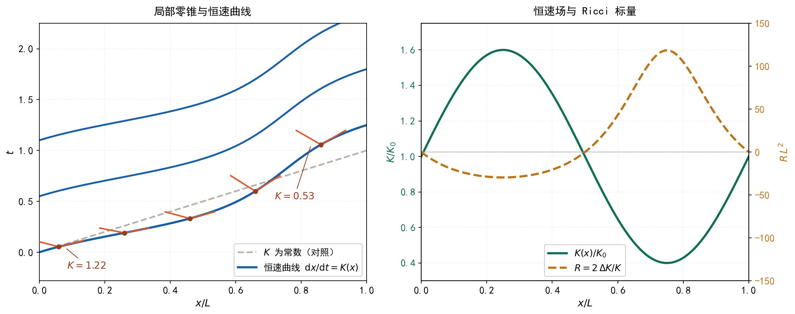

# 恒速场群 {#sec-invariant-speed-field-group}

## 本章的范围 {#sec-ifg-scope}

**一句话**：本章把第 @sec-invariant-speed-group 章的常数 $K$ 换成时空上的函数 $K(p)$，然后问三个问题——逐点的群还在不在、跨点的复合还在不在、它究竟能给出多少几何与表示论。

本章只讨论数学对象之间的对应关系。

三个问题的答案先列出，下文逐一给出依据：

| 问题 | 答案 | 依据 |
|---|---|---|
| 逐点的群还在不在 | 在。每点一个 $G_{K(p)}$ | @sec-ifg-fiber |
| 跨点的复合还在不在 | 不在，需要额外的联络 | @sec-ifg-cross |
| 能给出多少几何 | 在受限约定下能给出曲率，但给不出一般度规 | @sec-ifg-gr |

## 恒速场 {#sec-ifg-field}

### 定义

::: {#def-ifg-field}
## 恒速场
设 $M$ 是一个 $n+1$ 维光滑流形。称函数

$$
K:M\longrightarrow(0,\infty]
$$

为 $M$ 上的**恒速场**。
:::

在每点 $p\in M$，把 $K(p)$ 的值代入第 @sec-invariant-speed-group 章的 @eq-isg-final，得到一个作用在切空间 $T_pM$ 上的线性变换群，记为 $G_{K(p)}$。

### 这不是一个群

**这一点必须说清楚**：把所有点上的 $G_{K(p)}$ 放在一起，得到的**不是**一个群。

理由是：群的运算（复合）要求两个元素作用在同一个集合上。$\Lambda\in G_{K(p)}$ 作用在 $T_pM$ 上，$\Lambda'\in G_{K(q)}$ 作用在 $T_qM$ 上。当 $p\neq q$ 时这是两个不同的向量空间，$\Lambda'\circ\Lambda$ 没有定义。

数学上这类对象的名字是**群丛**（逐点指定的群所构成的丛）。为避免与其他领域的同名用法混淆，本章称它为**恒速场群**。

### 逐点的三个端点

第 @sec-invariant-speed-group 章的三个端点现在逐点化：

| $K(p)$ 的取值 | $p$ 点处的群 | 该点特征 |
|---|---|---|
| 有限（含 $K=c$） | 洛伦兹型 | 该点有有限的不变速度 |
| $\infty$ | 伽利略型 | 该点时间分量不变 |
| $\to0$ | Carroll 型 | 该点空间分量不变（需重新参数化） |

**注意**：$K$ 场可以在不同点取不同类型的端点值。这是常数 $K$ 情形下不存在的新现象，见 @sec-ifg-interface。

## 纤维内：逐点闭合 {#sec-ifg-fiber}

### 命题

::: {#prp-ifg-fiber}
## 逐点群
对每一点 $p$，$G_{K(p)}$ 是群。
:::

**证明**：第 @sec-invariant-speed-group 章推导 @eq-isg-final 的每一步，只用到了「该点的 $K$ 值」这一个信息，没有用到「$K$ 在所有点相同」。逐步核对：

1. 第一步至第三步（定出 $C=-vA$、$D=A$）：只用到线性性与空间反射，不含 $K$；
2. 第四步（定出 $\beta=-v/K^{2}$）：只用到 $p$ 点处速度为 $K(p)$ 的变换行为；
3. 第五步（定出 $A(v)=1/\sqrt{1-v^{2}/K^{2}}$）：只用到同一个 $K$ 值下的群闭合。

因此把 $K$ 换成 $K(p)$，全部推导逐字成立：在 $p$ 点，$G_{K(p)}$ 对复合封闭、含恒等元、每个元素可逆。$\square$

**此命题的适用范围**：只限于**同一根纤维内**（同一切空间上）的复合。跨纤维的复合见 @sec-ifg-cross。

### 齐次群与非齐次群

第 @sec-invariant-speed-group 章的 $G_K$ 只含 boost（参数 $v$），是**齐次**的——它保持原点不动。要谈完整的李代数结构，还需把平移纳入。

加入时间平移 $a$ 与空间平移 $b$，得**非齐次恒速群** $IG_K$，作用于 $(t,x)$：

$$
t'=A(v)\Bigl(t-\frac{v\,x}{K^{2}}\Bigr)+a,\qquad
x'=A(v)\,(x-vt)+b
$$

在 1+1 维、$K$ 常数时，这是 $3$ 参数群。

### 生成元与结构常数（$K$ 常数）

对 $v$ 在 $v=0$ 处求导。由 @eq-isg-final 记 $A(v)=\bigl(1-v^{2}/K^{2}\bigr)^{-1/2}$，有 $A(0)=1$、$A'(0)=0$（$A$ 是 $v$ 的偶函数），故

$$
\left.\frac{\partial t'}{\partial v}\right|_{v=0}=-\frac{x}{K^{2}},\qquad
\left.\frac{\partial x'}{\partial v}\right|_{v=0}=-t
$$

即 boost 生成元为向量场

$$
B=-\frac{x}{K^{2}}\,\partial_t-t\,\partial_x
$$

另两个生成元为平移：$H=\partial_t$、$P=\partial_x$。

**逐项计算李括号**（记 $B^{t}=-x/K^{2}$、$B^{x}=-t$；$H^{t}=1$、$H^{x}=0$；$P^{t}=0$、$P^{x}=1$）：

*$[B,H]$ 的时间分量*：

$$
[B,H]^{t}=B^{j}\partial_j H^{t}-H^{j}\partial_j B^{t}
=0-\partial_t\!\left(-\frac{x}{K^{2}}\right)=0
$$

（$K$ 为常数，故 $\partial_t(x/K^{2})=0$。）

*$[B,H]$ 的空间分量*：

$$
[B,H]^{x}=B^{j}\partial_j H^{x}-H^{j}\partial_j B^{x}
=0-\partial_t(-t)=1
$$

故

$$
[B,H]=P
$$ {#eq-ifg-BH}

*$[B,P]$ 的时间分量*：

$$
[B,P]^{t}=B^{j}\partial_j P^{t}-P^{j}\partial_j B^{t}
=0-\partial_x\!\left(-\frac{x}{K^{2}}\right)=\frac{1}{K^{2}}
$$

*$[B,P]$ 的空间分量*：

$$
[B,P]^{x}=B^{j}\partial_j P^{x}-P^{j}\partial_j B^{x}
=0-\partial_x(-t)=0
$$

故

$$
[B,P]=\frac{1}{K^{2}}\,H
$$ {#eq-ifg-BP}

另有显然的 $[H,P]=0$。

### 由此得到的一个硬结论

**$K$ 在李代数中只出现在结构常数 $1/K^{2}$ 的位置上。** 于是：

| $K$ | $[B,P]$ | 李代数 |
|---|---|---|
| 有限 | $\dfrac{1}{K^{2}}H\neq0$ | 庞加莱型 |
| $\infty$ | $0$ | 伽利略型 |

**这两个李代数不同构**——一个有非零结构常数，一个为零。这是第 @sec-invariant-speed-group 章「两支底层不同」这句话在李代数层面的证明；而群收缩在李代数层面就是一句

$$
\frac{1}{K^{2}}\longrightarrow 0\qquad (K\to\infty)
$$

### 结构常数变场

把 $K$ 换成 $K(p)$，由 @eq-ifg-BH 与 @eq-ifg-BP，每点的结构常数为

$$
[B,P]_{p}=\frac{1}{K(p)^{2}}\,H
$$

**结构常数成为时空上的函数。** 这个对象的数学名字是**李代数丛**：每根纤维上是一个李代数，不同纤维上的李代数由不同的结构常数刻画。

## 跨纤维：复合失效 {#sec-ifg-cross}

### 内禀的论证

$\Lambda\in G_{K(p)}$ 与 $\Lambda'\in G_{K(q)}$ 作用在**不同的向量空间**上。要让它们复合，必须先指定一个把 $T_qM$ 搬到 $T_pM$ 的线性同构——这就是**联络**。

**联络不是由 $K$ 场给出的。** $K$ 场只说「每点用哪个群」，不说「各点之间怎么缝合」。这是两个互相独立的结构。

### 坐标下的显式演示

上面的论证是定性的。要看出「失效」具体是什么形状，可以在一个坐标卡里做显式计算。

**须说明这一步的坐标依赖性**：下面把逐点的生成元当作向量场来用，这只有在取定坐标卡、使「位置向量」有意义时才成立，因此它不是内禀的。它的作用只是把失效的量显式写出来。

取 1+1 维，坐标 $(t,x)$。把 $B$ 的分量中的 $K$ 换成 $K(t,x)$：

$$
B^{t}=-\frac{x}{K(t,x)^{2}},\qquad B^{x}=-t
$$

重算括号。

*$[B,H]$ 的时间分量*：

$$
[B,H]^{t}=0-\partial_t\!\left(-\frac{x}{K^{2}}\right)
=x\,\partial_t\!\left(K^{-2}\right)
=x\cdot\left(-2K^{-3}\,\partial_tK\right)
=-\frac{2x}{K^{3}}\,\partial_tK
$$

空间分量同前为 $1$，故

$$
[B,H]=P-\frac{2x\,\partial_tK}{K^{3}}\,H
$$ {#eq-ifg-BH-field}

*$[B,P]$ 的时间分量*：

$$
[B,P]^{t}=0-\partial_x\!\left(-\frac{x}{K^{2}}\right)
=\partial_x\!\left(x\,K^{-2}\right)
=K^{-2}+x\left(-2K^{-3}\,\partial_xK\right)
$$

空间分量同前为 $0$，故

$$
[B,P]=\left(\frac{1}{K^{2}}-\frac{2x\,\partial_xK}{K^{3}}\right)H
$$ {#eq-ifg-BP-field}

### 两个后果

**后果一：不再闭合。** @eq-ifg-BP-field 的右端是「函数」乘 $H$，而不是「常数」乘 $H$。因此在实常系数下由 $\{H,P,B\}$ 张成的 $3$ 维空间，对李括号**不封闭**：

- $K$ 常数时，右端系数为 $1/K^{2}$，是常数，闭合；
- $K$ 非常数时，右端系数含 $\partial_xK$，不是常数，漏出这个 $3$ 维空间。

**后果二：多出来的项正比于 $\partial K$。** 由 @eq-ifg-BH-field 与 @eq-ifg-BP-field，两个多出项都形如

$$
\frac{x\,\partial_\mu K}{K^{3}}
=\frac{\partial_\mu K}{K}\cdot\frac{x}{K^{2}}
$$

即都正比于 $\partial_\mu K/K$。

**这一点很关键**：@sec-ifg-connection 将算出，在对角约定下 Levi-Civita 联络的 Christoffel 符号恰好是 $\partial_\mu K/K$ 型。也就是说，**联络所做的正是吸收这一类项**。

## 联络：从群丛到几何 {#sec-ifg-connection}

### 补上联络之后

一旦补上联络，就可以谈曲率。但联络有无穷多种选法，$K$ 场并不挑出其中任何一种。

**本节做一件事**：取一个**约定**（下文的「对角约定」），使联络由度规唯一确定，从而把联络也用 $K$ 场表达出来。这样得到一个可以完整算到底的例子。这个约定的局限在 @sec-ifg-gr 中说明。

### 对角约定

::: {#def-ifg-diagonal}
## 对角约定
在 $n+1$ 维流形上取度规

$$
\mathrm{d}s^{2}=K^{2}\,\mathrm{d}t^{2}-\delta_{ij}\,\mathrm{d}x^{i}\mathrm{d}x^{j}
$$ {#eq-ifg-metric}

其中 $K=K(t,x^{1},\dots,x^{n})$ 即恒速场，$\delta_{ij}$ 为欧氏度规。
:::

**与第 @sec-invariant-speed-group 章的一致性检验**：$K$ 为常数时，@eq-ifg-metric 的二次型正是 $Q_K=K^{2}t^{2}-\lvert\mathbf{x}\rvert^{2}$，即该章的不变量。

度规分量及其逆：

$$
g_{00}=K^{2},\qquad g_{ij}=-\delta_{ij},\qquad g_{0i}=0
$$

$$
g^{00}=\frac{1}{K^{2}},\qquad g^{ij}=-\delta^{ij},\qquad g^{0i}=0
$$

**注意 $g_{ij}=-\delta_{ij}$ 是常数**，故 $\partial_\mu g_{ij}=0$；唯一的非零导数是 $\partial_\mu g_{00}=2K\,\partial_\mu K$。这是下面所有计算得以大幅简化的原因。

### Christoffel 符号（逐项）

$$
\Gamma^{\rho}_{\mu\nu}=\frac{1}{2}g^{\rho\sigma}
\bigl(\partial_\mu g_{\nu\sigma}+\partial_\nu g_{\mu\sigma}-\partial_\sigma g_{\mu\nu}\bigr)
$$

逐项代入（$\rho=0$ 时求和只剩 $\sigma=0$；$\rho=k$ 时只剩 $\sigma=l$）。

**(a) $\Gamma^{0}_{00}$**

$$
\Gamma^{0}_{00}=\frac{1}{2}g^{00}\bigl(\partial_0g_{00}+\partial_0g_{00}-\partial_0g_{00}\bigr)
=\frac{1}{2}\cdot\frac{1}{K^{2}}\cdot\bigl(2K\,\partial_0K\bigr)
=\frac{\partial_0K}{K}
$$

**(b) $\Gamma^{0}_{0i}=\Gamma^{0}_{i0}$**

$$
\Gamma^{0}_{0i}=\frac{1}{2}g^{00}\bigl(\partial_0g_{i0}+\partial_ig_{00}-\partial_0g_{i0}\bigr)
=\frac{1}{2}\cdot\frac{1}{K^{2}}\cdot\bigl(2K\,\partial_iK\bigr)
=\frac{\partial_iK}{K}
$$

**(c) $\Gamma^{0}_{ij}$**

$$
\Gamma^{0}_{ij}=\frac{1}{2}g^{00}\bigl(\partial_ig_{j0}+\partial_jg_{i0}-\partial_0g_{ij}\bigr)=0
$$

（前两项含 $g_{i0}=0$，第三项含 $\partial_0g_{ij}=0$。）

**(d) $\Gamma^{k}_{00}$**

$$
\Gamma^{k}_{00}=\frac{1}{2}g^{kl}\bigl(\partial_0g_{0l}+\partial_0g_{0l}-\partial_lg_{00}\bigr)
=\frac{1}{2}\bigl(-\delta^{kl}\bigr)\bigl(-2K\,\partial_lK\bigr)
=K\,\partial_kK
$$

**(e) $\Gamma^{k}_{0i}$ 与 $\Gamma^{k}_{ij}$**

$$
\Gamma^{k}_{0i}=\frac{1}{2}g^{kl}\bigl(\partial_0g_{il}+\partial_ig_{0l}-\partial_lg_{0i}\bigr)=0
$$

$$
\Gamma^{k}_{ij}=\frac{1}{2}g^{kl}\bigl(\partial_ig_{jl}+\partial_jg_{il}-\partial_lg_{ij}\bigr)=0
$$

**汇总**（其余为零）：

$$
\Gamma^{0}_{00}=\frac{\partial_0K}{K},\qquad
\Gamma^{0}_{0i}=\Gamma^{0}_{i0}=\frac{\partial_iK}{K},\qquad
\Gamma^{k}_{00}=K\,\partial_kK
$$ {#eq-ifg-christoffel}

**关键观察**：所有非零 Christoffel 符号都形如 $\partial_\mu K/K$，与 @sec-ifg-cross 中「多出来的项」同型。

### Ricci 张量（逐项）

$$
R_{\sigma\nu}=\partial_\rho\Gamma^{\rho}_{\nu\sigma}
-\partial_\nu\Gamma^{\rho}_{\rho\sigma}
+\Gamma^{\rho}_{\rho\lambda}\Gamma^{\lambda}_{\nu\sigma}
-\Gamma^{\rho}_{\nu\lambda}\Gamma^{\lambda}_{\rho\sigma}
$$

记 $\lvert\nabla K\rvert^{2}:=\sum_k(\partial_kK)^{2}$，$\Delta K:=\sum_k\partial_k\partial_kK$（空间拉普拉斯），$K_0:=\partial_0K$。

**(a) $R_{00}$** 的四项分别为：

*第一项*：

$$
\partial_\rho\Gamma^{\rho}_{00}
=\partial_0\Gamma^{0}_{00}+\partial_k\Gamma^{k}_{00}
=\partial_0\!\left(\frac{K_0}{K}\right)+\partial_k\bigl(K\,\partial_kK\bigr)
$$

$$
=\left(\frac{\partial_0^{2}K}{K}-\frac{K_0^{2}}{K^{2}}\right)+\lvert\nabla K\rvert^{2}+K\,\Delta K
$$

*第二项*：

$$
\partial_0\Gamma^{\rho}_{\rho0}
=\partial_0\bigl(\Gamma^{0}_{00}+\Gamma^{k}_{k0}\bigr)
=\partial_0\!\left(\frac{K_0}{K}+0\right)
=\frac{\partial_0^{2}K}{K}-\frac{K_0^{2}}{K^{2}}
$$

*第三项*（$\lambda$ 取 $0$ 与 $i$ 两类）：

$$
\Gamma^{\rho}_{\rho\lambda}\Gamma^{\lambda}_{00}
=\frac{K_0}{K}\cdot\frac{K_0}{K}
+\sum_i\frac{\partial_iK}{K}\cdot\bigl(K\,\partial_iK\bigr)
=\frac{K_0^{2}}{K^{2}}+\lvert\nabla K\rvert^{2}
$$

*第四项*（$(\rho,\lambda)$ 的四种组合 $(0,0)$、$(0,i)$、$(k,0)$、$(k,i)$）：

$$
\Gamma^{\rho}_{0\lambda}\Gamma^{\lambda}_{\rho0}
=\frac{K_0}{K}\cdot\frac{K_0}{K}
+\frac{\partial_iK}{K}\cdot\bigl(K\,\partial_iK\bigr)
+\bigl(K\,\partial_kK\bigr)\cdot\frac{\partial_kK}{K}
+0
=\frac{K_0^{2}}{K^{2}}+2\lvert\nabla K\rvert^{2}
$$

*四项相减*（第一项 − 第二项 + 第三项 − 第四项）：

$$
R_{00}=\bigl[\lvert\nabla K\rvert^{2}+K\,\Delta K\bigr]
+\bigl[\lvert\nabla K\rvert^{2}\bigr]
-\bigl[2\lvert\nabla K\rvert^{2}\bigr]
=K\,\Delta K
$$

其中含 $\partial_0^{2}K$ 与 $K_0^{2}$ 的项在第一、二项之间精确抵消。故

$$
\boxed{R_{00}=K\,\Delta K}
$$

**(b) $R_{ij}$** 的四项分别为：

第一项 $\partial_\rho\Gamma^{\rho}_{ij}=0$（因 $\Gamma^{0}_{ij}=\Gamma^{k}_{ij}=0$）；第三项 $\Gamma^{\rho}_{\rho\lambda}\Gamma^{\lambda}_{ij}=0$（因 $\Gamma^{\lambda}_{ij}=0$）。

*第二项*：

$$
\partial_j\Gamma^{\rho}_{\rho i}
=\partial_j\!\left(\frac{\partial_iK}{K}\right)
=\frac{\partial_i\partial_jK}{K}-\frac{\partial_iK\,\partial_jK}{K^{2}}
$$

*第四项*（只有 $(\rho,\lambda)=(0,0)$ 非零）：

$$
\Gamma^{\rho}_{j\lambda}\Gamma^{\lambda}_{\rho i}
=\Gamma^{0}_{j0}\,\Gamma^{0}_{0i}
=\frac{\partial_jK}{K}\cdot\frac{\partial_iK}{K}
$$

*四项相减*：

$$
R_{ij}
=0-\left(\frac{\partial_i\partial_jK}{K}-\frac{\partial_iK\,\partial_jK}{K^{2}}\right)
+0-\frac{\partial_iK\,\partial_jK}{K^{2}}
=-\frac{\partial_i\partial_jK}{K}
$$

$$
\boxed{R_{ij}=-\frac{\partial_i\partial_jK}{K}}
$$

**(c) $R_{0i}$** 的四项分别为：

$$
\partial_\rho\Gamma^{\rho}_{0i}
=\partial_0\!\left(\frac{\partial_iK}{K}\right)
=\frac{\partial_0\partial_iK}{K}-\frac{\partial_iK\,K_0}{K^{2}}
$$

$$
\partial_i\Gamma^{\rho}_{\rho0}
=\partial_i\!\left(\frac{K_0}{K}\right)
=\frac{\partial_0\partial_iK}{K}-\frac{K_0\,\partial_iK}{K^{2}}
$$

$$
\Gamma^{\rho}_{\rho\lambda}\Gamma^{\lambda}_{0i}=\frac{K_0}{K}\cdot\frac{\partial_iK}{K},\qquad
\Gamma^{\rho}_{i\lambda}\Gamma^{\lambda}_{\rho0}=\frac{\partial_iK}{K}\cdot\frac{K_0}{K}
$$

四项相减时，两类项两两精确抵消：

$$
\boxed{R_{0i}=0}
$$

### Ricci 标量

$$
R=g^{00}R_{00}+g^{ij}R_{ij}
=\frac{1}{K^{2}}\bigl(K\,\Delta K\bigr)
+\bigl(-\delta^{ij}\bigr)\left(-\frac{\partial_i\partial_jK}{K}\right)
$$

$$
=\frac{\Delta K}{K}+\frac{\delta^{ij}\partial_i\partial_jK}{K}
=\frac{\Delta K}{K}+\frac{\Delta K}{K}
$$

$$
\boxed{R=\frac{2\,\Delta K}{K}}
$$ {#eq-ifg-R}

**这个结果与空间维数 $n$ 无关。**

**自检**：$K$ 为常数 ⟹ $\Delta K=0$ ⟹ $R=0$，平坦。✓

**一个直接的推论**：$R$ 只含**空间**二阶导数，不含 $\partial_0^{2}K$。也就是说，在这个约定下 $K$ 场的时间依赖不产生曲率。这与一件可以直接验证的事一致：若 $K=K(t)$ 只依赖 $t$，作坐标变换 $\tilde t=\int^{t}K(s)\,\mathrm{d}s$，则 $K^{2}\mathrm{d}t^{2}=\mathrm{d}\tilde t^{2}$，@eq-ifg-metric 化为 Minkowski 度规。

### Einstein 张量

$$
G_{\mu\nu}=R_{\mu\nu}-\frac{1}{2}R\,g_{\mu\nu}
$$

逐项代入：

$$
G_{00}=K\,\Delta K-\frac{1}{2}\cdot\frac{2\,\Delta K}{K}\cdot K^{2}
=K\,\Delta K-K\,\Delta K=0
$$

$$
G_{0i}=0-\frac{1}{2}R\cdot 0=0
$$

$$
G_{ij}=-\frac{\partial_i\partial_jK}{K}
-\frac{1}{2}\cdot\frac{2\,\Delta K}{K}\cdot\bigl(-\delta_{ij}\bigr)
=\frac{\Delta K\,\delta_{ij}-\partial_i\partial_jK}{K}
$$ {#eq-ifg-G}

$$
\boxed{G_{00}=0,\qquad G_{0i}=0,\qquad
G_{ij}=\frac{\Delta K\,\delta_{ij}-\partial_i\partial_jK}{K}}
$$

### 真空解

由 @eq-ifg-G，真空要求 $G_{ij}=0$，即

$$
\partial_i\partial_jK=\Delta K\,\delta_{ij}
$$

对 $i=j$ 求和（$n$ 个空间维，$\delta_{ii}=n$）：

$$
\Delta K=\Delta K\cdot n
\quad\Longrightarrow\quad
(n-1)\,\Delta K=0
$$

当 $n\geq2$ 时得 $\Delta K=0$，代回得 $\partial_i\partial_jK=0$。故 $K$ 对空间坐标是**仿射**的：

$$
\boxed{K(t,\mathbf{x})=a(t)+b_i(t)\,x^{i}}
$$ {#eq-ifg-vacuum}

即：在对角约定下，真空解只允许 $K$ 在空间上线性（其系数可依赖 $t$）。

## 与广义相对论：能给出什么，给不出什么 {#sec-ifg-gr}

### 能给出：曲率

由 @eq-ifg-R，$K$ 场在对角约定下**确实产生曲率**。这是正面结果：

$$
R=\frac{2\,\Delta K}{K}
$$

$K$ 为常数 ⟹ $R=0$；$K$ 对空间非线性 ⟹ $R\neq0$。换句话说，**在这一约定下，恒速场的不均匀性就是曲率**。

@fig-invariant-speed-field 给出一个一维截面的例子。

{#fig-invariant-speed-field width=92%}

@fig-invariant-speed-field 左栏：取 $K(x)=K_0\bigl(1+\alpha\sin(2\pi x/L)\bigr)$，在若干位置画出该点的局部零锥（张角由 $K(x)$ 决定，见 @eq-ifg-metric），并画出恒速曲线 $\mathrm{d}x/\mathrm{d}t=K(x)$ 的解。**$K$ 常数时零锥张角处处相同、恒速曲线为直线；$K$ 非常数时两者都不再成立。**

右栏：同一个 $K(x)$ 的曲线，以及由 @eq-ifg-R 算出的 Ricci 标量 $R=2K''/K$。**$R$ 与 $K$ 的二阶导数同号同步，且在 $K$ 为常数处为零。**

**须说明**：该图只是一维截面的示例，不含超出 @eq-ifg-R 的内容；横轴与纵轴的刻度均无物理含义。

### 给不出之一：能量密度

由 @eq-ifg-G，$G_{00}=0$ **恒成立**。若写 Einstein 方程 $G_{\mu\nu}=\kappa T_{\mu\nu}$，则

$$
T_{00}=\frac{1}{\kappa}G_{00}=0
$$

**这意味着：在对角约定下，无论 $K$ 场取什么形状，能量密度恒为零。**

这是一条硬边界。它说明这一类度规装不下任何具有非零能量密度的物质分布——$G_{ij}$ 可以非零（有应力），但没有 $T_{00}$ 与之匹配。

**须标注**：这个零是对角约定（@eq-ifg-metric）的后果，不是恒速场群本身的性质。第 @sec-invariant-speed-dynamics 章改用 tetrad 约定（空间标架也由 $K$ 控制）后，将得到 $G_{00}\neq0$ 的显式表达式。

### 给不出之二：一般度规

| 对象 | 每点的自由度（3+1 维） |
|---|---|
| 恒速场 $K$ | $1$ |
| 度规 $g_{\mu\nu}$ | $10$ 个分量，扣除 $4$ 个坐标自由度，剩 $6$ 个物理自由度 |

$1<6$。对角约定是把 $10$ 个分量压成 $1$ 个的极强限制。

**因此**：给定 $K$ 场，能算出一个度规（@eq-ifg-metric）；反过来，给定一个一般解，不能用单个 $K$ 场描述。这是**切片**，不是**生成**。

### 定位

| 广义相对论的构成 | 恒速场群是否给出 |
|---|---|
| 每点一个洛伦兹群（取 $K=c$） | **给出** |
| 联络 | 不给出（需另行指定；对角约定下由度规诱导） |
| Einstein 场方程 | 不给出 |
| 一般度规的 $6$ 个物理自由度 | 不给出 |

**一句话**：恒速场群处在广义相对论的**前一步**，不是上一步。它给出 GR 所用的运动学骨架，而 GR 的动力学内容全在它之外。

## 与量子力学：中央扩张的两端 {#sec-ifg-qm}

以下只谈群的表示论，不涉及物理诠释。

### 逐点化的表示论

$K$ 常数时，$G_K$（更确切地说是其非齐次版本 $IG_K$）的表示论决定了波动力学方程的协变性要求。$K$ 变场后，每点有自己的群 $G_{K(p)}$，因而每点有自己的表示论。

### 一条与 $K$ 直接相关的结构差异：中央扩张

这是本章与量子力学对接中最硬的一条。

李代数的中央扩张由其二阶上同调分类。对 $IG_K$ 的两支：

| $K$ | 李代数 | 中央扩张 |
|---|---|---|
| $\infty$ | 伽利略代数 | **有**（一维，扩张参数即质量 $m$；扩张后的群称 Bargmann 群） |
| 有限 | 庞加莱型代数 | **无**（$H^{2}=0$） |

**这解释了「质量」在两种理论中身份的不同**：

- 在 $K=\infty$ 一端，质量是**中央荷**——它直接出现在李代数的括号 $[P_i,B_j]=m\,\delta_{ij}$ 中，是群结构的参数；
- 在 $K$ 有限一端，没有中央荷，质量是 Casimir 算符 $P^{\mu}P_{\mu}$ 的本征值——它是**表示的标签**，不是群的参数。

**$K$ 变场时的后果**：若 $K$ 场在某区域取 $\infty$、在另一区域取有限值，则「质量」这个参数在两端具有**不同的数学身份**。在跨越两端的界面上，不存在统一的质量参数。

### 方程的对位

| $K$ | 协变性要求 | 方程 |
|---|---|---|
| $c$ | 洛伦兹协变 | 克莱因–戈登方程 $\bigl(\frac{1}{c^{2}}\partial_t^{2}-\nabla^{2}+\frac{m^{2}c^{2}}{\hbar^{2}}\bigr)\psi=0$ |
| $\infty$ | 伽利略协变（严格表述用 Bargmann 群） | 薛定谔方程 $i\hbar\,\partial_t\psi=-\frac{\hbar^{2}}{2m}\nabla^{2}\psi$ |

两者由 $K\to\infty$ 的极限相联系：从克莱因–戈登方程中抽出快变相位 $\psi=e^{-imc^{2}t/\hbar}\,\varphi$ 再取 $c\to\infty$，即得薛定谔方程。**这与群收缩是同一个参数极限。**

### 变 $K$ 的方程

若方程的系数含 $K(p)$，则 $K$ 的空间变化使方程成为**变系数偏微分方程**；$K$ 常数时才退化为常系数方程。

### 定位

| 量子力学的构成 | 恒速场群是否给出 |
|---|---|
| 协变性要求（选哪一类方程） | **给出**（分类学） |
| Hilbert 空间、算符代数 | 不给出 |
| 概率解释 | 不给出 |
| 中央扩张与质量参数 | 部分给出——它**解释了**质量为何只在一端是中央荷 |

## 退化曲面 {#sec-ifg-interface}

### 常数 $K$ 情形不存在的新现象

$K$ 场可以在不同区域取不同类型的端点值。设 $\Sigma\subset M$ 是一张超曲面，其两侧分别满足

$$
K\bigr|_{\text{一侧}}\ \text{有限},\qquad
K\bigr|_{\text{另一侧}}\ \to\infty
$$

由第 @sec-invariant-speed-group 章的结论：有限 $K$ 的群彼此同构，但它们与 $K=\infty$ 的群**不同构**（李代数层面即 $[B,P]=H/K^{2}$ 与 $[B,P]=0$ 之别）。

**因此在 $\Sigma$ 上，结构群发生类型改变，不存在跨越 $\Sigma$ 的同构。**

### 这一现象的数学性质

- $\Sigma$ 是 $K$ 场的退化水平集；
- 在 $\Sigma$ 上，@eq-ifg-metric 的 $g_{00}=K^{2}$ 趋于 $\infty$ 或趋于 $0$，度规退化；
- 由 @eq-ifg-R，若 $K$ 在 $\Sigma$ 附近急剧变化，则 $\Delta K$ 很大，Ricci 标量无界。

**须说明**：这里说的是度规退化，不涉及任何物理判断。

## 结论 {#sec-ifg-conclusion}

| 命题 | 依据 |
|---|---|
| 恒速场群是群丛，不是群 | 不同点的群作用在不同的切空间上 |
| 逐点群闭合 | @prp-ifg-fiber |
| 结构常数为 $1/K(p)^{2}$ | @eq-ifg-BP |
| 两支李代数不同构 | $[B,P]=H/K^{2}$ 与 $[B,P]=0$ |
| 跨纤维复合失效 | @eq-ifg-BP-field，系数非常数 |
| 联络是额外结构，$K$ 场不给出 | @sec-ifg-cross |
| 对角约定下 $R=2\Delta K/K$ | @eq-ifg-R |
| 对角约定下 $G_{00}\equiv0$ | @eq-ifg-G |
| 真空解为 $K=a(t)+b_i(t)\,x^{i}$ | @eq-ifg-vacuum |
| 质量只在 $K=\infty$ 一端是中央荷 | 李代数上同调 |
| 恒速场群不能生成 GR 与 QM | 自由度 $1<6$；动力学不在其中 |

: 本章各命题及其依据 {#tbl-ifg-conclusion}

**一句话**：把 $K$ 升为场，得到的是群丛而不是群——逐点的结构群还在，跨点的缝合不在。补上联络并在受限的对角约定下，可以算出曲率 $R=2\Delta K/K$；但同一约定也给出 $G_{00}\equiv0$，即这一类装不下能量密度。恒速场群给出的是运动学骨架，动力学在它之外。

## 术语说明 {#sec-ifg-terms}

为避免歧义，列出本章所用术语及其在本章中的含义：

| 术语 | 本章中的含义 |
|---|---|
| 恒速场 | 定义在流形上的函数 $K:M\to(0,\infty]$，逐点指定该点的跨系恒速 |
| 群丛 | 逐点指定一个群所构成的丛；**不是**群，因为跨点无复合运算 |
| 纤维 | 流形上一点 $p$ 处的切空间 $T_pM$ |
| 李代数丛 | 逐点一个李代数，结构常数随点变化 |
| 联络 | 把相邻点的切空间联系起来的额外结构；不由 $K$ 场给出 |
| Christoffel 符号 | 联络在坐标下的分量 |
| Ricci 张量 / Ricci 标量 | 由联络的曲率缩并得到，度量「缝合不起来」的程度 |
| Einstein 张量 | $G_{\mu\nu}=R_{\mu\nu}-\frac{1}{2}R\,g_{\mu\nu}$ |
| 中央扩张 | 给李代数添一个与所有元素对易的方向；伽利略代数有，庞加莱型代数无 |
| Bargmann 群 | 伽利略群的中央扩张，扩张参数为质量 |
| 对角约定 | 把度规限制为 $K^{2}\mathrm{d}t^{2}-\delta_{ij}\mathrm{d}x^{i}\mathrm{d}x^{j}$ 的约定 |
