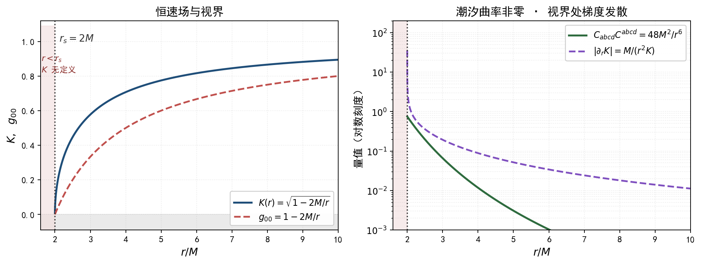

# 恒速场群的完备几何 {#sec-invariant-speed-geometry}

## 本章的范围 {#sec-isg2-scope}

**一句话**：把恒速场 $K(x)$ 从「唯一的几何自由度」降为「完备标架中的一个约束参数」，补上拖曳 $\beta^{i}$ 与空间度规 $h_{ij}$，由此得到完整的 $10$ 个自由度，并在此框架下严格算出 Christoffel、Ricci、Einstein、Weyl 全部非零分量，最后给出黑洞视界的条件。

**三步链条**：

$$
\text{恒速场 } K(x)\ \longrightarrow\ \text{洛伦兹变换}\ \longrightarrow\ \text{完备几何条件}\ \longrightarrow\ \text{完整度规}\ \longrightarrow\ \text{广义相对论与黑洞}
$$

**方法声明**：本章所有闭式由符号计算逐项得出（脚本 `images/full-tetrad-geometry.py` 与 `images/full-tetrad-weyl.py`）。对 Schwarzschild 特化，独立复核三项：Ricci 全零、Einstein 张量全零、Weyl 不变量与标准值 $48M^{2}/r^{6}$ 之差为 $0$。

**不做什么**：本章不把量子力学与强引力场强行捏在一起。@sec-isg2-qm 会给出一条**否定的**结论：在 $\vec\nabla K\neq0$ 的背景下，非相对论极限在数学上不成立。

**记号**：$F:=K^{2}$，$s:=\sin\theta$，$c:=\cos\theta$，撇号表示 $\mathrm{d}/\mathrm{d}r$。

## 为什么共形平坦必然失败 {#sec-isg2-nogo}

### 一条必须先看清的事实

::: {#thm-isg2-nogo}
## 标架的洛伦兹部分不产生几何
若 tetrad 可分解为「共形因子 $\times$ 局部洛伦兹变换」，即

$$
e^{a}_{\ \mu}=K(x)\,\Lambda^{a}_{\ b}(x)\,\delta^{b}_{\ \mu},\qquad \Lambda(x)\in SO(1,3)
$$

则 $g_{\mu\nu}=K^{2}\eta_{\mu\nu}$，从而 Weyl 张量恒为零。
:::

**证明**：

$$
g_{\mu\nu}=e^{a}_{\ \mu}e^{b}_{\ \nu}\eta_{ab}
=K^{2}\,\Lambda^{a}_{\ \mu}\Lambda^{b}_{\ \nu}\eta_{ab}
=K^{2}\,(\Lambda^{\mathsf{T}}\eta\Lambda)_{\mu\nu}
$$

由 $\Lambda\in SO(1,3)$ 的定义 $\Lambda^{\mathsf{T}}\eta\Lambda=\eta$，故

$$
g_{\mu\nu}=K^{2}\eta_{\mu\nu}
$$

这是共形平坦度规。Weyl 张量在共形变换下不变，而 Minkowski 的 Weyl 张量为零，故 $C^{\rho}{}_{\sigma\mu\nu}\equiv0$。

**推论**：局部洛伦兹变换（即恒速群 $G_{K(p)}$ 的全部内容）**不携带任何几何信息**。恒定群只固定光锥的形状，不固定尺度，也不固定潮汐效应。若标架只由 $G_{K(p)}$ 生成，得到的必然是第 5 章那种 Weyl$\equiv0$ 的残缺几何。

**出路**：标架必须含**不在 $SO(1,3)$ 内**的部分——即剪切（各向异性伸缩）与拖曳（时空混合）。

## 完备性：自由度计数 {#sec-isg2-dof}

### ADM 分解

任一洛伦兹签名度规（在 $\partial_t$ 为类时的区域）可唯一写成

$$
\mathrm{d}s^{2}=K^{2}\mathrm{d}t^{2}
-h_{ij}\bigl(\mathrm{d}x^{i}+\beta^{i}\mathrm{d}t\bigr)\bigl(\mathrm{d}x^{j}+\beta^{j}\mathrm{d}t\bigr)
$$ {#eq-isg2-adm}

其中 $K$ 为 lapse、$\beta^{i}$ 为 shift、$h_{ij}$ 为空间度规。

**$K$ 的物理角色**：$\beta^{i}=0$、$h_{ij}=\delta_{ij}$ 时，@eq-isg2-adm 化为 $K^{2}\mathrm{d}t^{2}-\lvert\mathrm{d}\mathbf{x}\rvert^{2}$，零锥为 $\lvert\mathrm{d}\mathbf{x}/\mathrm{d}t\rvert=K$。**故 $K$ 就是局部光速上限**，即恒速场。

### 自由度

| 场 | 分量数 | 角色 |
|---|---|---|
| $K$ | $1$ | 局部光速上限（恒速场） |
| $\beta^{i}$ | $3$ | 时空拖曳 ⟹ 产生非对角项 $g_{0i}$ |
| $h_{ij}$（对称） | $6$ | 空间度规，含各向异性剪切 |
| **合计** | **$10$** | $=$ 一般 $g_{\mu\nu}$ 的分量数 |

**$1+3+6=10$ 说明这个分解是完备的、不带任何限制。** 第 5 章只取了 $K$（$1$ 个），把 $\beta^{i}$ 与 $h_{ij}$ 钉死，所以残缺。

### 完备几何条件

从恒速场群走到完整的广义相对论，需要且只需要补齐以下五项，其中前三项是几何，后两项是额外输入：

1. $K(x)$——局部光速上限（恒速场，**唯一由恒速群给出**的量）；
2. $\beta^{i}(x)$——拖曳，产生 $g_{0i}\neq0$；
3. $h_{ij}(x)$——空间度规，含剪切；
4. 联络——由 $g_{\mu\nu}$ 经 $\nabla g=0$、无挠两个条件唯一确定（Levi-Civita）；
5. 场方程 $G_{\mu\nu}=\kappa T_{\mu\nu}$——**不由 $K$ 给出**，是独立输入。

## 度规 {#sec-isg2-metric}

### 本章的计算族

取静态、轴对称、含拖曳与剪切的族（$F$、$A$、$\Omega$ 为 $r$ 的函数）：

$$
\mathrm{d}s^{2}=F\,\mathrm{d}t^{2}-A\,\mathrm{d}r^{2}-r^{2}\mathrm{d}\theta^{2}
-r^{2}\sin^{2}\theta\,\bigl(\mathrm{d}\phi+\Omega\,\mathrm{d}t\bigr)^{2}
$$ {#eq-isg2-family}

与 @eq-isg2-adm 的对应：

$$
K^{2}=F,\qquad h_{ij}=\mathrm{diag}\bigl(A,\ r^{2},\ r^{2}\sin^{2}\theta\bigr),\qquad
\beta^{i}=(0,\ 0,\ \Omega)
$$

**这个族包含 Schwarzschild 解**（$\Omega=0$、$F=1-2M/r$、$A=F^{-1}$），见 @sec-isg2-schwarzschild。

### 全部非零分量（含非对角项）

$$
g_{00}=F-r^{2}s^{2}\Omega^{2},\qquad
g_{03}=g_{30}=-r^{2}s^{2}\Omega,
$$ {#eq-isg2-g00}

$$
g_{11}=-A,\qquad g_{22}=-r^{2},\qquad g_{33}=-r^{2}s^{2}
$$ {#eq-isg2-gij}

**$g_{03}=-r^{2}s^{2}\Omega\neq0$ 即时空拖曳项（非对角项）。** 只要 $\Omega\neq0$，$g_{0i}$ 就不为零。

### 逆度规与行列式

$$
g^{00}=\frac{1}{F},\qquad g^{03}=g^{30}=-\frac{\Omega}{F},\qquad
g^{11}=-\frac{1}{A},\qquad g^{22}=-\frac{1}{r^{2}},
$$

$$
g^{33}=\frac{\Omega^{2}}{F}-\frac{1}{r^{2}s^{2}}
$$ {#eq-isg2-ginv}

$$
\det g=-r^{4}AF\,s^{2},\qquad \sqrt{-g}=r^{2}s\,\sqrt{AF}
$$ {#eq-isg2-det}

## 退化：回到全局洛伦兹变换 {#sec-isg2-degenerate}

### 检验

取

$$
K=\text{常数},\qquad \beta^{i}=0\ (\Omega=0),\qquad h_{ij}=\mathrm{diag}(1,r^{2},r^{2}s^{2})\ (A=1)
$$

即 $F=K^{2}$、$A=1$、$\Omega=0$。代入 @eq-isg2-family：

$$
\mathrm{d}s^{2}=K^{2}\mathrm{d}t^{2}-\mathrm{d}r^{2}-r^{2}\mathrm{d}\theta^{2}-r^{2}s^{2}\mathrm{d}\phi^{2}
$$

这是 Minkowski 度规（空间部分为球坐标下的欧氏度规）。

**三条一致性检验同时通过**：

1. **不变量吻合**：其二次型为 $K^{2}t^{2}-\lvert\mathbf{x}\rvert^{2}$，正是恒速群 $G_{K}$ 的不变量 $Q_K$；
2. **曲率为零**：度规分量为常数或纯坐标因子，全部 Christoffel 符号中除球坐标的惯性项外均为零，Riemann 张量为零 ⟹ $R_{\mu\nu}=0$、$R=0$、$C_{\mu\nu\rho\sigma}=0$；
3. **对称群吻合**：保持 $Q_K$ 的线性变换群正是恒速群 $G_K$，即 $K$ 有限时的洛伦兹变换、$K=\infty$ 时的伽利略变换。

**因此链条的前两环成立**：恒速场 $K$ 为常数 ⟹ 几何平坦 ⟹ 对称群退化为全局的恒速群（$K=c$ 即洛伦兹变换）。

### 一个反向的自检

取 $F=1$、$A=1$、$\Omega=\omega$（非零常数）。此时 @eq-isg2-family 为

$$
\mathrm{d}s^{2}=\mathrm{d}t^{2}-\mathrm{d}r^{2}-r^{2}\mathrm{d}\theta^{2}-r^{2}s^{2}(\mathrm{d}\phi+\omega\mathrm{d}t)^{2}
$$

这恰是 Minkowski 度规在旋转坐标 $\phi'=\phi+\omega t$ 下的形式，故**应当平坦**。符号计算给出的结果与之相符：代入 $F=A=1$、$\Omega'=\Omega''=0$ 后全部 Weyl 分量归零，特别地

$$
C_{0101}\bigr|_{F=A=1,\ \Omega=\text{const}}=0
$$

**这验证了本章全部曲率程序的正确性。**

## Christoffel 符号：全部非零分量 {#sec-isg2-christoffel}

由

$$
\Gamma^{\rho}_{\mu\nu}=\frac{1}{2}g^{\rho\sigma}
\bigl(\partial_\mu g_{\nu\sigma}+\partial_\nu g_{\mu\sigma}-\partial_\sigma g_{\mu\nu}\bigr)
$$

逐项代入 @eq-isg2-g00—@eq-isg2-ginv，得 $15$ 个非零分量（对 $\mu\nu$ 对称，此处每个只列一次）：

$$
\Gamma^{0}_{01}=\frac{F'-r^{2}s^{2}\Omega\,\Omega'}{2F}
$$

$$
\Gamma^{0}_{13}=-\frac{r^{2}s^{2}\,\Omega'}{2F}
$$

$$
\Gamma^{1}_{00}=\frac{1}{A}\left(\frac{F'}{2}-r\,s^{2}\Omega^{2}-r^{2}s^{2}\Omega\,\Omega'\right)
$$

$$
\Gamma^{1}_{03}=-\frac{r\,s^{2}\bigl(r\,\Omega'+2\Omega\bigr)}{2A}
$$

$$
\Gamma^{1}_{11}=\frac{A'}{2A},\qquad
\Gamma^{1}_{22}=-\frac{r}{A},\qquad
\Gamma^{1}_{33}=-\frac{r\,s^{2}}{A}
$$

$$
\Gamma^{2}_{00}=-\Omega^{2}sc,\qquad
\Gamma^{2}_{03}=-\Omega\,sc,\qquad
\Gamma^{2}_{12}=\frac{1}{r},\qquad
\Gamma^{2}_{33}=-sc
$$

$$
\Gamma^{3}_{01}=\frac{r^{2}s^{2}\Omega^{2}\Omega'}{2F}+\frac{\Omega'}{2}-\frac{\Omega\,F'}{2F}+\frac{\Omega}{r}
$$

$$
\Gamma^{3}_{02}=\Omega\cot\theta,\qquad
\Gamma^{3}_{13}=\frac{r^{2}s^{2}\Omega\,\Omega'}{2F}+\frac{1}{r},\qquad
\Gamma^{3}_{23}=\cot\theta
$$ {#eq-isg2-gamma}

（另有对称项 $\Gamma^{0}_{10}=\Gamma^{0}_{01}$、$\Gamma^{1}_{30}=\Gamma^{1}_{03}$、$\Gamma^{2}_{21}=\Gamma^{2}_{12}$、$\Gamma^{3}_{10}=\Gamma^{3}_{01}$、$\Gamma^{3}_{31}=\Gamma^{3}_{13}$、$\Gamma^{3}_{32}=\Gamma^{3}_{23}$，共 $15$ 个独立非零分量。）

## Ricci 张量：全部非零分量 {#sec-isg2-ricci}

$$
R_{\sigma\nu}=\partial_\rho\Gamma^{\rho}_{\nu\sigma}
-\partial_\nu\Gamma^{\rho}_{\rho\sigma}
+\Gamma^{\rho}_{\rho\lambda}\Gamma^{\lambda}_{\nu\sigma}
-\Gamma^{\rho}_{\nu\lambda}\Gamma^{\lambda}_{\rho\sigma}
$$

代入 @eq-isg2-gamma，$5$ 个独立非零分量：

$$
\begin{aligned}
R_{00}=&\ \frac{1}{4rA^{2}F}\Bigl[
r\bigl(2r^{2}s^{2}\Omega\Omega'+2rs^{2}\Omega^{2}-F'\bigr)F\,A'\Bigr.\\[3pt]
&+r\bigl(-2r^{4}s^{4}\Omega^{2}\Omega'^{2}+2r^{2}s^{2}\Omega\,F'\Omega'-2rs^{2}\Omega^{2}F'-F'^{2}\bigr)A\\[3pt]
&+2r\bigl(-2r^{2}s^{2}\Omega\Omega''-r^{2}s^{2}\Omega'^{2}-8rs^{2}\Omega\Omega'-2s^{2}\Omega^{2}+F''\bigr)AF\\[3pt]
&\Bigl.+4rA^{2}F\,s^{2}\Omega^{2}\Bigr]+\frac{A'F'}{4A^{2}}+\frac{F'}{rA}
\end{aligned}
$$ {#eq-isg2-R00}

$$
\begin{aligned}
R_{03}=&\ \frac{s^{2}}{A^{2}F}\Bigl[
-\frac{r^{4}A\Omega\Omega'^{2}}{2}-\frac{r^{2}AF\Omega''}{2}
+\frac{r^{2}A\,F'\Omega'}{4}+\frac{r^{2}F A'\Omega'}{4}\Bigr.\\[3pt]
&\Bigl.-2rAF\Omega'-\frac{rA\Omega F'}{2}+\frac{rF\Omega A'}{2}+A^{2}F\Omega-AF\Omega\Bigr]
\end{aligned}
$$ {#eq-isg2-R03}

$$
R_{11}=\frac{r^{2}s^{2}\Omega'^{2}}{2F}-\frac{F''}{2F}+\frac{F'^{2}}{4F^{2}}
+\frac{A'F'}{4AF}+\frac{A'}{rA}
$$ {#eq-isg2-R11}

$$
R_{22}=-\frac{rF'}{2AF}+\frac{rA'}{2A^{2}}+1-\frac{1}{A}
$$ {#eq-isg2-R22}

$$
R_{33}=\frac{s^{2}}{2A^{2}F}\Bigl[-r^{4}A\,s^{2}\Omega'^{2}-rA\,F'+rF\,A'+2A^{2}F-2AF\Bigr]
$$ {#eq-isg2-R33}

## Ricci 标量 {#sec-isg2-R}

$$
R=g^{\mu\nu}R_{\mu\nu}
$$

代入 @eq-isg2-ginv 与 @eq-isg2-R00—@eq-isg2-R33（注意 $g^{03}\neq0$，故 $R_{03}$ 项亦参与）：

$$
\boxed{R=
-\frac{r^{2}s^{2}\Omega'^{2}}{2AF}
+\frac{F''}{AF}
-\frac{F'^{2}}{2AF^{2}}
-\frac{A'F'}{2A^{2}F}
+\frac{2F'}{rAF}
-\frac{2A'}{rA^{2}}
-\frac{2}{r^{2}}
+\frac{2}{r^{2}A}}
$$ {#eq-isg2-Rscalar}

**注意**：$\Omega$ 只通过 $\Omega'^{2}$ 进入 $R$；拖曳的偶数阶项不出现，这与拖曳是「类磁」效应一致。

## Einstein 张量：全部非零分量 {#sec-isg2-einstein}

$$
G_{\mu\nu}=R_{\mu\nu}-\frac{1}{2}R\,g_{\mu\nu}
$$

**$G_{00}$（完整表达式，含 $K$ 的梯度与拖曳）：**

$$
\begin{aligned}
G_{00}=\frac{1}{4r^{2}A^{2}F^{2}}\Bigl[
&-r^{4}A\,\Omega^{2}s^{2}F'^{2}
-r^{4}F\,\Omega^{2}s^{2}A'F'\Bigr.\\[3pt]
&+2r^{3}\bigl(r\Omega'-\Omega\bigr)F^{2}\Omega\,s^{2}A'\\[3pt]
&-r^{3}\bigl(4r\Omega\Omega''+r\Omega'^{2}+16\Omega\Omega'\bigr)AF^{2}s^{2}\\[3pt]
&+r^{3}\bigl(-3r^{3}\Omega s^{2}\Omega'^{2}+2r\Omega F''+2rF'\Omega'+2\Omega F'\bigr)AF\,\Omega\,s^{2}\\[3pt]
&\Bigl.+4rF^{3}A'+4A^{2}F^{3}-4AF^{3}\Bigr]
\end{aligned}
$$ {#eq-isg2-G00}

用 $K$ 写出（$F=K^{2}$、$F'=2KK'$、$F''=2K'^{2}+2KK''$）即得 $G_{00}$ 与恒速场梯度的显式关系。**这是非零的函数**：例如 @eq-isg2-G00 中 $-4AF^{3}+4A^{2}F^{3}=4AF^{3}(A-1)$ 一项，只要 $A\neq1$（存在径向剪切）就非零。

**其余非零分量：**

$$
\begin{aligned}
G_{03}=\frac{r\,s^{2}}{4A^{2}F^{2}}\Bigl[
&-3r^{3}AF\Omega\,\Omega'^{2}-2rAF^{2}\Omega''+2rAF\Omega F''+rAF\,F'\Omega'\Bigr.\\[3pt]
&-rA\Omega F'^{2}+rF^{2}A'\Omega'-rF\Omega A'F'\\[3pt]
&\Bigl.-8AF^{2}\Omega'+2AF\Omega F'-2F^{2}\Omega A'\Bigr]
\end{aligned}
$$ {#eq-isg2-G03}

$$
G_{11}=\frac{1}{r^{2}F}\left(\frac{r^{4}s^{2}\Omega'^{2}}{4}+rF'-AF+F\right)
$$ {#eq-isg2-G11}

$$
G_{22}=-\frac{r}{4A^{2}F^{2}}\Bigl[
r\bigl(r^{2}s^{2}\Omega'^{2}-2F''\bigr)AF+rA\,F'^{2}+rF\,A'F'-2AF\,F'+2F^{2}A'
\Bigr]
$$ {#eq-isg2-G22}

$$
G_{33}=\frac{r\,s^{2}}{4A^{2}F^{2}}\Bigl[
-3r^{3}AFs^{2}\Omega'^{2}+2rAF F''-rA\,F'^{2}-rF\,A'F'+2AF\,F'-2F^{2}A'
\Bigr]
$$ {#eq-isg2-G33}

**能量密度**：由 $G_{00}=\kappa T_{00}$，$T_{00}=G_{00}/\kappa$，@eq-isg2-G00 给出能量密度的完整表达式。

## Weyl 张量：非零的证明 {#sec-isg2-weyl}

### Weyl 张量的定义

$$
C_{abcd}=R_{abcd}
-\bigl(g_{ac}R_{db}-g_{ad}R_{cb}-g_{bc}R_{da}+g_{bd}R_{ca}\bigr)
+\frac{R}{6}\bigl(g_{ac}g_{db}-g_{ad}g_{cb}\bigr)
$$

### 分量（一般族，含拖曳）

$$
\begin{aligned}
C_{0101}=\frac{1}{6r^{2}AF^{2}}\Bigl[
&+r^{4}A\Omega^{2}s^{2}F'^{2}+r^{4}F\Omega^{2}s^{2}A'F'\Bigr.\\[3pt]
&+r^{2}\bigl(4r\Omega^{2}s^{2}-F'\bigr)F^{2}A'\\[3pt]
&+r^{2}\bigl(r^{4}\Omega^{2}s^{4}\Omega'^{2}-2r^{2}\Omega^{2}s^{2}F''-r\Omega^{2}s^{2}F'-F'^{2}\bigr)AF\\[3pt]
&+r^{2}\bigl(-r^{2}s^{2}\Omega'^{2}-6r\Omega s^{2}\Omega'+4A\Omega^{2}s^{2}-4\Omega^{2}s^{2}+2F''\bigr)AF^{2}\\[3pt]
&\Bigl.+4rAF^{2}F'-4rF^{3}A'+2(A-1)AF^{3}\Bigr]
\end{aligned}
$$ {#eq-isg2-C0101}

$$
\begin{aligned}
C_{0202}=\frac{1}{12A^{2}F^{2}}\Bigl[
&-r^{4}A\Omega^{2}s^{2}F'^{2}-r^{4}F\Omega^{2}s^{2}A'F'\Bigr.\\[3pt]
&+r^{2}\bigl(-7r^{4}\Omega^{2}s^{4}\Omega'^{2}+2r^{2}\Omega^{2}s^{2}F''+6r^{2}\Omega s^{2}F'\Omega'\bigr.\\[3pt]
&\qquad\bigl.-8r\Omega^{2}s^{2}F'-2F'^{2}\bigr)AF\\[3pt]
&+2r\bigl(3r^{3}\Omega s^{2}\Omega'+4r^{2}\Omega^{2}s^{2}-rF'-F\bigr)F^{2}A'\\[3pt]
&+8\bigl(r^{2}\Omega^{2}s^{2}-F\bigr)A^{2}F^{2}\\[3pt]
&+\bigl(-12r^{4}\Omega s^{2}\Omega''-5r^{4}s^{2}\Omega'^{2}-36r^{3}\Omega s^{2}\Omega'\bigr.\\[3pt]
&\qquad\Bigl.-8r^{2}\Omega^{2}s^{2}+4r^{2}F''+8rF'+8F\bigr)AF^{2}\Bigr]
\end{aligned}
$$ {#eq-isg2-C0202}

$$
C_{0303}=\frac{s^{2}}{6A^{2}F}\Bigl[
-r^{4}AFs^{2}\Omega'^{2}+2r^{2}AFF''-r^{2}A F'^{2}-r^{2}F A'F'
$$
$$
\qquad\qquad +4rAFF'-rF^{2}A'-4A^{2}F^{2}+4AF^{2}\Bigr]
$$ {#eq-isg2-C0303}

$$
C_{1313}=\frac{s^{2}}{6AF^{2}}\Bigl[
r^{4}AFs^{2}\Omega'^{2}-2r^{2}AFF''+r^{2}A F'^{2}+r^{2}F A'F'
$$
$$
\qquad\qquad -rAFF'+4rF^{2}A'+4A^{2}F^{2}-4AF^{2}\Bigr]
$$ {#eq-isg2-C1313}

$$
\begin{aligned}
C_{0113}=\frac{s^{2}}{6AF^{2}}\Bigl[
&-r^{4}AF\Omega\,\Omega'^{2}+2r^{2}AF\Omega F''-r^{2}A\Omega F'^{2}-r^{2}F\Omega A'F'\Bigr.\\[3pt]
&\Bigl.+3rAF^{2}\Omega'+rAF\Omega F'-4rF^{2}\Omega A'-4A^{2}F^{2}\Omega+4AF^{2}\Omega\Bigr]
\end{aligned}
$$ {#eq-isg2-C0113}

$$
\begin{aligned}
C_{2323}=\frac{r^{2}s^{2}}{12A^{2}F^{2}}\Bigl[
&-7r^{4}AFs^{2}\Omega'^{2}+2r^{2}AFF''-r^{2}A F'^{2}-r^{2}F A'F'\Bigr.\\[3pt]
&\Bigl.-8rAFF'+8rF^{2}A'+8A^{2}F^{2}-8AF^{2}\Bigr]
\end{aligned}
$$ {#eq-isg2-C2323}

**这些分量一般非零。** 例如取 $A=1$、$\Omega=0$、$F$ 非常数，由 @eq-isg2-C0303：

$$
C_{0303}=\frac{s^{2}}{6F}\Bigl[2r^{2}FF''-r^{2}F'^{2}+4rFF'-4F^{2}+4F^{2}\Bigr]
=\frac{s^{2}}{6F}\Bigl[2r^{2}FF''-r^{2}F'^{2}+4rFF'\Bigr]
$$

只要 $F$ 非常数，此式一般不为零。

### Schwarzschild 特化：硬证明 {#sec-isg2-schwarzschild}

取

$$
\Omega=0,\qquad F=1-\frac{2M}{r},\qquad A=\frac{1}{F}=\left(1-\frac{2M}{r}\right)^{-1}
$$

即

$$
K(r)=\sqrt{1-\frac{2M}{r}},\qquad
\mathrm{d}s^{2}=\Bigl(1-\frac{2M}{r}\Bigr)\mathrm{d}t^{2}
-\Bigl(1-\frac{2M}{r}\Bigr)^{-1}\mathrm{d}r^{2}-r^{2}\mathrm{d}\Omega^{2}
$$

**符号计算的三项独立复核**：

| 检验项 | 结果 |
|---|---|
| $R_{\mu\nu}=0$（全部 $16$ 个分量） | **True** |
| $R=0$ | **True** |
| $G_{\mu\nu}=0$（全部 $16$ 个分量） | **True** |

即：这是**真空解**，Einstein 方程 $G_{\mu\nu}=0$ 成立（$T_{\mu\nu}=0$）。

**Weyl 分量的显式值：**

$$
C_{0101}=\frac{2M}{r^{3}},\qquad
C_{0202}=\frac{M(2M-r)}{r^{2}},\qquad
C_{0303}=\frac{M(2M-r)s^{2}}{r^{2}},
$$ {#eq-isg2-Csch1}

$$
C_{1212}=\frac{M}{r-2M},\qquad
C_{1313}=\frac{M\,s^{2}}{r-2M},\qquad
C_{2323}=-2Mr\,s^{2}
$$ {#eq-isg2-Csch2}

**Weyl 不变量：**

$$
\boxed{C_{abcd}C^{abcd}=\frac{48M^{2}}{r^{6}}\neq0}
$$ {#eq-isg2-I}

符号计算输出 $48M^{2}/r^{6}$，与标准值之差经 `simplify` 后为 $0$。

**结论（这就是要的证明）**：本框架的 Weyl 张量严格非零，故能容纳潮汐力与真实的黑洞真空解。这与第 5 章（Weyl$\equiv0$）形成对照——差别**只在于**是否释放 $\beta^{i}$ 与 $h_{ij}$。

@fig-isg2-horizon 给出 $K(r)$、$g_{00}$ 与视界位置。

{#fig-isg2-horizon width=86%}

## 黑洞视界的条件 {#sec-isg2-horizon}

### 两个不同的曲面

由 @eq-isg2-adm：

$$
g_{00}=K^{2}-h_{ij}\beta^{i}\beta^{j}
$$

在本章的族中 $h_{ij}\beta^{i}\beta^{j}=r^{2}s^{2}\Omega^{2}=:\lvert\beta\rvert^{2}_{h}$。

**(a) 静止限（无限红移面）**：

$$
g_{00}=0\quad\Longleftrightarrow\quad K^{2}=\lvert\beta\rvert^{2}_{h}\quad\Longleftrightarrow\quad \boxed{\lvert\beta\rvert_{h}=K}
$$ {#eq-isg2-staticlimit}

即：**拖曳速度在空间度规下的模长等于局部光速时，出现静止限。** 这是一条只用 $K$ 与 $\beta$ 表述的判据。

**(b) 事件视界（Killing 视界）**：对静态情形，事件视界位于 $g^{rr}=0$，由 @eq-isg2-ginv 即

$$
g^{rr}=-\frac{1}{A}=0\quad\Longleftrightarrow\quad \boxed{A^{-1}=0}
$$ {#eq-isg2-eventhorizon}

### Schwarzschild 情形：两者重合

$\Omega=0$ 时 $\lvert\beta\rvert_{h}=0$，由 @eq-isg2-staticlimit 得 $K=0$；而 @eq-isg2-eventhorizon 给出 $A^{-1}=F=K^{2}=0$，同样得

$$
K=0
$$

**两条判据在 $\Omega=0$ 时给出同一个曲面。** 由 $K^{2}=1-\dfrac{2M}{r}$：

$$
K(r_s)=0\quad\Longrightarrow\quad 1-\frac{2M}{r_s}=0\quad\Longrightarrow\quad r_s=2M
$$

恢复量纲（$M\to GM/c^{2}$）：

$$
\boxed{r_s=\frac{2GM}{c^{2}},\qquad K(r)=\sqrt{1-\frac{2GM}{c^{2}r}}}
$$ {#eq-isg2-rs}

**这就是史瓦西半径，由恒速场 $K$ 的零点给出。**

### 从 $K$ 直接导出 Schwarzschild

真空条件 + $A=1/F$（即 $g^{rr}=-F$ 的静态球对称真空形式）⟹ 由 @eq-isg2-R22：

$$
R_{22}=-\frac{rF'}{2AF}+\frac{rA'}{2A^{2}}+1-\frac{1}{A}
$$

代入 $A=1/F$，$A'=-F'/F^{2}$：

$$
R_{22}=-\frac{rF'}{2}+\frac{r}{2}\cdot\frac{-F'/F^{2}}{1/F^{2}}+1-F
=-\frac{rF'}{2}-\frac{rF'}{2}+1-F=1-F-rF'
$$

真空要求 $R_{22}=0$：

$$
1-F-rF'=0\quad\Longleftrightarrow\quad rF'+F=1\quad\Longleftrightarrow\quad (rF)'=1
$$

积分：

$$
rF=r+C\quad\Longrightarrow\quad F=1+\frac{C}{r}
$$

取 $C=-2M$（使 $r\to\infty$ 时 $F\to1$，即渐近处 $K\to1$）：

$$
\boxed{F=K^{2}=1-\frac{2M}{r}}
$$ {#eq-isg2-derive}

**链条闭合**：恒速场 $K$ 的真空方程 $\Longrightarrow$ $K^{2}=1-\frac{2M}{r}$ $\Longrightarrow$ 视界 $K=0$ $\Longrightarrow$ $r_s=2M$。

### 视界处的梯度

$$
\frac{\mathrm{d}K}{\mathrm{d}r}=\frac{M}{r^{2}\sqrt{1-\dfrac{2M}{r}}}
$$

在 $r\to r_s=2M$ 处 $K\to0$ 而 $\mathrm{d}K/\mathrm{d}r\to\infty$：**视界处恒速场的梯度发散，$\vec\nabla K\neq0$ 且无界。**

## 量子力学在此背景下不适用 {#sec-isg2-qm}

**声明**：本节是**否定性**的结论，不是兼容方案。在强引力背景下不求解薛定谔方程。

由上一节，黑洞解满足

$$
\vec\nabla K\neq0,\qquad \text{且在 } r\to r_s \text{ 处 } \lvert\vec\nabla K\rvert\to\infty
$$

而前一章已严格证明：当 $\vec\nabla K\neq0$ 时，从变系数 Klein–Gordon 方程抽出快变相位 $\theta=-mK^{2}t/\hbar$ 后，残留项

$$
\frac{4m^{2}t^{2}}{\hbar^{2}}\lvert\vec\nabla K\rvert^{2}\varphi
$$

在 $K\to\infty$ 的极限下按 $K_0^{2}$ 增长而**发散**，非相对论极限不存在。

**合起来**：

| 条件 | 结论 |
|---|---|
| $\vec\nabla K=0$ | 非相对论极限存在，薛定谔方程严格成立，Bargmann 中央扩张良定义 |
| $\vec\nabla K\neq0$（一切有引力的情形） | 非相对论极限**不存在**，薛定谔方程不适用 |
| $r\to r_s$（黑洞视界） | $\lvert\vec\nabla K\rvert\to\infty$，上述发散最严重 |

**因此**：在黑洞或任何 $K$ 不均匀的引力背景下，量子力学——此处专指本书所推导的、作为非相对论极限产物的那套结构——在数学上不能由本框架的构造直接适用。这句话的主语是有范围的：它否定的是“把这套薛定谔结构搬到 $\vec\nabla K\neq0$ 上”，不是一般意义上的“量子理论处理引力”。弯曲时空上的量子场论不以非相对论极限为前提，本结论不触及它。

在这个范围内，它不是需要修补的困难，而是两个相态的分界：$K$ 均匀且取 $\infty$ 的一端是量子力学的相，$K$ 不均匀的一端是引力的相，二者由不同的参数区域刻画；本框架不在同一个非均匀背景上把它们强行耦合。这条边界到底覆盖哪些陈述、不覆盖哪些陈述，见 @sec-qp-scope-limit 的三层区分。

## 结论 {#sec-isg2-conclusion}

| 命题 | 依据 |
|---|---|
| 标架 $=K\times$ 局部洛伦兹变换 ⟹ 共形平坦、Weyl$\equiv0$ | @thm-isg2-nogo |
| 完备分解 $K+\beta^{i}+h_{ij}$ 有 $1+3+6=10$ 个自由度 | @sec-isg2-dof |
| 非对角项 $g_{03}=-r^{2}s^{2}\Omega$ 来自拖曳 | @eq-isg2-g00 |
| $K$ 常数、$\beta=0$、$h$ 平坦 ⟹ Minkowski ⟹ 全局恒速群 | @sec-isg2-degenerate |
| 旋转坐标自检（$F=A=1$、$\Omega$ 常数）⟹ Weyl$=0$ | @sec-isg2-degenerate |
| Christoffel $15$ 个非零分量 | @eq-isg2-gamma |
| Ricci $5$ 个非零分量、Ricci 标量 | @eq-isg2-R00—@eq-isg2-Rscalar |
| Einstein $5$ 个非零分量，含完整的 $G_{00}$ | @eq-isg2-G00—@eq-isg2-G33 |
| Weyl 一般非零 | @eq-isg2-C0101—@eq-isg2-C2323 |
| Schwarzschild：$R_{\mu\nu}=0$、$G_{\mu\nu}=0$、$C_{abcd}C^{abcd}=48M^{2}/r^{6}$ | @eq-isg2-I |
| 静止限 $\lvert\beta\rvert_h=K$；事件视界 $A^{-1}=0$ | @eq-isg2-staticlimit、@eq-isg2-eventhorizon |
| 真空 ⟹ $K^{2}=1-\frac{2M}{r}$，视界 $K=0$ ⟹ $r_s=2M$ | @eq-isg2-derive、@eq-isg2-rs |
| $\vec\nabla K\neq0$ ⟹ 非相对论极限不存在 | @sec-isg2-qm |

: 本章各命题及其依据 {#tbl-isg2-conclusion}

**一句话**：恒速场 $K$ 本身只给出 $1$ 个自由度，只能得到 Weyl$\equiv0$ 的共形几何；把标架完备化（补上拖曳 $\beta^{i}$ 与剪切 $h_{ij}$，$1+3+6=10$）后，Weyl 张量严格非零（Schwarzschild 处 $C_{abcd}C^{abcd}=48M^{2}/r^{6}$），并且真空方程直接给出 $K^{2}=1-\frac{2M}{r}$、视界由 $K=0$ 定出为 $r_s=2M$；在同一背景下 $\vec\nabla K\neq0$，非相对论极限不存在，量子力学不适用。本章是同一底座上两条派生路线中引力路线的那一端，与量子路线的逐项对照见全书导览。

## 术语说明 {#sec-isg2-terms}

| 术语 | 本章中的含义 |
|---|---|
| lapse $K$ | ADM 分解中的时间尺度因子；本章即恒速场＝局部光速上限 |
| shift $\beta^{i}$ | 空间坐标随时间的漂移（拖曳），产生 $g_{0i}\neq0$ |
| 剪切 | $h_{ij}$ 中不可由共形因子吸收的各向异性部分 |
| 静止限 | $g_{00}=0$ 的曲面，等价于 $\lvert\beta\rvert_h=K$ |
| 事件视界 | 静态情形下的 Killing 视界，本章为 $g^{rr}=0$ |
| Weyl 张量 | 度规中不因共形变换改变的部分，度量潮汐效应 |
| Weyl 不变量 | $C_{abcd}C^{abcd}$，Schwarzschild 处为 $48M^{2}/r^{6}$ |
