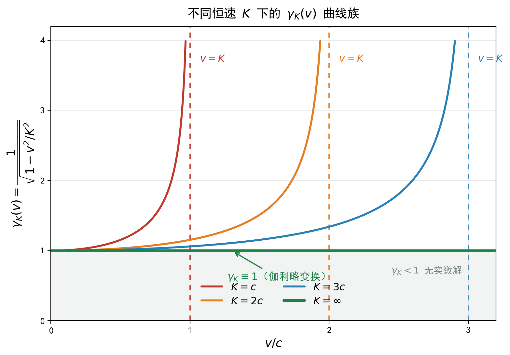

# 恒速群 {#sec-invariant-speed-group}

## 本章的范围 {#sec-isg-scope}

@sec-transform-derivation 章从三条弱前提出发，同时导出了伽利略变换与洛伦兹变换。本章保留那套推导的全部算式，但更换其**解读方式**：把两条变换不看作两个并列的理论，而看作**同一个参数化群族的两个端点**。

## 两种解读方式 {#sec-isg-two-views}

### 原解读

存在不变对象。取“存在不变时间”得伽利略变换；取”存在不变速度 $c$“得洛伦兹变换。

### 新解读

存在恒速 $K$（$K$ 为待定参数）。由此得一个参数化的群族。取 $K$ 有限，得洛伦兹型变换；取 $K=\infty$，得伽利略变换。

### 差在哪里

两种解读的算式**完全相同**，差别只在于：**“不变时间”是一条独立公设，还是 $K=\infty$ 的推论单参数族**

新解读取消了这一冲突：**唯一公设是”存在恒速 $K$“，$K$ 是参数；$K=\infty$ 时，不变时间作为极限性质自动出现。**

这是本章要落笔的第一条：

::: {#prp-isg-one-param}

## 单参数族

在下述公设 (A1)—(A4) 下，变换构成以 $K\in(0,\infty]$ 为参数的群族 $G_K$；$t'=t$（不变时间）是 $K=\infty$ 情形的推论。
:::

## 公设 {#sec-isg-axioms}

**(A1) 线性性。** 两个惯性系之间的坐标变换是线性的。

**(A2) 空间各向同性。** 空间旋转不改变变换的形式；特别地，沿 $+x$ 方向速度为 $v$ 的变换与沿 $-x$ 方向速度为 $v$ 的变换之间由空间反射联系。

**(A3) 群结构。** 变换的集合对复合封闭，含恒等元，每个元素可逆。

**(A4) 存在恒速 $K$。** 存在常数 $K>0$，使得：若某物在 $S$ 系中沿 $x$ 方向速度为 $K$，则其在 $S'$ 系中沿 $x'$ 方向速度亦为 $K$。

**说明**：本章不预设 $K$ 的具体数值。$K$ 是一个待定参数，公设 (A4) 只断言其存在。

## 推导 {#sec-isg-derivation}

以下五步与 @sec-transform-derivation 章的推导逐行对应：前三步对应该章的公共约束（约束 1、约束 2），后两步对应该章洛伦兹一支的约束 3L、约束 4L，唯一的差别是把该章的常数 $c$ 换成待定参数 $K$。算式完整重列一遍，是为了让“换解读不换算式”这句话可以逐行核对。

限于 1+1 维（$t,x$）。由 (A1)，变换写成矩阵形式

$$
\begin{pmatrix} t'\\ x' \end{pmatrix}
=
\begin{pmatrix} A & B\\ C & D \end{pmatrix}
\begin{pmatrix} t\\ x \end{pmatrix}
$$ {#eq-isg-mat}

其中 $A,B,C,D$ 为相对速度 $v$ 的函数。以下逐步定出它们。

### 第一步：$S'$ 原点在 $S$ 中的轨迹

$S'$ 的原点满足 $x'=0$。设其在 $S$ 系中速度为 $v$，即 $x=vt$。由 @eq-isg-mat 第二行：

$$
C\,t+D\,(vt)=0\quad\Longrightarrow\quad C=-vD
$$ {#eq-isg-C}

### 第二步：$S$ 原点在 $S'$ 中的轨迹

$S$ 的原点满足 $x=0$。由 (A2)（空间反射对称），其在 $S'$ 系中速度为 $-v$：

$$
x'=-v\,t'
$$ {#eq-isg-S-origin}

把 $x=0$ 代入 @eq-isg-mat：

$$
t'=A\,t,\qquad x'=C\,t
$$

代入 @eq-isg-S-origin：

$$
C\,t=-v\,(A\,t)\quad\Longrightarrow\quad C=-vA
$$ {#eq-isg-C2}

### 第三步：由第一步与第二步得 $A=D$

比较 @eq-isg-C 与 @eq-isg-C2（$v\neq0$ 时）：

$$
-vD=-vA\quad\Longrightarrow\quad D=A
$$ {#eq-isg-AD}

代回 @eq-isg-C：

$$
C=-vA
$$ {#eq-isg-C3}

至此，@eq-isg-mat 化为

$$
t'=A\,(t+\beta x),\qquad x'=A\,(x-vt)
$$ {#eq-isg-form}

其中记 $B=:A\beta$，$\beta$ 为待定函数。

### 第四步：由恒速的存在定 $\beta$

设某物在 $S$ 系中速度为 $K$：$x=Kt$。由 @eq-isg-form：

$$
t'=A\,(t+\beta K t)=A\,t\,(1+\beta K)
$$

$$
x'=A\,(Kt-vt)=A\,t\,(K-v)
$$

由 (A4)，其在 $S'$ 系中速度亦为 $K$：

$$
\frac{x'}{t'}=K
\quad\Longrightarrow\quad
\frac{A\,t\,(K-v)}{A\,t\,(1+\beta K)}=K
$$

消去 $A\,t$（$A\neq0,\ t\neq0$）：

$$
K-v=K\,(1+\beta K)=K+\beta K^{2}
$$

$$
-v=\beta K^{2}
\quad\Longrightarrow\quad
\beta=-\frac{v}{K^{2}}
$$ {#eq-isg-beta}

代回 @eq-isg-form，得变换的**形式**

$$
t'=A(v)\Bigl(t-\frac{v\,x}{K^{2}}\Bigr),\qquad
x'=A(v)\,(x-vt)
$$ {#eq-isg-family}

其中 $A(v)$ 尚未定出，由 (A3)（群结构）确定。

### 第五步：由群结构定 $A(v)$

把 @eq-isg-family 写成矩阵：

$$
\Lambda(v)=A(v)
\begin{pmatrix}
1 & -\dfrac{v}{K^{2}}\\[6pt]
-v & 1
\end{pmatrix}
$$ {#eq-isg-Lambda}

**复合两个变换。** 先算矩阵部分（记 $M(v):=\begin{pmatrix}1&-v/K^{2}\\-v&1\end{pmatrix}$）：

$$
M(v)\,M(u)=
\begin{pmatrix}
1 & -\dfrac{v}{K^{2}}\\[4pt]
-v & 1
\end{pmatrix}
\begin{pmatrix}
1 & -\dfrac{u}{K^{2}}\\[4pt]
-u & 1
\end{pmatrix}
$$

逐项相乘：

$$
=\begin{pmatrix}
1\cdot1+\Bigl(-\dfrac{v}{K^{2}}\Bigr)(-u) &
1\cdot\Bigl(-\dfrac{u}{K^{2}}\Bigr)+\Bigl(-\dfrac{v}{K^{2}}\Bigr)\cdot1\\[10pt]
(-v)\cdot1+1\cdot(-u) &
(-v)\Bigl(-\dfrac{u}{K^{2}}\Bigr)+1\cdot1
\end{pmatrix}
$$

$$
=\begin{pmatrix}
1+\dfrac{uv}{K^{2}} &
-\dfrac{u+v}{K^{2}}\\[10pt]
-(u+v) &
1+\dfrac{uv}{K^{2}}
\end{pmatrix}
=\Bigl(1+\frac{uv}{K^{2}}\Bigr)
\begin{pmatrix}
1 & -\dfrac{w}{K^{2}}\\[6pt]
-w & 1
\end{pmatrix}
$$

其中

$$
w:=\frac{u+v}{1+\dfrac{uv}{K^{2}}}
$$ {#eq-isg-w}

即 $M(v)M(u)=\Bigl(1+\frac{uv}{K^{2}}\Bigr)M(w)$。

由 (A3)，$\Lambda(v)\Lambda(u)$ 必须仍属于此族，即

$$
\Lambda(v)\Lambda(u)=\Lambda(w)
$$

$$
A(v)A(u)\Bigl(1+\frac{uv}{K^{2}}\Bigr)M(w)=A(w)M(w)
$$

比较系数：

$$
A(v)\,A(u)\Bigl(1+\frac{uv}{K^{2}}\Bigr)=A(w)
$$ {#eq-isg-func}

取 $u=-v$，则 $w=0$，且 $A(0)=1$（恒等变换），代入 @eq-isg-func：

$$
A(v)\,A(-v)\Bigl(1-\frac{v^{2}}{K^{2}}\Bigr)=1
$$ {#eq-isg-func2}

由 (A2)（空间反射），$A(-v)=A(v)$，故

$$
A(v)^{2}=\frac{1}{1-\dfrac{v^{2}}{K^{2}}}
\quad\Longrightarrow\quad
A(v)=\frac{1}{\sqrt{1-\dfrac{v^{2}}{K^{2}}}}
$$ {#eq-isg-A}

（取正根，使 $v\to0$ 时 $A\to1$。)

### 结果：恒速群

把 @eq-isg-A 代入 @eq-isg-family，得

$$
\boxed{
t'=\frac{t-\dfrac{v\,x}{K^{2}}}{\sqrt{1-\dfrac{v^{2}}{K^{2}}}},\qquad
x'=\frac{x-vt}{\sqrt{1-\dfrac{v^{2}}{K^{2}}}}}
$$ {#eq-isg-final}

由 @eq-isg-w，相对速度的合成律为

$$
w=\frac{u+v}{1+\dfrac{uv}{K^{2}}}
$$ {#eq-isg-composition}

**@eq-isg-final 只含一个自由参数 $K$。**

## 不变量与群律 {#sec-isg-invariants}

### 不变量随 $K$ 而变

对任意有限 $K$，由 @eq-isg-final 可直接验证二次型

$$
Q_K(t,x):=K^{2}t^{2}-x^{2}
$$

在变换下不变。逐项写出：

$$
Q_K(t',x')
=K^{2}t'^{2}-x'^{2}
=\frac{K^{2}\left(t-\dfrac{vx}{K^{2}}\right)^{2}-(x-vt)^{2}}{1-\dfrac{v^{2}}{K^{2}}}
$$

分子展开（逐项）：

$$
\begin{aligned}
&K^{2}\left(t^{2}-2\frac{vtx}{K^{2}}+\frac{v^{2}x^{2}}{K^{4}}\right)-\left(x^{2}-2vtx+v^{2}t^{2}\right)\\[4pt]
&=\left(K^{2}t^{2}-2vtx+\frac{v^{2}x^{2}}{K^{2}}\right)-x^{2}+2vtx-v^{2}t^{2}\\[4pt]
&=K^{2}t^{2}+\frac{v^{2}x^{2}}{K^{2}}-x^{2}-v^{2}t^{2}\\[4pt]
&=(K^{2}-v^{2})\,t^{2}-\left(1-\frac{v^{2}}{K^{2}}\right)x^{2}\\[4pt]
&=\left(1-\frac{v^{2}}{K^{2}}\right)\left(K^{2}t^{2}-x^{2}\right)
\end{aligned}
$$

代回：

$$
Q_K(t',x')
=\frac{\left(1-\dfrac{v^{2}}{K^{2}}\right)\left(K^{2}t^{2}-x^{2}\right)}{1-\dfrac{v^{2}}{K^{2}}}
=K^{2}t^{2}-x^{2}
=Q_K(t,x)
$$

即 $Q_K$ 不变。

### $K=\infty$ 时的不变量

取 $K\to\infty$，由 @eq-isg-galilei 有 $t'=t$，故任意两事件的时间差满足

$$
\Delta t'=\Delta t
$$

此时不变对象不再是二次型，而是**时间差本身**（以及空间长度 $\lvert\Delta x\rvert$）。

### 两支的不变对象不是同一个东西

| $K$ | 不变对象 | 类型 |
|---|---|---|
| 有限 | $Q_K=K^{2}t^{2}-x^{2}$ | 二次型 |
| $\infty$ | $\Delta t$、$\lvert\Delta x\rvert$ | 一次量 |
| $0$ | Carroll 型 | —— |

**这是两支“底层不同”的精确数学表述**：它们不是同一个不变量的两个取值，而是**不变量的阶不同**——一个是二次型，一个为一次量。有限 $K$ 的二次型在 $K\to\infty$ 时不收敛到 $\Delta t$，而是发散（因为 $K^2t^2$ 项无界）。

### 群律

由 @eq-isg-composition，两个变换的合成对应速度

$$
w=\frac{u+v}{1+\dfrac{uv}{K^{2}}}
$$

且合成后的变换仍在族内（推导见 @sec-isg-derivation 第五步）。恒等元对应 $v=0$，逆元对应 $v\to-v$。故 $G_K$ 对复合封闭，构成群。

**$K$ 与群的关系**：$K$ 是群族的参数，不是群的元素参数。每个 $K$ 值给出一个确定的群 $G_K$；不同 $K$ 值给出不同构的群（$K$ 有限者彼此同构，$K=\infty$ 与 $K=0$ 是参数区间的两个端点）。

### 李代数层面的对照 {#sec-isg-lie}

对 @eq-isg-final 在 $v=0$ 处求导，得 boost 生成元 $B=-\frac{x}{K^{2}}\partial_t-t\,\partial_x$。与两个平移生成元 $H=\partial_t$、$P=\partial_x$ 一起，唯一的非常数结构括号为

$$
[B,H]=P,\qquad [B,P]=\frac{1}{K^{2}}\,H
$$

**$K$ 在李代数中只出现在结构常数 $1/K^{2}$ 的位置上**：$K$ 有限时 $[B,P]\neq0$（庞加莱型），$K=\infty$ 时 $[B,P]=0$（伽利略型）。**两支的李代数不同构**——这是“两支底层不同”在李代数层面的证明，而群收缩就是一句 $1/K^{2}\to0$。逐项推导见 @sec-invariant-speed-field-group 章。

## 参数 $K$ 的取值 {#sec-isg-K}

### $K$ 有限

此时 @eq-isg-final 给出洛伦兹型变换。特取 $K=c$ 时，即狭义相对论中的洛伦兹变换。

**注意**：$c$ 是 $K$ 的一个**取值**，不是 $K$ 本身。在恒速群的框架里，$K=c$ 与 $K=2c$ 或 $K=0.5c$ 在结构上是平权的——它们都给出同构的群，只是单位尺度不同。

### $K=\infty$：伽利略变换

在 @eq-isg-final 中取极限 $K\to\infty$：

$$
\sqrt{1-\frac{v^{2}}{K^{2}}}\longrightarrow 1,\qquad
\frac{v}{K^{2}}\longrightarrow 0
$$

故

$$
t'=t,\qquad x'=x-vt
$$ {#eq-isg-galilei}

**这就是伽利略变换。** 相应地，@eq-isg-composition 变为 $w=u+v$。

**@prp-isg-one-param 的第二部分在此得到验证**：不变时间 $t'=t$ 是 $K=\infty$ 的推论。它是 @eq-isg-final 在这一参数值下的极限形式。

### $K\to0$：Carroll 极限

这是另一个端点。由于 @eq-isg-final 中根号要求 $1-v^{2}/K^{2}>0$，即 $|v|<K$，当 $K\to0$ 时允许的速度范围收缩到 $\{0\}$：变换成为恒等变换。

但存在一个非平凡的极限：重新参数化，令 $v=K^{2}\beta$ 并让 $\beta$ 保持有限，$K\to0$。此时

$$
\frac{v^{2}}{K^{2}}=K^{2}\beta^{2}\longrightarrow0,\qquad
\sqrt{1-\frac{v^{2}}{K^{2}}}\longrightarrow1
$$

$$
\frac{v\,x}{K^{2}}=\frac{K^{2}\beta\,x}{K^{2}}=\beta x,\qquad
vt=K^{2}\beta t\longrightarrow0
$$

代入 @eq-isg-final：

$$
\boxed{t'=t-\beta x,\qquad x'=x}
$$ {#eq-isg-carroll}

**@eq-isg-carroll 是 Carroll 变换**：空间坐标不变，时间坐标依位置平移。

在这个极限下，特征速度趋于零，光锥成为时间轴方向，不同空间点之间不再有传播联系。

**须说明，$K\to\infty$ 与 $K\to0$ 并不对称。** $K\to\infty$ 时，@eq-isg-final 逐项收敛到 @eq-isg-galilei，群的李代数维数不变，是正常的群收缩；而 $K\to0$ 时，原参数化下的式子发散，必须先作 $v=K^{2}\beta$ 的重新参数化，极限才存在，且其不变量的秩更低。

因此，下文把二者并列为“两个端点”，只是排列上的对仗，不表示二者在数学上对称。

### 三个端点并排

| $K$ 的取值 | 变换 | 速度合成 | 特征 |
|---|---|---|---|
| 有限（含 $K=c$） | @eq-isg-final | $w=\dfrac{u+v}{1+\dfrac{uv}{K^{2}}}$ | 不变速度有限，同时性随系改变 |
| $\infty$ | $t'=t,\ x'=x-vt$ | $w=u+v$ | 同时性不随系改变 |
| $0$ | $t'=t-\beta x,\quad x'=x$ | Carroll 型 | 无传播联系（Carroll 极限） |

: 参数 $K$ 的三个端点 {#tbl-isg-ends}

### 函数图像

{#fig-invariant-speed width=86%}

@fig-invariant-speed 的横轴为 $v/c$，纵轴为 $\gamma_K(v)$，三条虚线分别标出三个有限 $K$ 的发散位置 $v=K$。从图中可以直接读出三件事：

1. **$K=\infty$ 是水平线 $\gamma_K\equiv1$**，即伽利略变换；
2. **$K$ 有限的曲线在 $v\to K$ 处发散**，且 $K$ 越小，发散位置越靠左；
3. **$K$ 越小，曲线起翘越早**——即偏离伽利略行为的程度在更低的速度上就显现出来；反之 $K$ 越大，曲线在越宽的速度范围内贴近 $1$。

**须说明**：该图只是 @eq-isg-final 的图像，不含超出该式的内容；它给出的是 $\gamma$ 随 $v/K$ 的变化，不涉及 $K$ 应当取什么值。

## 恒速群与狭义洛伦兹变换的关系 {#sec-isg-not-same}

### 形状相同，含义不同

@eq-isg-final 在 $K=c$ 时，与狭义相对论中的洛伦兹变换**公式形状相同**。但二者不是同一个数学对象：

| | 恒速群 $G_K$ | 狭义洛伦兹变换 |
|---|---|---|
| 对象 | 一族群，以 $K$ 为参数 | 一个群，$K$ 取定值 $c$ |
| $K$ 的地位 | 自由参数，取值待定 | 固定为 $c$ |
| $\infty$ 的处理 | $K=\infty$ 是真取的极限 | $c$ 有限，不取 $\infty$ |
| $t$ 的地位 | 随 $K$ 而定：$K<\infty$ 时随系变，$K=\infty$ 时不变 | 随系改变 |

**恒速群是一个族，狭义洛伦兹变换是这个族中的一个点。** 取 $K=c$ 得到那个点；取 $K=\infty$ 得到另一个点。

### 为什么不能说”恒速群就是洛伦兹变换“

因为：

1. **族不等于它的一个元素。** $G_K$ 在 $K=c$ 处的值才是狭义洛伦兹变换。
2. **$K=\infty$ 是真的取 $\infty$**，不是“把 $c$ 当作无穷”。这是两个完全不同的操作：一个是参数取极限，一个是把一个有限常数近似看作无穷。前者改变群的结构（庞加莱群收缩为伽利略群），后者只是一种数值近似。
3. **因此恒速群同时包含了两种时空结构的可能**，它在 $K$ 未定时，既不是纯粹的相对时空，也不是纯粹的绝对时空；选定 $K$ 之后才取其中一种形式。

**这就是本章的核心命题：**

::: {#prp-isg-superposition}

## 恒速群是族，不是族中的一点

恒速群 $G_K$ 是一个以 $K\in(0,\infty]$ 为参数的群族，其中：

- $K$ 有限（含 $K=c$）对应相对时空结构；
- $K=\infty$ 对应绝对时空结构（同时性不随系改变）；
- $K\to0$ 对应 Carroll 结构。

在 $K$ 未取定之前，族本身不偏向其中任何一种
:::

## 与其他结构的对接 {#sec-isg-others}

### 与波动力学方程

同一族群的表示论给出不同协变性要求的方程：

| $K$ | 协变性要求 | 相应的一阶／二阶方程 |
|---|---|---|
| $K=c$ | 洛伦兹协变 | 克莱因–戈登方程、狄拉克方程 |
| $K=\infty$ | 伽利略协变 | 薛定谔方程（严格表述用 Bargmann 群，即伽利略群的中央扩张）及 Lévy-Leblond 旋量方程 |

**所以：量子力学的两类动力学方程可以纳入同一个参数化框架**，分别对应 $K=\infty$ 与 $K=c$ 两端，并通过群收缩相联系。

### 与引力理论

| $K$ | 几何结构 |
|---|---|
| $K=c$ | 洛伦兹几何，爱因斯坦场方程 |
| $K=\infty$ | Newton–Cartan 几何（度规不可逆：时间一形式与空间度规分离） |

两者同样由收缩相联系。$K=\infty$ 一端并非空缺，而是有对应的几何构造。

### 与黑洞：不兼容

黑洞的现代定义是**事件视界**：时空因果结构中的单向膜，即光锥向内倾斜到不存在任何向外的未来方向的区域。

这个定义**直接依赖特征速度有限**：

- 逃逸速度 $v_{\text{esc}}=\sqrt{2GM/r}$；
- 令 $v_{\text{esc}}=K$，得临界半径 $r=2GM/K^{2}$；
- 当 $K=c$ 时，即 $r_s=2GM/c^{2}$，其内侧为事件视界。

**取 $K=\infty$ 时**：

- 允许的速度无上限（$|v|<K\to\infty$），任何有限速度都能逃逸；
- 光锥不再界定因果可达范围；
- **不存在单向膜，因而不存在事件视界**。

需要区分两层：

| 黑洞的定义 | 与 $K=\infty$ 的关系 |
|---|---|
| 逃逸速度 $\ge c$ 的天体（暗星） | **可以存在**（若另行规定光以有限速率 $c$ 传播） |
| 事件视界（因果结构中的单向膜） | **不存在** |

前者的障碍是**动力学**的（光跑得不够快，被引力拉回，像抛出的球）；后者的障碍是**因果结构**的（时空本身不提供向外的未来方向）。**$K=\infty$ 的框架只容得下前者。**

（顺带一句：这正是 @sec-two-source-field 章公设 A1+A2 所处的情形——坐标变换取伽利略式（$K=\infty$），同时另行规定光在静系以有限速率 $c$ 传播。）

### 汇总

| $K$ | 协变性要求 | 波动力学 | 引力几何 | 事件视界 |
|---|---|---|---|---|
| $c$ | 洛伦兹协变 | 克莱因–戈登、狄拉克 | 洛伦兹几何（GR） | 有（$r_s=2GM/c^{2}$） |
| 有限且 $\neq c$ | 以 $K$ 为不变速度的协变 | 同族方程（$c$ 替换为 $K$） | 同族几何 | 有（$r=2GM/K^{2}$） |
| $\infty$ | 伽利略协变 | 薛定谔（Bargmann 群） | Newton–Cartan | **无** |
| $0$ | Carroll 型 | 未列出 | Carroll 型几何 | 无 |

: $K$ 的取值与具体结构的对照 {#tbl-isg-applications}

## 与已有分类的关系 {#sec-isg-known}

以 $K$ 为参数的运动学群不是本书提出的；它在二十世纪的运动学群分类中占一个确定的位置。本节把**借用的**与**新增的**分开写，便于逐条核对。

### 已经有的部分

运动学群在相对性原理、空间各向同性、并要求宇称与时间反演为自同构等前提下，已被分类为 de Sitter 群及其旋转不变的收缩；除 de Sitter、Poincaré、Galilei 之外，该分类还给出“静态群”与非相对论宇宙群两支 [@bacrylevyleblond1968]。本书的 $G_K$ 正是 Poincaré 型一支**带上一个未定参数 $K$** 的写法：$K=c$ 落在该分类的 Poincaré 点，$K\to\infty$ 与 $K\to0$ 落在它的收缩图里。同一族也可由互易原理刻画 [@berzigorini1969]。

从一个化作另一个的操作本身是 Inönü–Wigner 群收缩：Poincaré $\to$ Galilei 就是原文给出的例子 [@inonuwigner1953]；本书只是把同一个收缩写成参数 $K\to\infty$，并保留 $K$ 未定时的一整族。$K\to0$（Carroll 型）端点的原始出处见 [@levyleblond1965carroll]。$K=\infty$ 一端与 Newton–Cartan 几何、Bargmann 结构的对应关系见 [@duval1985]；伽利略群的射线表示与质量作为中央荷的部分见 [@bargmann1954]，@sec-quantum-phase 章会把它整条推导出来。

### 本书新增的部分

以下四条不在上面这些文献的结论里。前两条改变了对 $K$ 的**处置**，后两条是处置改变之后得到的结论。

| 内容 | 地位 | 出处 |
|---|---|---|
| 以 $K$ 为参数的群族；$K=c$、$K=\infty$、$K\to0$ 三个端点 | 已有 | [@bacrylevyleblond1968] |
| Poincaré $\to$ Galilei 的群收缩 | 已有 | [@inonuwigner1953] |
| Carroll 端点 $K\to0$ | 已有 | [@levyleblond1965carroll] |
| $K=\infty$ 端的 Newton–Cartan 与 Bargmann 结构 | 已有 | [@duval1985] |
| **把 $K$ 由常数升级为时空上的场 $K(p)$；逐点的 $G_{K(p)}$ 仍成群，跨点复合则不成立** | 本书 | @sec-invariant-speed-field-group 章 |
| **$\vec\nabla K\neq0$ 时非相对论极限不存在**（相位抽取的残留项按 $K_0^{2}$ 发散且非 Hermitian，幺正性与概率守恒不再成立） | 本书 | @sec-invariant-speed-dynamics |
| **协变性不蕴含读数诠释**（同二次型在两支下形式不变，读数诠释不同） | 本书 | @sec-twins-comparison |
| 对称双生子的逐段线长核算与“线长 / 配对”两层的分离 | 本书 | @sec-twins-comparison、@sec-twins-noninertial 章 |

关键在于中间那条分界线。上述分类定理的前提里含有**齐次性**——参数是常数，群在整个时空上作用；一旦 $K$ 逐点取值，这一条前提不再满足，于是“构成群”这件事本身成为逐点成立、跨点不成立。由此产生的结果（非相对论极限在 $\vec\nabla K\neq0$ 处不存在）与该分类并不冲突：它落在那些定理的**前提之外**，而不是它们的结论之内。

把两者分开写不改变任何一条推导；它只让读者可以把借来的部分直接对照原文核对，把剩下的部分当成需要独立检验的断言。

## 术语说明 {#sec-isg-terms}

| 术语 | 本章中的含义 |
|---|---|
| 恒速 $K$ | 由公设引入的不变速度参数，$K\in(0,\infty]$；本章为常数（场的情形见 @sec-invariant-speed-field-group） |
| 恒速群 $G_K$ | 以 $K$ 为参数的一族群；同一组公式，不同 $K$ 给出不同的群律 |
| 群收缩 | $K\to\infty$ 或 $K\to0$ 的极限操作（Inönü–Wigner 意义），见 @sec-isg-known |
| Carroll 结构 | $K\to0$ 端的结构：零锥成为 $t=$ 常数 |
| Newton–Cartan 几何 | $K=\infty$ 端对应的度规形式：度规不可逆，时间一形式（秩 $1$）与空间度规（秩 $3$）分为两个对象 |
| Bargmann 群 | 伽利略群的中央扩张，多一个中心坐标；@sec-quantum-phase 章由其导出质量 |
| 世界线长度（线长）$s[\gamma]$ | 沿曲线由线元积分得到的量；它不随坐标描述改变（见 @prp-tc-covariance）。$K$ 有限时被积量为 $\sqrt{\mathrm{d}t^{2}-\mathrm{d}x^{2}/K^{2}}$，结果依赖路径形状；$K=\infty$ 时被积量为 $\mathrm{d}t$，积分等于端点时间之差，与路径无关（见 @sec-tc-reading-integral） |

## 结论 {#sec-isg-conclusion}

| 命题 | 依据 |
|---|---|
| 变换构成以 $K$ 为参数的群族 | A1—A4（@eq-isg-final） |
| $t'=t$ 是 $K=\infty$ 的推论 | @eq-isg-galilei |
| $K=\infty$ 是真取 $\infty$，不是拿 $c$ 充当无穷 | $\gamma\to1$ 与 $v/K^{2}\to0$ 同时成立 |
| 恒速群是族，狭义洛伦兹变换是族中一点 | @prp-isg-superposition |
| 量子力学的两类方程分别对应 $K=\infty$ 与 $K=c$ | 群表示与收缩 |
| $K=\infty$ 下无事件视界 | 光锥不界定因果范围，无单向膜 |

: 各命题及其依据 {#tbl-isg-conclusion}

**一句话**：把”存在恒速 $K$“作为唯一公设，得到的不是某一种时空结构，而是**一族时空结构**；伽利略变换是这族在 $K=\infty$ 处的极限（不变时间随之作为推论出现），狭义洛伦兹变换是 $K=c$ 处的取值。族本身在 $K$ 未定时不偏向任何一端。
