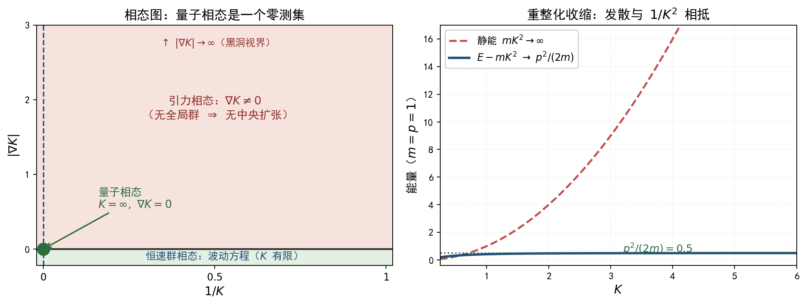

# 量子相态的代数生成 {#sec-quantum-phase}

## 本章的范围 {#sec-qp-scope}

**一句话**：取定相态参数（$K\to\infty$ 且 $\vec\nabla K=0$），从恒速群 $G_K$ 出发，经李代数收缩、射影表示与中央扩张，把量子力学的核心骨架（质量作为中央荷、$[q_i,p_j]=i\hbar\delta_{ij}$、薛定谔方程）逐项推导出来；最后用反证法证明这个骨架在 $\vec\nabla K\neq0$ 处不能存在。

**推导链条**：

$$
\begin{aligned}
\text{恒速群 } G_K\ \longrightarrow\ &\underbrace{K\to\infty,\ \vec\nabla K=0}_{\text{相态参数}}
\ \longrightarrow\ \text{伽利略群}\ \longrightarrow\ \text{射影表示 / 中央扩张}\\[4pt]
\longrightarrow\ &\text{Bargmann 代数}\ \longrightarrow\ \text{波动力学}\ \longrightarrow\ \text{量子力学骨架}
\end{aligned}
$$

### 三条禁令（本章的自我约束）

1. **不出现弯曲度规**。本章全程 $K$ 为常数，只用恒速群的不变二次型 $Q_K=K^{2}t^{2}-\lvert\mathbf{x}\rvert^{2}$ 及其对偶算符；不用任何 $g_{\mu\nu}(x)$、不用 Christoffel 符号、不做度规量子化。
2. **不出现引力**。$\vec\nabla K\neq0$ 只在第四部分作为**反证法的假设**出现，且立即导致矛盾。
3. **不出现"量子引力"**。本章不构造任何"引力的量子理论"。第四部分的结论恰恰是：那样的对象在本框架内没有定义域。这一结论的范围限定见 @sec-qp-scope-limit。

### 禁止预设清单

以下内容在本章出现的**位置**被严格规定，此前不得使用：

| 对象 | 首次出现 |
|---|---|
| 薛定谔方程 | @eq-qp-schrodinger（第三部分末尾） |
| 对易关系 $[q_i,p_j]=i\hbar\delta_{ij}$ | @eq-qp-ccr（第二部分末尾） |
| 德布罗意关系 $E=\hbar\omega$、$p=\hbar k$ | @eq-qp-debroglie（第三部分） |
| 质量 $m$ | @eq-qp-m2（作为质量壳参数引入，先于一切解释） |

第一、二部分**不预设**薛定谔方程与对易关系；它们是被推出来的，不是被写下来的。

### 记号与约定

- $K$：恒速场（本章为常数）；$K^{2}=F$。
- 生成元：**Hermitian** 算符 $\hat H$（时间平移）、$\hat P_i$（空间平移）、$\hat B_i$（boost）、$\hat J_i$（转动）、$\hat M$（中央荷）。位置算符记作 $\hat q_i$，以免与 $K$ 混淆。
- 向量场 $X$ 与其 Hermitian 算符的对应：$[\hat X,\hat Y]=i\hbar\,[X,Y]_{\text{vf}}$。据此 $\hat P_i=-i\hbar\partial_i$、$\hat H=i\hbar\partial_t$。
- $\hbar$ 的地位：量子化映射 $[\ ,\ ]=i\hbar\{\ ,\ \}$ 的尺度，是经验常数；本章**不声称**推导它的数值。本章推导的是 $m$ 的地位。
- 符号核验脚本 `images/quantum-phase-algebra.py`，输出见 `images/qp.out`；本章每个闭式后标注核验结果。

## 第一部分　相态参数：$K\to\infty$ 与 $\vec\nabla K=0$ {#sec-qp-part1}

### 恒速群的 $K\to\infty$ 极限

第 @sec-invariant-speed-group 章的恒速群 $G_K$（取 $1+1$ 维，空间部分同理）：

$$
t'=\frac{t-\dfrac{vx}{K^{2}}}{\sqrt{1-\dfrac{v^{2}}{K^{2}}}},\qquad
x'=\frac{x-vt}{\sqrt{1-\dfrac{v^{2}}{K^{2}}}}
$$ {#eq-qp-GK}

::: {#prp-qp-galileo}
## $K\to\infty$ 逐项给出伽利略变换
在 @eq-qp-GK 中令 $K\to\infty$（$v$ 固定），逐项取极限得

$$
t'=t,\qquad x'=x-vt
$$

即伽利略变换。
:::

**证明**：$\sqrt{1-v^{2}/K^{2}}\to1$；$\dfrac{vx}{K^{2}}\to0$。故 $t'\to t$、$x'\to x-vt$。

符号核验（向量场层面）：boost 生成元 $B=-\dfrac{x}{K^{2}}\partial_t-t\partial_x$ 在 $K\to\infty$ 下给出 $(0,-t)$，即 $-t\partial_x$；且 $[B,P]$ 的极限为 $(0,0)$。输出：

```
K->oo 后 boost 生成元 B = (0, -t)
K->oo 后 [B,P] = (0, 0)
```

### 不变量的退化：从 $1$ 个到 $2$ 个

恒速群的不变量为

$$
Q_K=K^{2}(\Delta t)^{2}-\lvert\Delta\mathbf{x}\rvert^{2}
$$

两边除以 $K^{2}$ 并取 $K\to\infty$：

$$
\frac{Q_K}{K^{2}}=(\Delta t)^{2}-\frac{\lvert\Delta\mathbf{x}\rvert^{2}}{K^{2}}\ \longrightarrow\ (\Delta t)^{2}
$$

所以极限结构不再由**一个**二次型给出，而由**两个**独立的不变量给出：

$$
\boxed{\Delta t\ \text{不变},\qquad \lvert\Delta\mathbf{x}\rvert\ \text{不变}}
$$ {#eq-qp-two-invariants}

**这就是"绝对时间 + 绝对空间"的严格含义**：时空不再是带单一度规的整体，而是 $\mathbb{R}\times\mathbb{R}^{3}$ 上分别带时间尺度与欧氏尺度的一对结构。@eq-qp-two-invariants 是本章全部推导的几何输入。

### 零锥的退化

零锥 $\lvert\mathrm{d}\mathbf{x}/\mathrm{d}t\rvert=K$ 在 $K\to\infty$ 时张开为

$$
\lvert\mathrm{d}\mathbf{x}/\mathrm{d}t\rvert=\infty\quad\Longleftrightarrow\quad t=\text{常数}
$$

即：**零曲面退化为同时超曲面**，信号速度无上界。这正是伽利略时空"瞬时传播"的严格表述，也是后面非相对论极限中"不存在不变波速"的几何根源。

### $\vec\nabla K=0$ 不是简化假设，而是前提

第 @sec-invariant-speed-field-group 章已证明：当 $K$ 随点变化时，逐点的 $G_{K(p)}$ 各自成群，但**跨点的复合不再是群运算**——复合多出 $\propto\partial_\mu K/K$ 的项。

**本章第二部分要做的事是"表示论"**：表示论的对象是**一个群**。因此：

$$
\vec\nabla K\neq0\ \Longrightarrow\ \text{不存在可供表示的全局群}\ \Longrightarrow\ \text{第二部分全部失效}
$$

这不是"为了算得动而设的简化"，而是**定义域条件**：量子相态的定义本身就包含 $\vec\nabla K=0$。第四部分会把这一点写成反证法的第一层。

### 不变算符与色散关系

由不变量 $Q_K$ 的对偶（逆）二次型 $\mathrm{diag}(K^{-2},-1,-1,-1)$，恒速群的不变算符为

$$
\Box_K:=\frac{1}{K^{2}}\partial_t^{2}-\nabla^{2}
$$ {#eq-qp-box}

（$K$ 为常数，故这是**平直**的常系数算符；本章不涉及任何变系数或弯曲版本。）

取 $\psi\sim e^{i(\mathbf{k}\cdot\mathbf{x}-\omega t)}$，代入 $(\Box_K+\text{质量项})\psi=0$：

$$
-\frac{\omega^{2}}{K^{2}}+\lvert\mathbf{k}\rvert^{2}=-\frac{m^{2}K^{2}}{\hbar^{2}}
$$

以 $E=\hbar\omega$、$p=\hbar\lvert\mathbf{k}\rvert$ 写出，得**恒速群的质量壳关系**：

$$
\boxed{\frac{E^{2}}{K^{2}}-\lvert\mathbf{p}\rvert^{2}=m^{2}K^{2}}
\quad\Longleftrightarrow\quad
E^{2}=m^{2}K^{4}+\lvert\mathbf{p}\rvert^{2}K^{2}
$$ {#eq-qp-m2}

@eq-qp-m2 中的 $m$ 是质量壳参数；它的代数身份（本征值还是中央荷）由第二部分定出。

## 第二部分　伽利略代数与中央扩张 {#sec-qp-part2}

### 恒速代数的收缩

恒速群的生成元（向量场）：$H=\partial_t$、$P_i=\partial_i$、$B_i=-\dfrac{x_i}{K^{2}}\partial_t-t\partial_i$。符号核验给出

$$
[B_i,P_j]=\frac{\delta_{ij}}{K^{2}}H,\qquad [B_i,H]=P_i,\qquad [H,P_i]=0
$$

换成 Hermitian 算符（$[\hat X,\hat Y]=i\hbar[X,Y]_{\text{vf}}$）：

$$
[\hat B_i,\hat P_j]=\frac{i\hbar}{K^{2}}\delta_{ij}\hat H,\qquad
[\hat B_i,\hat H]=i\hbar\hat P_i,\qquad
[\hat H,\hat P_i]=[\hat P_i,\hat P_j]=[\hat B_i,\hat B_j]=0
$$ {#eq-qp-algK}

全部结构常数中 $K$ 只以 $1/K^{2}$ 出现（第 @sec-invariant-speed-group 章的结论）。

::: {#thm-qp-contraction}
## 朴素收缩
若在 @eq-qp-algK 中令 $K\to\infty$ 而保持 $\hat H$ 有限，则

$$
[\hat B_i,\hat P_j]\to0
$$

所得的正是**无中央扩张的伽利略代数**（$10$ 个生成元 $\hat H,\hat P_i,\hat B_i,\hat J_i$）：

$$
[\hat B_i,\hat H]=i\hbar\hat P_i,\quad [\hat B_i,\hat P_j]=0,\quad
[\hat H,\hat P_i]=0,\quad [\hat P_i,\hat P_j]=0,\quad [\hat B_i,\hat B_j]=0
$$ {#eq-qp-gal}
:::

**但这是一个陷阱。** 在质量壳 @eq-qp-m2 上，$\hat H$ 的谱为

$$
E=\sqrt{m^{2}K^{4}+\lvert\mathbf{p}\rvert^{2}K^{2}}
=mK^{2}\sqrt{1+\frac{\lvert\mathbf{p}\rvert^{2}}{m^{2}K^{2}}}
=mK^{2}+\frac{\lvert\mathbf{p}\rvert^{2}}{2m}+O\!\left(\frac{1}{K^{2}}\right)
$$ {#eq-qp-expE}

即 $\hat H$ **不保持有限**：$\hat H/K^{2}\to m\cdot\mathbf 1$。$\hat H$ 发散而结构常数 $1/K^{2}$ 消失，两者相乘留下有限的非零极限。这就是 Inönü–Wigner 收缩中的**重整化收缩**。

::: {#thm-qp-central}
## 中央荷的诞生
在质量壳 @eq-qp-m2 的表示上作重整化收缩

$$
\hat B_i\ \text{不变},\qquad \hat P_i\ \text{不变},\qquad
\hat H_{\text{nr}}:=\hat H-mK^{2}\mathbf 1
$$

则 $K\to\infty$ 时

$$
[\hat B_i,\hat P_j]=\frac{i\hbar}{K^{2}}\delta_{ij}\bigl(mK^{2}\mathbf 1+\hat H_{\text{nr}}\bigr)
=i\hbar\delta_{ij}m\,\mathbf 1+\frac{i\hbar}{K^{2}}\delta_{ij}\hat H_{\text{nr}}
\ \longrightarrow\ \boxed{i\hbar\delta_{ij}\hat M},\qquad \hat M:=m\,\mathbf 1
$$

同时

$$
[\hat B_i,\hat H_{\text{nr}}]=[\hat B_i,\hat H]=i\hbar\hat P_i,\qquad
[\hat P_i,\hat H_{\text{nr}}]=0
$$

所得的代数**不是** @eq-qp-gal，而是带中央扩张的 **Bargmann 代数**。
:::

**证明**：第一式用 $\hat H=mK^{2}\mathbf 1+\hat H_{\text{nr}}$ 代入 @eq-qp-algK；第二式用 $[mK^{2}\mathbf 1,\cdot]=0$。极限中 $\hat H_{\text{nr}}/K^{2}\to0$。

**收敛核验**：由 @eq-qp-m2 与 $\hat H=mK^{2}+\hat H_{\text{nr}}$，

$$
\frac{\hat H^{2}}{K^{2}}-\lvert\hat{\mathbf P}\rvert^{2}=m^{2}K^{2}
\ \Longrightarrow\ 2m\hat H_{\text{nr}}-\lvert\hat{\mathbf P}\rvert^{2}+\frac{\hat H_{\text{nr}}^{2}}{K^{2}}=0
\ \xrightarrow{K\to\infty}\ \boxed{\hat H_{\text{nr}}=\frac{\lvert\hat{\mathbf P}\rvert^{2}}{2m}}
$$ {#eq-qp-casimir-contract}

符号核验输出：`展开 E^2/K^2 - p^2 - m^2K^2 = E_nr**2/K**2 + 2*E_nr*m - p**2`，极限为 `2*E_nr*m - p**2`。

### 经典实现已经带着中央荷

在相空间 $(\mathbf q,\mathbf p)$ 上，伽利略 boost 要求

$$
\delta q_i=v_i t,\qquad \delta p_i=m v_i
$$

由泊松括号生成：$\delta f=\{\mathbf v\cdot\mathbf K,f\}$，解出

$$
\mathbf K=m\mathbf q-t\mathbf p
$$ {#eq-qp-Kclass}

（校核：$\{v_jK_j,q_i\}=v_j\{mq_j-tp_j,q_i\}=tv_i$；$\{v_jK_j,p_i\}=v_j m\delta_{ji}=mv_i$。）

于是

$$
\boxed{\{K_i,p_j\}=m\,\delta_{ij}\neq0}
$$ {#eq-qp-poisson}

**这是关键的一步**：伽利略群在**经典**相空间上的实现，其 boost 生成元与动量的括号**已经非零**，数值就是 $m$。换言之，**经典理论早就活在中央扩张里**，只是没有人这样叫它。量子化映射 $[\ ,\ ]=i\hbar\{\ ,\ \}$ 于是直接给出

$$
[\hat B_i,\hat P_j]=i\hbar\delta_{ij}m\,\mathbf 1
$$

与 @thm-qp-central 完全一致。两条独立的路（代数收缩 / 经典实现）给出同一个中央荷。

### 中央扩张的分类：唯一性

::: {#thm-qp-extension}
## 伽利略代数的中央扩张唯一
设 $\mathfrak g$ 为 @eq-qp-gal 的伽利略代数（生成元 $\hat H,\hat P_i,\hat B_i,\hat J_i$，共 $10$ 个），其最一般的（一维）中央扩张为

$$
[X,Y]_{\text{ext}}=[X,Y]+c(X,Y)\,\hat M,\qquad [\hat M,\cdot]=0
$$

其中 $c$ 为反对称双线性形。则 Jacobi 恒等式与"模去上边界"之后，解空间为

$$
\boxed{H^{2}(\mathfrak g,\mathbb R)=\mathbb R\ (\text{一维})}
$$

其非平凡代表元唯一（差一个常数倍）：

$$
c(\hat B_i,\hat P_j)=\delta_{ij},\qquad \text{其余分量}=0
$$ {#eq-qp-cocycle}
:::

**证明（分四步）**：

**第一步（转动部分可清空）**。转动子代数 $\mathfrak{so}(3)$ 半单，由 Whitehead 引理 $H^{2}(\mathfrak{so}(3),\mathbb R)=0$；又 $\mathfrak{so}(3)$ 紧致，可对上闭链作平均而不改变其上同调类。故可取 $c$ 为 $\mathfrak{so}(3)$ 不变的，于是 $c$ 的分量只能由不变张量 $\delta_{ij}$、$\varepsilon_{ijk}$ 构造。

**第二步（逐分量消去）**。$c$ 反对称，且取值是一维中心（无指标），故：

| 分量 | 可用的不变张量 | 结论 |
|---|---|---|
| $c(\hat P_i,\hat P_j)$、$c(\hat B_i,\hat B_j)$ | 反对称 $2$ 阶不变张量不存在（$\delta$ 对称、$\varepsilon$ 需 $3$ 个指标） | $=0$ |
| $c(\hat H,\hat P_i)$、$c(\hat H,\hat B_i)$ | 不变矢量不存在 | $=0$ |
| $c(\hat H,\hat J_i)=\eta$ | 标量，暂留 | 待定 |
| $c(\hat J_i,\hat P_j)=\alpha\delta_{ij}$ | $\delta$ 不变，暂留 | 待定 |
| $c(\hat J_i,\hat B_j)=\gamma\delta_{ij}$ | 同上 | 待定 |
| $c(\hat B_i,\hat P_j)=\beta\delta_{ij}$ | 同上，暂留 | 待定 |

**第三步（Jacobi 杀死 $\eta,\alpha,\gamma$）**。

- 对三元组 $(\hat H,\hat J_i,\hat J_j)$：
  $$
  [\hat H,[\hat J_i,\hat J_j]]+[\hat J_i,[\hat J_j,\hat H]]+[\hat J_j,[\hat H,\hat J_i]]
  =\varepsilon_{ijk}[\hat H,\hat J_k]=\varepsilon_{ijk}\eta\,\hat M=0\ \Longrightarrow\ \eta=0
  $$
- 对 $(\hat J_i,\hat J_j,\hat P_k)$：逐项展开（$\varepsilon$ 收缩恒等式 $\varepsilon_{jkl}\varepsilon_{ilm}-\varepsilon_{ikl}\varepsilon_{jlm}+\varepsilon_{ijl}\varepsilon_{klm}=0$）后 $\hat P$ 项自动抵消，$\hat M$ 项给出
  $$
  \alpha\bigl(\varepsilon_{jki}-\varepsilon_{ikj}-\varepsilon_{ijk}\bigr)\hat M=\alpha\,\varepsilon_{ijk}\hat M=0\ \Longrightarrow\ \alpha=0
  $$
- 同理对 $(\hat J_i,\hat J_j,\hat B_k)$ 得 $\gamma\,\varepsilon_{ijk}=0\Longrightarrow\gamma=0$。

**第四步（$\beta$ 自由且非上边界）**。其余 Jacobi 恒等式对 $\beta$ 无约束：

- $(\hat H,\hat B_i,\hat P_j)$：$[\hat H,\beta\delta_{ij}\hat M]+[\hat B_i,0]+[\hat P_j,-i\hbar\hat P_i]=0$；
- $(\hat B_i,\hat B_j,\hat P_l)$、$(\hat B_i,\hat P_j,\hat P_l)$：$\hat M$ 为中心，全为零。

上边界形如 $c_f(X,Y)=f([X,Y])$（$f$ 为线性泛函）。但 $[\hat B_i,\hat P_j]=0$，故对任何 $f$ 都有 $c_f(\hat B_i,\hat P_j)=f(0)=0\neq\beta\delta_{ij}$。故 $\beta\neq0$ 时该上闭链**不是上边界**，上同调类非平凡。

**符号核验**（$10$ 生成元、$45$ 个待定分量、$120$ 个 Jacobi 方程，逐一解出）：

```
未扩张伽利略代数 Jacobi 自检: True
2-闭上链空间维数: 10
2-上边界空间维数: 9
H^2(galilei, R) 的维数 = 1
代表元 c(P_i,K_j)=delta_ij 满足全部 Jacobi: True
上边界在 (K_i,P_j) 分量上的值 [K_i,P_j] = {} -> 恒为 0，故代表元非上边界
```

**结论**：伽利略代数的中央扩张不是可以随意添加的附加结构，而是**唯一的、且非加不可的**（前提是质量非零）。

### 射影表示与 Bargmann 群

#### 为什么必须射影

**理由一（量子力学的基本结构）**。物理态是 Hilbert 空间中的**射线**（Born 规则只依赖 $\lvert\psi\rvert^{2}$，全局相位不可观测）。由 Wigner 定理，对称群在射线上实现为酉（或反酉）变换，故只要求

$$
U(g_2)U(g_1)=\omega(g_2,g_1)\,U(g_2g_1),\qquad \lvert\omega\rvert=1
$$ {#eq-qp-projective}

即**射影表示**。上同调分类（@thm-qp-extension）告诉我们：$\omega$ 的非平凡部分只有一个参数。

**理由二（真表示不够用）**。若坚持 $\omega\equiv1$（真表示），则中央荷 $\hat M=0$，后果有三（见 @sec-qp-ccr）：位置算符无从定义；$\hat H_{\text{nr}}=\lvert\hat{\mathbf P}\rvert^{2}/2\hat M$ 无意义；且波方程在 boost 下不协变——符号核验给出：去掉相位后

$$
i\hbar\partial_t\Phi+\frac{\hbar^{2}}{2m}\partial_x^{2}\Phi
=i\hbar\partial_t\psi+\frac{\hbar^{2}}{2m}\partial_x^{2}\psi-i\hbar v\,\partial_x\psi
$$

残留项 $-i\hbar v\,\partial_x\psi\neq0$（`残留 = -I*V*hbar*psi_X`）。**故相位不是装饰，而是协变性的必要条件。**

**理由三（经典理论已经如此）**。@eq-qp-poisson 表明经典实现本身就带 $m$；量子化不能把一个非零的括号变成零。

#### 显式的上闭链

伽利略群元素 $g=(b,\mathbf a,\mathbf v,R)$，作用为

$$
\mathbf x'=R\mathbf x+\mathbf v t+\mathbf a,\qquad t'=t+b
$$

设波函数按

$$
(U(g)\psi)(\mathbf x',t')=\exp\!\left[\frac{i}{\hbar}m\Bigl(\mathbf v\cdot R\mathbf x+\frac{1}{2}\lvert\mathbf v\rvert^{2}t\Bigr)\right]\psi(\mathbf x,t)
$$ {#eq-qp-Ug}

（$R=1$、$\mathbf a=0$、$b=0$ 时即 $\psi'(\mathbf x,t)=e^{\frac{i}{\hbar}m(\mathbf v\cdot\mathbf x-\frac12 v^{2}t)}\psi(\mathbf x-\mathbf v t,t)$，见 @eq-qp-boost。）

**复合计算**。连续作用 $g_1$、$g_2$ 后总相位为

$$
\frac{m}{\hbar}\Bigl[\mathbf v_2\cdot R_2\mathbf x_1+\tfrac12\lvert\mathbf v_2\rvert^{2}t_1
+\mathbf v_1\cdot R_1\mathbf x+\tfrac12\lvert\mathbf v_1\rvert^{2}t\Bigr]
$$

代入 $\mathbf x_1=R_1\mathbf x+\mathbf v_1t+\mathbf a_1$、$t_1=t+b_1$，整理出 $\mathbf x$ 与 $t$ 的系数，与直接作用 $U(g_2g_1)$（其 $\mathbf v=\mathbf v_2+R_2\mathbf v_1$、$R=R_2R_1$）的相位逐项比较，二者**完全一致**，只差一个常数：

$$
\boxed{U(g_2)U(g_1)=e^{\frac{i}{\hbar}m\,\xi(g_2,g_1)}U(g_2g_1)},\qquad
\xi(g_2,g_1)=\mathbf v_2\cdot R_2\mathbf a_1+\frac{1}{2}\lvert\mathbf v_2\rvert^{2}b_1
$$ {#eq-qp-cocycle-explicit}

取 $\mathbf v_2=\varepsilon\mathbf e_i$、$\mathbf a_1=\eta\mathbf e_j$（$b_1=0$、$R=I$），得 $\xi=\varepsilon\eta\delta_{ij}$，其无穷小形式正是 $[\hat B_i,\hat P_j]=i\hbar\delta_{ij}\hat M$。

#### Bargmann 群

把相位升格为一个新的坐标 $\zeta$，定义 $\mathbb R^{4}\times\mathbb R$ 上的作用

$$
\mathbf x'=R\mathbf x+\mathbf v t+\mathbf a,\qquad t'=t+b,\qquad
\zeta'=\zeta-\Bigl(\mathbf v\cdot R\mathbf x+\tfrac12\lvert\mathbf v\rvert^{2}t\Bigr)+c
$$

复合给出 $c=c_1+c_2-\bigl(\tfrac12\lvert\mathbf v_2\rvert^{2}b_1+\mathbf v_2\cdot R_2\mathbf a_1\bigr)$：这是**真正的群律**（结合律由构造保证），称为 **Bargmann 群** $\widetilde G$。它比伽利略群多一个中心方向 $\zeta$，其李代数正是 @thm-qp-central 的扩张代数。

波函数取等变函数

$$
\widetilde\psi(\mathbf x,t,\zeta)=e^{\frac{i}{\hbar}m\zeta}\,\psi(\mathbf x,t)
$$

由 $\widetilde\psi(gP)=\widetilde\psi(P)$ 反解，恰好回到 @eq-qp-Ug。**故"带相位的量子波函数"="Bargmann 群中心方向上的等变函数"**，中央荷 $m$ 就是该中心方向的本征值。

### 质量的身份：中心元，而非本征值 {#sec-qp-mass}

::: {#thm-qp-mass}
## 质量的代数身份
在 $K\to\infty$ 的相态中，质量 $m$ 是李代数的**中心元素** $\hat M=m\mathbf 1$ 的本征值；而在 $K$ 有限时，质量是 **Casimir 算符的本征值**。二者身份不同。
:::

**证明（对照两条路）**：

**(a) $K$ 有限（恒速群，含 $K=c$ 的洛伦兹情形）**。由 @eq-qp-m2，

$$
\hat C:=\frac{\hat H^{2}}{K^{2}}-\lvert\hat{\mathbf P}\rvert^{2}=m^{2}K^{2}\mathbf 1
$$

$\hat C$ 与所有生成元对易，是 Casimir 算符；$m^{2}$ 是它的**本征值**。质量在这里是"由生成元算出来的一个数"：$\hat C$ 由 $\hat H,\hat{\mathbf P}$ 构造，$m$ 由 $\hat C$ 决定。**没有任何中心扩张**（$H^{2}(\mathfrak{iso}(1,3),\mathbb R)=0$，庞加莱群的射影表示等价于其万有覆盖的真表示）。

**(b) $K\to\infty$**。取极限后 $\hat C=m^{2}K^{2}\to\infty$ 退化，@eq-qp-casimir-contract 给出存活的 Casimir

$$
\hat C_{\text{G}}:=2\hat M\hat H_{\text{nr}}-\lvert\hat{\mathbf P}\rvert^{2}=2m\,\hat E_{\text{int}}
$$ {#eq-qp-casimirG}

（校核：$[\hat B_l,\hat C_{\text{G}}]=2\hat M[\hat B_l,\hat H_{\text{nr}}]-[\hat B_l,\lvert\hat{\mathbf P}\rvert^{2}]=2\hat M(i\hbar\hat P_l)-2i\hbar\hat M\hat P_l=0$。）

此时 **$\hat M$ 本身是中心元素，不是任何算符的函数**：它不能由 $\hat H,\hat P_i,\hat B_i,\hat J_i$ 表出（@thm-qp-extension 的第四步），而是代数的一个独立方向。真正作为"本征值"出现的量换成了**内能** $\hat E_{\text{int}}$。

**推论（Bargmann 超选择规则）**。$\hat M$ 中心 $\Rightarrow$ 由 Schur 引理，在不可约表示上 $\hat M=m\mathbf 1$；不同 $m$ 的表示之间不存在把它们耦合起来的代数元素，故**不同质量的态不能相干叠加**——这是质量作为中央荷的可检验后果。相反，在 (a) 中 $m$ 只是 Casimir 本征值，不同质量的态可以叠加。**"质量是中央荷"不是措辞，是有判别力的命题。**

| 相态 | $m$ 的代数身份 | 可否叠加不同 $m$ |
|---|---|---|
| $K$ 有限 | Casimir $\hat H^{2}/K^{2}-\lvert\hat{\mathbf P}\rvert^{2}$ 的本征值 $m^{2}K^{2}$ | 可以 |
| $K\to\infty$、$\vec\nabla K=0$ | **中心元素** $\hat M$ 的本征值 $m$ | **不可以**（超选择） |

### 位置–动量对易关系的导出 {#sec-qp-ccr}

由 @eq-qp-Kclass，boost 生成元在 $t=0$ 时等于"$m\times$位置"。据此**定义**位置算符：

$$
\hat q_i:=\frac{1}{m}\bigl(\hat B_i+t\,\hat P_i\bigr)\qquad\Bigl(\text{即 } \hat B_i=m\hat q_i-t\hat P_i\Bigr)
$$ {#eq-qp-defq}

::: {#thm-qp-ccr}
## 对易关系
在中央荷 $\hat M=m\mathbf 1$ 的不可约扇区上，

$$
\boxed{[\hat q_i,\hat P_j]=i\hbar\delta_{ij}\mathbf 1}
$$ {#eq-qp-ccr}
:::

**证明**：由 @eq-qp-defq 与 @thm-qp-central，

$$
[\hat q_i,\hat P_j]=\frac{1}{m}\bigl[\hat B_i+t\hat P_i,\hat P_j\bigr]
=\frac{1}{m}\bigl[\hat B_i,\hat P_j\bigr]
=\frac{1}{m}\,i\hbar\delta_{ij}\hat M
=\frac{1}{m}\,i\hbar\delta_{ij}\,m\mathbf 1=i\hbar\delta_{ij}\mathbf 1
$$

（用到 $[\hat P_i,\hat P_j]=0$。）

**显式算子核验**（$\hat B=mx+i\hbar t\partial_x$、$\hat P=-i\hbar\partial_x$、$\hat q=x$）：

```
[K,P] f = I*hbar*m*f(X, T) 期望 i hbar m f
[q,P] f = I*hbar*f(X, T) 期望 i hbar f
```

**反之，若中央荷为零**（@thm-qp-contraction 的朴素收缩）：$[\hat B_i,\hat P_j]=0$，于是 $[\hat q_i,\hat P_j]=0$。此时 $\hat q$ 与 $\hat P$ 可同时对角化：**没有不确定性原理，没有不可对易的观测量，量子化无从谈起**。这正是"伽利略代数本身 $[x,p]=0$、无法支撑量子化"的严格形式——缺的不是某个技巧，缺的是中央扩张。

**推论（不确定性）**：由 @eq-qp-ccr 与 Cauchy–Schwarz，$\Delta q_i\,\Delta P_i\geq\dfrac{\hbar}{2}$。$\hbar$ 在此第一次以"不可对易性的尺度"出现。

## 第三部分　波动力学方程的生成 {#sec-qp-part3}

### 路线一：从 Casimir 直接生成

在不可约表示上代入 @eq-qp-casimirG，并用 $\hat H_{\text{nr}}=i\hbar\partial_t$、$\hat P_i=-i\hbar\partial_i$、$\hat M=m\mathbf 1$：

$$
\Bigl(2m\,i\hbar\partial_t+\hbar^{2}\nabla^{2}\Bigr)\psi=2mE_{\text{int}}\psi
$$

无内部结构（$E_{\text{int}}=0$，即能量零点取在静能之上）时：

$$
i\hbar\partial_t\psi=-\frac{\hbar^{2}}{2m}\nabla^{2}\psi
$$ {#eq-qp-schrodinger}

**这就是薛定谔方程**——它是"$\hat H_{\text{nr}}$ 由 $\hat{\mathbf P}$ 与 $\hat M$ 经 Casimir 决定"这一表示论事实的解析表达。

### 路线二：从不变波动方程取极限（相位抽取，完整计算）

由 @eq-qp-box 与质量壳 @eq-qp-m2，恒速群的不变波动方程为

$$
\left(\frac{1}{K^{2}}\partial_t^{2}-\nabla^{2}+\frac{m^{2}K^{2}}{\hbar^{2}}\right)\psi=0
$$ {#eq-qp-KG}

（$K$ 为常数，平直，常系数。）注意 @eq-qp-expE：静能 $mK^{2}\to\infty$，故 $\psi$ 含快变相位。抽取正能支：

$$
\psi=e^{-\frac{i}{\hbar}mK^{2}t}\,\varphi,\qquad
\theta:=\frac{mK^{2}t}{\hbar}
$$

逐项：

$$
\partial_t^{2}\psi=e^{-i\theta}\Bigl(\partial_t^{2}\varphi-\frac{2imK^{2}}{\hbar}\partial_t\varphi-\frac{m^{2}K^{4}}{\hbar^{2}}\varphi\Bigr)
$$

代入 @eq-qp-KG，**静能项严格相消**：

$$
\frac{1}{K^{2}}\Bigl(-\frac{m^{2}K^{4}}{\hbar^{2}}\varphi\Bigr)+\frac{m^{2}K^{2}}{\hbar^{2}}\varphi
=-\frac{m^{2}K^{2}}{\hbar^{2}}\varphi+\frac{m^{2}K^{2}}{\hbar^{2}}\varphi=0
$$

符号核验：`静能项 m^2K^2/hbar^2 是否相消（core - claim）: 0`。余下

$$
\frac{1}{K^{2}}\partial_t^{2}\varphi-\frac{2im}{\hbar}\partial_t\varphi-\nabla^{2}\varphi=0
$$

乘以 $\dfrac{i\hbar}{2m}$ 并整理：

$$
i\hbar\partial_t\varphi=-\frac{\hbar^{2}}{2m}\nabla^{2}\varphi
+\frac{\hbar^{2}}{2mK^{2}}\partial_t^{2}\varphi
$$ {#eq-qp-preSch}

**取 $K\to\infty$，末项 $\to0$，得 @eq-qp-schrodinger。** 误差项是 $\dfrac{\hbar^{2}}{2mK^{2}}\partial_t^{2}\varphi=O(K^{-2})$，显式可控。

**两点说明**：

1. 相位 $e^{-imK^{2}t/\hbar}$ 的选择 = 正能支的选择；反号则取负能支。$K\to\infty$ 时两支被无穷大的静能间隙隔开，**反粒子在极限中消失**——这是相态边界的另一条痕迹。
2. 静能 $mK^{2}$ 本身在极限中不收敛，它没有可观测量对应；它的"残余"正是中央荷 $\hat M=m\mathbf 1$。@thm-qp-central 与这里的相消是同一件事的代数版与分析版。

### 路线三：德布罗意关系与色散关系（波粒二象性的代数化）

极限色散关系由 @eq-qp-casimir-contract 给出：

$$
E_{\text{nr}}=\frac{\lvert\mathbf p\rvert^{2}}{2m}
$$

引入德布罗意关系

$$
E=\hbar\omega,\qquad \mathbf p=\hbar\mathbf k
$$ {#eq-qp-debroglie}

代入：

$$
\hbar\omega=\frac{\hbar^{2}\lvert\mathbf k\rvert^{2}}{2m}\quad\Longrightarrow\quad
\boxed{\omega(\mathbf k)=\frac{\hbar\lvert\mathbf k\rvert^{2}}{2m}}
$$ {#eq-qp-omega}

对一切 $\mathbf k$ 的模态作叠加：

$$
\psi(\mathbf x,t)=\int a(\mathbf k)\,e^{i(\mathbf k\cdot\mathbf x-\omega(\mathbf k)t)}\,\mathrm d^{3}k
$$

逐项求时间导数与拉普拉斯：

$$
i\hbar\partial_t\psi=\int \hbar\omega(\mathbf k)\,a(\mathbf k)e^{i(\cdots)}\mathrm d^{3}k
=\int\frac{\hbar^{2}\lvert\mathbf k\rvert^{2}}{2m}a(\mathbf k)e^{i(\cdots)}\mathrm d^{3}k
$$

$$
-\frac{\hbar^{2}}{2m}\nabla^{2}\psi
=-\frac{\hbar^{2}}{2m}\int(-\lvert\mathbf k\rvert^{2})a(\mathbf k)e^{i(\cdots)}\mathrm d^{3}k
=\text{同一表达式}
$$

故 $\psi$ 满足 @eq-qp-schrodinger。**三条路线给出同一个方程。**

**波速**：群速度 $\nabla_{\mathbf k}\omega=\dfrac{\hbar\mathbf k}{m}=\dfrac{\mathbf p}{m}$（牛顿关系）；相速度 $\dfrac{\omega}{\lvert\mathbf k\rvert}=\dfrac{\hbar\lvert\mathbf k\rvert}{2m}$。**两者不等，且不存在与波源无关的不变波速**——这与第一部分"零锥退化为 $t=$ 常数"相呼应：$K=\infty$ 的时空里没有 $K$ 可供波速去等于。

### 概率守恒与幺正性

由 @eq-qp-schrodinger 直接推出连续性方程：

$$
\partial_t\rho+\nabla\cdot\mathbf j=0,\qquad
\rho=\lvert\psi\rvert^{2},\qquad
\mathbf j=\frac{\hbar}{m}\,\mathrm{Im}\!\left(\psi^{*}\nabla\psi\right)
$$

故 $\int\lvert\psi\rvert^{2}\mathrm d^{3}x$ 守恒，演化酉。这与第二部分的出发点完全一致：**正是"概率守恒 $\Rightarrow$ 态是射线 $\Rightarrow$ 射影表示 $\Rightarrow$ 中央扩张"这条链，把 $m$ 送进了代数。**

### 协变性校核

在 boost $\mathbf v$ 下（@eq-qp-Ug 的 $R=1,\mathbf a=b=0$ 形式）：

$$
\boxed{\psi'(\mathbf x,t)=\exp\!\left[\frac{i}{\hbar}m\Bigl(\mathbf v\cdot\mathbf x-\frac{1}{2}\lvert\mathbf v\rvert^{2}t\Bigr)\right]\psi(\mathbf x-\mathbf v t,t)}
$$ {#eq-qp-boost}

**校核**（记 $\boldsymbol\xi=\mathbf x-\mathbf vt$、$S=m(\mathbf v\cdot\mathbf x-\tfrac12 v^{2}t)$，故 $S_t=-\tfrac12mv^{2}$、$\nabla S=m\mathbf v$）：

$$
i\hbar\partial_t\psi'+\frac{\hbar^{2}}{2m}\nabla^{2}\psi'
=e^{\frac{i}{\hbar}S}\Bigl[\Bigl(\tfrac{mv^{2}}{2}-\tfrac{mv^{2}}{2}\Bigr)\psi+i\hbar\psi_t-i\hbar\mathbf v\cdot\nabla\psi
+i\hbar\mathbf v\cdot\nabla\psi+\frac{\hbar^{2}}{2m}\nabla^{2}\psi\Bigr]
$$

$$
=e^{\frac{i}{\hbar}S}\Bigl[i\hbar\partial_t\psi+\frac{\hbar^{2}}{2m}\nabla^{2}\psi\Bigr]
$$

符号核验：`i hbar Phi_T + (hbar^2/2m) Phi_XX` 化为 `e^{iS/hbar} * [...]`，其中
`[...] = hbar**2*psi_XX/(2*m) + I*hbar*psi_T`；代入方程后括号内为 `0`。

**故 $\psi$ 满足方程 $\Leftrightarrow$ $\psi'$ 满足方程**，且相位使 $\lvert\psi'\rvert^{2}=\lvert\psi\rvert^{2}$（Born 规则不变）。去掉相位则残留 $-i\hbar\mathbf v\cdot\nabla\psi\neq0$（见 @sec-qp-part2 理由二）。**中央扩张与协变性是同一件事。**

## 第四部分　相态边界：反证 {#sec-qp-part4}

**命题**：量子力学（第二部分与第三部分的全部结构）只在 $\vec\nabla K=0$ 的相态中存在。

**反证假设**：$K\to\infty$ 的量子相态与 $\vec\nabla K\neq0$ 的引力背景共存。

以下三层论据各自独立地推翻该假设。

### 第一层：群层面——根本没有可供表示的群

第 @sec-invariant-speed-field-group 章已证明：$K=K(p)$ 时逐点 $G_{K(p)}$ 各自成群，但跨点复合多出 $\propto\partial_\mu K/K$ 的项，**不构成群**。而第二部分的全部工具（李代数、上同调 $H^{2}$、射影表示、Schur 引理）都以"存在一个李群"为前提。

$$
\vec\nabla K\neq0\ \Longrightarrow\ \text{无全局群}\ \Longrightarrow\ \text{第二部分的对象不存在}
$$

**这不是"算不出来"，而是"没有对象可算"。**

### 第二层：代数层面——Jacobi 恒等式强迫 $\vec\nabla K=0$

即使强行保留生成元，把 @eq-qp-algK 的 $K$ 换成乘法算符 $\hat K(\mathbf x)$，则

$$
[\hat B_i,\hat P_j]=i\hbar\delta_{ij}\,\hat H\,\hat K(\mathbf x)^{-2}
$$

中央扩张要求 $[\hat B_i,\hat P_j]$ 与一切生成元对易（$\hat M$ 为中心）。取 Jacobi 恒等式 $(\hat P_k,\hat B_i,\hat P_j)$：

$$
[\hat P_k,[\hat B_i,\hat P_j]]+\underbrace{[\hat B_i,[\hat P_j,\hat P_k]]}_{=0}+\underbrace{[\hat P_j,[\hat P_k,\hat B_i]]}_{\text{同类项}}=0
$$

而

$$
[\hat P_k,\,i\hbar\delta_{ij}\hat H\hat K^{-2}]
=i\hbar\delta_{ij}[\hat P_k,\hat K^{-2}]\hat H
=i\hbar\delta_{ij}\,(-i\hbar)\,\partial_k\!\bigl(K^{-2}\bigr)\hat H
=2\hbar^{2}\delta_{ij}\frac{\partial_kK}{K^{3}}\,\hat H\neq0
$$

::: {#thm-qp-jacobi}
## 中央扩张存在 $\Longleftrightarrow$ $\vec\nabla K=0$
Jacobi 恒等式 $(\hat P_k,\hat B_i,\hat P_j)$ 在 $\hat H\neq0$ 时成立，当且仅当 $\partial_kK=0$。等价地：中央荷 $\hat M$ 是中心元素，当且仅当 $\vec\nabla K=0$。
:::

**即：中央扩张（第二部分的全部内容）与"恒速场不均匀"互斥。** 质量作为中央荷的存在条件，正好是 $\vec\nabla K=0$。

### 第三层：动力学层面——残留项发散且破坏幺正性

退一步：不顾前两层，直接在 @eq-qp-KG 中把常数 $K$ 换成 $K(\mathbf x)$（这是**最保守**的写法：不引入度规、不引入协变导数，只把常数换成函数），仍取相位 $\psi=e^{-\frac{i}{\hbar}mK(\mathbf x)^{2}t}\varphi$。此时 $\theta=\dfrac{mK(\mathbf x)^{2}t}{\hbar}$ 含 $\mathbf x$，故

$$
\nabla\theta=\frac{2mtK}{\hbar}\nabla K,\qquad
\nabla^{2}\theta=\frac{mt}{\hbar}\nabla^{2}\!\bigl(K^{2}\bigr)
$$

静能项仍逐点相消，但 $\nabla^{2}$ 作用于相位产生**三个残留项**（符号核验 `core2 - 预期形式 = 0`）：

$$
\boxed{
\begin{aligned}
i\hbar\partial_t\varphi=&\ -\frac{\hbar^{2}}{2m}\nabla^{2}\varphi
+\frac{\hbar^{2}}{2mK^{2}}\partial_t^{2}\varphi\\[3pt]
&\underbrace{+\,2i\hbar t\,K\bigl(\nabla K\cdot\nabla\varphi\bigr)}_{\text{残留项 A}}
\underbrace{+\,i\hbar t\Bigl(\lvert\nabla K\rvert^{2}+K\nabla^{2}K\Bigr)\varphi}_{\text{残留项 B}}
\underbrace{+\,2mt^{2}K^{2}\lvert\nabla K\rvert^{2}\varphi}_{\text{残留项 C}}
\end{aligned}}
$$ {#eq-qp-residual}

令 $K\to K_0\to\infty$ 而 $\nabla K$ 固定非零：

| 项 | 量级 | 性质 |
|---|---|---|
| 残留项 A | $\sim K_0$ | 一阶导数、系数纯虚 ⟹ **反 Hermite** |
| 残留项 B | $\sim K_0$ | 零阶、系数纯虚 ⟹ **反 Hermite** |
| 残留项 C | $\sim K_0^{2}$ | 零阶、实系数 ⟹ Hermite，但**发散** |

**结论**：

1. 残留项 C 按 $K_0^{2}$ 增长，**极限不存在**——非相对论极限在 $\vec\nabla K\neq0$ 处没有定义；
2. 残留项 A、B 是反 Hermite 的，$\hat H_{\text{nr}}$ 不再是自伴算符 ⟹ **幺正性丧失** ⟹ $\int\lvert\varphi\rvert^{2}$ 不再守恒 ⟹ **概率解释崩溃**。

而概率守恒正是第二部分引入射影表示的**唯一理由**。于是论证闭合：**迫使中央扩张出现的那个条件，在 $\vec\nabla K\neq0$ 时先被破坏。**

### 黑洞视界处

第 @sec-invariant-speed-geometry 章给出：Schwarzschild 解 $K(r)=\sqrt{1-\dfrac{2M}{r}}$，视界 $r\to r_s=2M$ 处

$$
K\to0,\qquad \lvert\nabla K\rvert=\frac{M}{r^{2}\sqrt{1-\frac{2M}{r}}}\to\infty
$$

此时残留项 C 不仅随 $K_0$ 发散，还因 $\lvert\nabla K\rvert\to\infty$ 而**双重发散**。量子力学的代数框架在此不是"遇到困难"，而是**没有定义的对象**：没有群、没有中央荷、没有自伴的 Hamiltonian、没有概率守恒。

### 相态对偶表

| | 量子相态 | 引力相态 |
|---|---|---|
| 参数 | $K\to\infty$，$\vec\nabla K=0$ | $K$ 有限或 $\vec\nabla K\neq0$ |
| 对称结构 | 全局伽利略群（Bargmann 群） | 逐点 $G_{K(p)}$，**跨点不成群** |
| $m$ 的身份 | **中心元素** $\hat M$（超选择） | Casimir 本征值 / 不成立 |
| 波方程 | 薛定谔方程（一阶 $t$） | 变系数方程，非相对论极限不存在 |
| 幺正性 | 保持 | 破坏（残留项反 Hermite） |
| 典型对象 | 原子、凝聚态、散射 | Schwarzschild 解、黑洞视界 |

**这就是"严禁强行量子引力"的数学内容**：两个相态由**相态参数**$(K,\vec\nabla K)$ 的不同区域定义；它们的定义域不相交。所谓"量子引力"的困难，在本框架里不是一道待解的题，而是一个**范畴错误**——它要求在 $\vec\nabla K\neq0$ 处求解一个只在 $\vec\nabla K=0$ 处才有定义的方程。

@fig-qp-phase 给出相态图与静能的分离。

{#fig-qp-phase width=88%}

### 本节结论的范围：三层陈述 {#sec-qp-scope-limit}

上面的反证支持到下面第二层。为免被读成更大的断言，把三层分开写。

| 层次 | 陈述 | 地位 |
|---|---|---|
| (A) 结构内的定理 | 由 $G_K$ 的收缩导出的这套量子力学骨架（第二、三部分的全部对象），其定义域是相态参数区域 $(K\to\infty,\ \vec\nabla K=0)$；在该结构里，把这套对象搬到 $\vec\nabla K\neq0$ 的区域没有指称 | 在本章已列出的输入下**可证** |
| (B) 带条件的推论 | 若某个“量子引力”陈述以本章的这套结构为前提，则该陈述在本框架内没有定义域 | (A) 的直接推论，**可证** |
| (C) 关于世界的断言 | 一般意义上的量子引力不可能，或它本身是范畴错误 | **不可证，本章也不论证** |

第三层要成立，需要外加一条前提：$G_K$ 框架是任何关于量子与引力的理论都必须落到的底层结构。这条前提本章没有给出——它不来自 @thm-qp-jacobi，也不来自 @eq-qp-residual，因为那两条的**输入**就是 $(G_K,\ \vec\nabla K)$ 这一套处置；用它们去推出 (C)，等于用一个结构的成员身份去否认该结构之外成员的存在。

本书自己在第 @sec-invariant-speed-group 章把恒速群写成一整个参数族 $G_K$，$K=c$ 只是其中一个取值，同一章还列出至少三套自洽的输入（对称、伽利略、洛伦兹）给出不同的答案。既然框架本身是族中的一元，本书就没有据它去宣称“唯一真理”的资格——这一条与前言的立场是同一条。

具体地说，以下进路**不以 (A) 的前提为出发点**，因此本节的结论对它们既不支持也不反对：弯曲时空上的量子场论（不以非相对论极限为前提）、半经典引力 $G_{\mu\nu}=8\pi G\,\langle T_{\mu\nu}\rangle$、广义相对论的有效场论处理、弦论、圈量子引力。它们是否成立是与本节不同的问题；本框架没有裁判它们所需要的术语，也没有裁判它们所需要的结论。

所以本节做的是把**这套**量子力学的边界画准，而不是给“量子引力”下一个判决。边界写得准，(A) 才站得住——这一层限制不是让步。

## 结论 {#sec-qp-conclusion}

| 命题 | 依据 |
|---|---|
| $K\to\infty$ 逐项给出伽利略变换 | @prp-qp-galileo |
| 不变量退化为 $\Delta t$ 与 $\lvert\Delta\mathbf{x}\rvert$ 两个 | @eq-qp-two-invariants |
| 零锥退化为 $t=$ 常数 | @sec-qp-part1 |
| 恒速代数 $[\hat B_i,\hat P_j]=\frac{i\hbar}{K^{2}}\delta_{ij}\hat H$ 的收缩 | @eq-qp-algK、@thm-qp-contraction |
| 静能 $mK^{2}$ 发散与 $1/K^{2}$ 相抵 ⟹ 中央荷 $\hat M=m\mathbf 1$ | @thm-qp-central |
| 经典实现 $\{K_i,p_j\}=m\delta_{ij}$ 已带中央荷 | @eq-qp-poisson |
| $H^{2}(\mathfrak{gal},\mathbb R)=\mathbb R$，唯一代表元 $c(\hat B_i,\hat P_j)=\delta_{ij}$ | @thm-qp-extension |
| 上闭链 $\xi=\mathbf v_2\cdot R_2\mathbf a_1+\frac12\lvert\mathbf v_2\rvert^{2}b_1$；Bargmann 群 | @eq-qp-cocycle-explicit |
| $m$ 是**中心元**（非 Casimir 本征值）⟹ 质量超选择 | @thm-qp-mass |
| $[\hat q_i,\hat P_j]=i\hbar\delta_{ij}$；$\hat M=0$ 时退化为 $0$ | @thm-qp-ccr |
| 薛定谔方程的三条独立导出路线 | @eq-qp-schrodinger |
| 静能项严格相消，余项 $O(K^{-2})$ | @eq-qp-preSch |
| 协变性当且仅当带 $m$ 相位 | @eq-qp-boost |
| 中央扩张 $\Longleftrightarrow\vec\nabla K=0$（Jacobi） | @thm-qp-jacobi |
| $\vec\nabla K\neq0$ ⟹ 残留项 $\sim K_0^{2}$ 发散 + 反 Hermite | @eq-qp-residual |

: 本章各命题及其依据 {#tbl-qp-conclusion}

**一句话**：取定相态参数 $K\to\infty$、$\vec\nabla K=0$ 后，恒速群的李代数经重整化收缩（静能发散与结构常数消失相抵）产生唯一的中央扩张，中央荷即质量 $m$；由此解出 $[\hat q_i,\hat P_j]=i\hbar\delta_{ij}$，并由 Casimir 或德布罗意色散关系生成薛定谔方程；而 Jacobi 恒等式反过来要求 $\vec\nabla K=0$——量子力学与引力是两个不相交的相态，二者的强行耦合在本框架内无定义。

## 术语说明 {#sec-qp-terms}

| 术语 | 本章中的含义 |
|---|---|
| 相态参数 | $(K,\vec\nabla K)$；量子相态为 $(K\to\infty,\,0)$ |
| 中央扩张 | 李代数中新增的中心方向；此处唯一，由质量标记 |
| 中央荷 $\hat M$ | 与一切生成元对易的算符；不可约扇区上 $\hat M=m\mathbf 1$ |
| Casimir 算符 | 由生成元构造、与一切生成元对易的算符；$K$ 有限时 $m^{2}$ 是它的本征值 |
| 上闭链 / 上边界 | 决定射影表示相位的 $2$ 形式；模去上边界后即 $H^{2}$ |
| Bargmann 群 | 伽利略群的中央扩张，多一个中心坐标 $\zeta$ |
| 超选择规则 | 不同中央荷本征值的态不能相干叠加 |
| 重整化收缩 | Inönü–Wigner 收缩中先扣除发散部分（此处为静能 $mK^{2}$）再取极限 |
| 射影表示 | $U(g_2)U(g_1)=\omega\,U(g_2g_1)$；由态是射线所致 |
