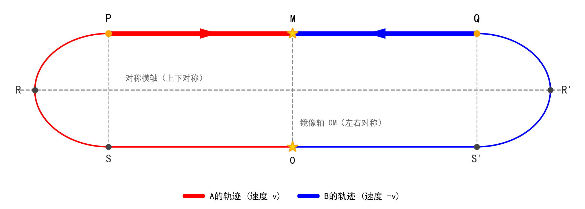

# 对称双生子实验 {#sec-symmetric-twins}

本章设计一个完全镜像对称的双生子实验，检验“钟慢效应”这一测量结果与随身时钟物理过程之间的关系。

## 实验过程

::: {#def-experiment-object}
## 实验对象

设惯性参考系 $S$ 中存在两个质点 $A$ 和 $B$。在时空原点 $O$ 处，$A$ 与 $B$ 相遇并完成时钟对表。设此时 $S$ 系的坐标时 $t=0$，两者的随身时钟时（携带的时钟读数）分别记为 $\tau_{A}$ 和 $\tau_{B}$，且设 $\tau_{A} = \tau_{B} = 0$。
:::

::: {#def-path-segments}
## 路径分段

从 $O$ 点出发，$A$ 和 $B$ 分别沿两条完全镜像对称的空间路径运动，在时空点 $M$ 再次相遇。其路径分为两个阶段：

1. **弧线段 $O \rightarrow P$ 与 $O \rightarrow Q$**：$A$ 经过弧线到达点 $P$，$B$ 经过完全镜像的弧线到达点 $Q$。这两段过程包含了加速与转向。
2. **直线段 $P \rightarrow M$ 与 $Q \rightarrow M$**：设 $A$ 到达 $P$ 点后，从点 $P$ 开始以恒定速度 $v$ 沿直线向 $M$ 运动，$B$ 到达 $Q$ 点后，从点 $Q$ 开始以恒定速度 $-v$ 沿直线向 $M$ 运动。
:::

{#fig-twins width=95%}

::: {#cnj-symmetry}
## 对称性公理

根据实验设定，路径 $O \rightarrow P \rightarrow M$ 与 $O \rightarrow Q \rightarrow M$ 关于中心轴 $OM$ 完美镜像对称。即：$A$ 和 $B$ 的物理经历在空间几何与动力学上完全等价。这一对称性在逻辑上确立了 $A$ 与 $B$ 的身份平等与可互换性。

此外，图形还关于横轴上下对称：$S$ 与 $S'$ 分别是 $A$、$B$ 路径上与 $P$、$Q$ 关于横轴对称的点。沿横轴翻转时，$P$ 与 $S$ 互换、$Q$ 与 $S'$ 互换、$M$ 与 $O$ 互换；于是 $A$ 的直线段 $P \rightarrow M$ 与 $A$ 出发时的直线段 $O \rightarrow S$ 互为镜像（$B$ 侧同理）。
:::

## 钟慢效应

本章只研究路径分段（@def-path-segments）中第 2 阶段直线段的惯性运动过程。

在 $A$ 的静止参考系 $S_A$ 中，$B$ 以相对速度 $v_{B/A}$ 运动。按洛伦兹变换 [@einstein1905]（推导见 @sec-transform-derivation），$A$ 测量 $B$ 的时间会发生膨胀，$A$ 测得的 $B$ 的时间流逝更慢。同理，在 $B$ 的静止系 $S_B$ 中，$B$ 也会得出 $A$ 的时间流逝更慢的结论。

## 对称性约束

根据 @cnj-symmetry（对称性公理），$A$ 和 $B$ 经历了完全镜像对称的物理过程。在 $M$ 点相遇时，两者随身时钟的读数相等。

## 实验结论

在满足洛伦兹变换的条件的前提下，洛伦兹变换测量得到的“时间不一致”，对称性确定的“随身时钟时相等”。这说明：洛伦兹变换测量出的时间差异，并不等同于物理上时钟实际经历的差异。