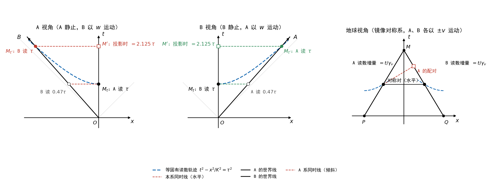
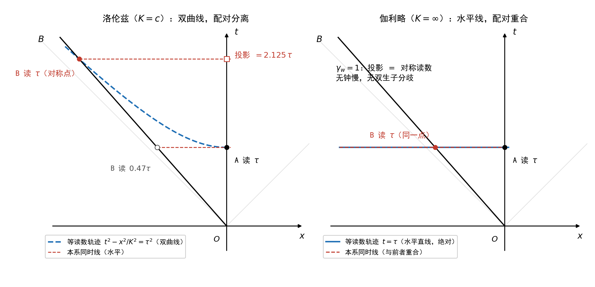

# 对称双生子实验：三种配对，三个数 {#sec-twins-comparison}

## 本章在链条上的位置 {#sec-tc-scope}

同一个实验、同一对曲线，可以算出不同的数。差别不在曲线本身，在**把哪些事件配成一对**。本章把这件事做成三个可对照的数字。

做法是：对同一个问题，分别用三种互不依赖的配对方式各算一遍，然后把三个答案并排放在一起。

**同一个问题**是：在直线段上，按某种配对把 $\gamma_B$ 上的一小段与 $\gamma_A$ 上的一小段配成一对，这两小段各自累积了多少线长？即求比值

$$
\frac{\mathrm{d}s_B}{\mathrm{d}s_A}
$$

其中 $\mathrm{d}s$ 是 @sec-twins-noninertial 章 (M4) 定义的那个量（线元沿曲线累积），本章从头到尾只与它打交道。

**本章不谈钟。** 上面这个比值是两条曲线的**长度增量之比**。它能不能接着读成“两只钟的读数之比”，是另外一项输入（@sec-layers 章 (P3b)）；那一步被单独隔离出去，本章的算式不依赖它，它成立与否也不改变本章任何一个数。将来若有了独立证据表明线长等于读数，本章三个数自动成为读数之比；若那样的证据不成立，换一项公设即可，本章的结果不受影响。

三种配对是：

- **两条曲线之间的映射**（实验本身的结构）：按镜像 $\iota$ 把两个事件配成一对；
- **本系同时面**（洛伦兹 $K=c$）：按 A 系同一坐标时把两个事件配成一对；
- **全局时间**（伽利略 $K=\infty$）：按所有参考系共享的时间把两个事件配成一对（@sec-two-source-field 章的公设 A2）。

三者彼此独立：第一种不依赖任何变换，也不依赖 $K$ 的取值；第二种依赖 $K=c$；第三种依赖 $K=\infty$。

本章的全部结论都属于**配对层**：它们随配对的选取而改变。配对这一项在 @sec-layers 章登记为 (P4)，$K$ 的取值登记为 (P1)；那里给出完整的分层表，不读那一章也能读完本章。

## 实验设定 {#sec-tc-setup}

::: {#def-experiment-object}
## 实验对象

设惯性参考系 $S$ 中存在两条分段光滑的类时曲线 $\gamma_A$ 与 $\gamma_B$。两者从公共事件 $O$ 出发，在公共事件 $M$ 再次相遇。

沿用 @sec-twins-noninertial 章的记号：

- $s_A(e)$ —— 沿 $\gamma_A$ 从 $O$ 到事件 $e$ 的**线长**，由 (M4) 沿该段曲线积分给出；
- $s_B(e)$ —— 沿 $\gamma_B$ 的同义写法。

两条曲线各自有多长，是两个数；本章问的是这两个数之比与配对的关系。
:::

::: {#def-path-segments}
## 路径分段

从 $O$ 出发，$\gamma_A$ 与 $\gamma_B$ 分别沿两条完全镜像对称的空间路径到 $M$。其路径分为两个阶段：

1. **弧线段 $O\to P$ 与 $O\to Q$**：$\gamma_A$ 经过弧线到达点 $P$，$\gamma_B$ 经过完全镜像的弧线到达点 $Q$。这两段包含曲率不恒为零的部分。
2. **直线段 $P\to M$ 与 $Q\to M$**：$\gamma_A$ 过 $P$ 后以恒定速率 $v$ 沿直线到 $M$；$\gamma_B$ 过 $Q$ 后以恒定速率 $v$ 沿镜像直线到 $M$。
:::

{#fig-twins-comparison width=92%}

::: {#cnj-symmetry}
## 对称性公理

根据实验设定，路径 $O\to P\to M$ 与 $O\to Q\to M$ 关于中心轴 $OM$ 完全镜像对称。即：$\iota$ 把 $\gamma_A$ 映为 $\gamma_B$ 并保持二次型（(M3)），两条曲线在几何上彼此无从区分——几何对两者用的是同一套判据，不因叫 $\gamma_A$ 还是 $\gamma_B$ 而改变（@sec-layers 章）。这一条不牵涉“哪个参与方在哪条曲线上”：那是第 2 步的事，由几何之外定。

此外，图形还关于横轴上下对称：$S$ 与 $S'$ 分别是 $\gamma_A$、$\gamma_B$ 上与 $P$、$Q$ 关于横轴对称的点。沿横轴翻转时，$P$ 与 $S$ 互换、$Q$ 与 $S'$ 互换、$M$ 与 $O$ 互换；于是 $\gamma_A$ 的直线段 $P\to M$ 与其出发时的直线段 $O\to S$ 互为镜像（$\gamma_B$ 侧同理）。
:::

镜像轴同时经过 $O$ 与 $M$，故分离与重逢发生在同一地点（两个事件的空间坐标相同）。

由 (M3)，本设定下换一次指定——把 $A$ 指定到 $\gamma_B$ 上、$B$ 指定到 $\gamma_A$ 上——**不产生新的情形**：换后的曲线对与原来的由 $\iota$ 相连，几何的全部陈述逐条相同，也没有任何可分辨的差别。这与非对称设定不同（@sec-asymmetric-twins 章 @sec-at-swap）——那里两条曲线不互为镜像，换指定把更长的那条换给了另一方。两处合起来的完整陈述见 @sec-layers 章 @sec-layers-no-veto 与 @sec-layers-swap-effect。

**本章只研究直线段 $P\to M$ 与 $Q\to M$**，即两段曲率恒为零的部分。这是为了只使用匀速运动的公式，不引入曲率非零情形的额外处理。

### 坐标系

取使两条直线段镜像对称的坐标系（$x$ 轴水平，$x=0$ 为对称轴），并把直线段的起点时刻记为 $t=0$。设 $P=(-d,\,0)$、$Q=(+d,\,0)$、$M=(0,\,d/v)$，其中 $v$ 为直线段上的速率。

于是直线段上的两条轨迹为

$$
\text{A：}\ x_A(t)=-d+vt,\qquad \text{B：}\ x_B(t)=+d-vt
$$ {#eq-trajectories}

镜像映射 $\iota(t,x):=(t,-x)$ 把 A 的轨迹映为 B 的轨迹：

$$
\iota\bigl(t,\,-d+vt\bigr)=\bigl(t,\,d-vt\bigr)
$$ {#eq-iota-lines}

**@eq-iota-lines 中两事件的时间分量相同，都是 $t$。** 这句话的全部内容是：$\iota$ 保持时间分量不变。它不需要任何外部参考系，也不需要任何参与方在场——时间方向是镜像对称自己挑出来的（$\iota$ 的 $+1$ 特征方向）。

## 三组输入各管什么 {#sec-tc-inputs}

三组输入彼此独立，本章分别使用，不混合。先把它们各自管的事情分清：

| 组 | $K$ 的取值（(P1)） | 条目 | 管的是什么 |
|---|---|---|---|
| S | 两支都成立 | (S1) 直线段完全镜像对称（@eq-iota-lines） | **配对**：$\iota(e_A)=e_B$ |
| L | $K=c$ | (L1) 洛伦兹变换 | 坐标换算与**配对**（同一坐标时 $t_A$） |
| G | $K=\infty$ | (G1) 伽利略变换 | 坐标换算与**配对**（全局时间 $t$） |

三组的差别集中在两处：**$K$ 取哪个值**，**配对怎么定**。

**这里没有列入任何关于钟的条目。** 另一种常见的做法是给每组各配一条把读数与其他量挂钩的公设（“起点读数相同”“经历相同过程读数相同”“静止钟的读数等于本系坐标时”）；那三条的作用是把下面这个比值进一步读作读数之比，而这一步本章悬置（@sec-layers 章的 (P3a) 与 (P3b)）。抽掉它们之后，三个数一个不少；下面逐节照算，读者可以核对这一点。

### 对称组（编号 S）

**(S1) 直线段完全镜像对称。** 由 @eq-iota-lines 表达：$\iota$ 把 $\gamma_A$ 的直线段逐点映为 $\gamma_B$ 的直线段。

本组不指定 $K$：下面的结论对 $K=c$ 与 $K=\infty$ 同真，因为 $\iota$ 对两支的二次型同样适用。

### 洛伦兹组（编号 L）

**(L1) 洛伦兹变换。** 相对速度 $u$ 的两系之间（$\gamma_u:=1/\sqrt{1-u^{2}/c^{2}}$）：

$$
t'=\gamma_u\Bigl(t-\frac{u\,x}{c^{2}}\Bigr),\qquad x'=\gamma_u\,(x-ut)
$$ {#eq-L1}

本组取 $K=c$，故 (M4) 的被积量为 $\sqrt{\mathrm{d}t^{2}-\mathrm{d}x^{2}/c^{2}}$。(L1) 在本章只做两件事：把曲线换到指定参考系的坐标里；给出该参考系的同时面。

### 伽利略组（编号 G）

**(G1) 伽利略变换。** 相对速度 $u$ 的两系之间：

$$
t'=t,\qquad x'=x-ut
$$ {#eq-G1}

本组取 $K=\infty$，故 (M4) 的被积量为 $\mathrm{d}t$。

**注意 (G1) 与 (L1) 的差别只在第一式**：一个说 $t'=t$，一个说 $t'=\gamma_u(t-ux/c^{2})$。本章两组结果之差，全部从这一条加上 $K$ 的取值产生。

## 配对一：按两条曲线之间的映射 {#sec-tc-symmetry}

::: {#prp-tc-equal}

## 对称对上两段累积线长相等

设 $e_A$ 与 $e_B$ 是直线段上的一对对称对（即 $\iota(e_A)=e_B$），则 $s_A(e_A)=s_B(e_B)$。
:::

**证明** 分三步，全部只用 @sec-twins-noninertial 章的 (M3)、(M4)。

**第一步**：$\iota$ 保二次型。由 $\iota(t,x)=(t,-x)$，时间分量不变而空间分量变号，故 $\mathrm{d}t^{2}$ 不变、$\mathrm{d}x^{2}$ 不变（方向变了，平方没变），于是

$$
\mathrm{d}s^{2}_{K}=\mathrm{d}t^{2}-\frac{\mathrm{d}x^{2}}{K^{2}}
$$

在 $\iota$ 下逐点不变——这对 $K$ 的每一个取值都成立。

**第二步**：由 (S1) 与 @eq-iota-lines，$\iota$ 把 $\gamma_A$ 上从 $P$ 到 $e_A$ 的整条弧一一映为 $\gamma_B$ 上从 $Q$ 到 $e_B$ 的整条弧。由第一步，$\iota$ 保二次型，故保线长，两段线长相等：

$$
s_A(e_A)-s_A(P)=s_B(e_B)-s_B(Q)
$$ {#eq-tc-inc}

**第三步**：$O\to P$ 与 $O\to Q$ 两段弧线亦互为镜像，同理得 $s_A(P)=s_B(Q)$。代入 @eq-tc-inc，左端减左端、右端减右端：

$$
\begin{aligned}
\bigl[s_A(e_A)-s_A(P)\bigr]-\bigl[s_B(e_B)-s_B(Q)\bigr]&=0\\[4pt]
s_A(e_A)-s_B(e_B)-\bigl[s_A(P)-s_B(Q)\bigr]&=0\\[4pt]
s_A(e_A)-s_B(e_B)&=0
\end{aligned}
$$

即 $s_A(e_A)=s_B(e_B)$。

这条论证没有用到任何变换，也没有用到 $K$ 的取值：它只用“两条曲线互为镜像 + 该映射保线元”。

### 比值

由 @prp-tc-equal，在对称对上 $s_A=s_B$ 逐点成立，故沿直线段取微分：

$$
\boxed{\dfrac{\mathrm{d}s_B}{\mathrm{d}s_A}=1}
$$ {#eq-tc-ratio-S}

### 若补一条关于钟的输入，能说到哪一步（可不读） {#sec-tc-weak}

@prp-tc-equal 说的是两条曲线的**长度**。若额外再补一条最窄的输入——

> **(P3a)（弱式，见 @sec-layers 章）**：互为镜像的两段过程，两端随身钟的读数增量相同。

则 @prp-tc-equal 可以接着读成一句话：**对称对上两只钟的读数相同**；其推论是，一方只要在本地读出自己的数，就知道另一方也是这个数——不是测量，不需要通信，不需要比对，也不需要第三者。本书把这称为“跨系可知”。

这条输入给得起什么、给不起什么，要说清楚：

- **给得起**的是相等与否：对称的两段之间，读数相同。
- **给不起**的是共同的快慢：若两侧读数同时乘上同一个因子，(P3a) 无法把它排除。**对称既不蕴含“两只钟一起变慢”，也不蕴含“一起变快”——它给不出这个判断。**
- **给不起**的还有数值：读数等于多少这条曲线累积了多长的数，是另一条更强的输入（(P3b)），本书不用。

本章除本节外不使用 (P3a)，全书不使用 (P3b)。

## 配对二：按本系同时面（洛伦兹） {#sec-tc-lorentz}

本节不使用 (S1)，只用 $K=c$ 的 (M4) 与 (L1)。

### 第一步：两条直线的相对速率

两者相向运动、速率各为 $v$ 时，由 (L1) 推出速度合成公式（标准推论，推导见 @sec-transform-derivation 章），相对速率为

$$
w=\frac{2v}{1+\dfrac{v^{2}}{c^{2}}},\qquad
\gamma_w=\frac{1}{\sqrt{1-\dfrac{w^{2}}{c^{2}}}}
=\frac{1+\dfrac{v^{2}}{c^{2}}}{1-\dfrac{v^{2}}{c^{2}}}
$$ {#eq-tc-w}

把坐标换到 A 的静止系：A 的世界线成为纵轴

$$
x_A=0,
$$

B 在该系中以速率 $w$ 做惯性运动，世界线是过 $O$ 的直线

$$
x_B=-w\,t_A.
$$

### 第二步：两侧各自累积多少线长

由 $K=c$ 的 (M4)：

- **A 侧**：$x_A=0$ 故 $\mathrm{d}x_A=0$，于是

$$
\mathrm{d}s_A=\sqrt{\mathrm{d}t^{2}-0}=\mathrm{d}t
$$ {#eq-tc-dsA-L}

- **B 侧**：代入 $x_B=-w\,t_A$，即 $\mathrm{d}x_B=-w\,\mathrm{d}t$，于是

$$
\mathrm{d}s_B=\sqrt{\mathrm{d}t^{2}-\frac{w^{2}\mathrm{d}t^{2}}{c^{2}}}
=\mathrm{d}t\sqrt{1-\frac{w^{2}}{c^{2}}}=\frac{\mathrm{d}t}{\gamma_w}
$$ {#eq-tc-dsB-L}

### 第三步：配对，然后取比值

(L1) 的同时面在 A 系中是 $t_A=$ 常数。按它配对时，$\gamma_A$ 上的一小段与 $\gamma_B$ 上配成对的那一小段**共享同一个 $\mathrm{d}t$**。于是由 @eq-tc-dsA-L 与 @eq-tc-dsB-L：

$$
\boxed{\dfrac{\mathrm{d}s_B}{\mathrm{d}s_A}=\dfrac{1}{\gamma_w}}
$$ {#eq-tc-ratio-L}

由 @eq-tc-w，$v\neq0$ 时 $\gamma_w>1$，故此比值小于 1。它说的是这样一件事：**按 A 系同时面切开时，配对的两小段各自的线长增量之比是 $1/\gamma_w$。**

把角色互换（改用 B 系的同时面），得到的比值同为 $1/\gamma_w$。理由是这个数只依赖两条直线之间的相对速率 $w$，而 $w$ 是这一对直线的几何量，互换两侧不会改变它——**换的是名字，不是这个数。**

## 配对三：按全局时间（伽利略） {#sec-tc-galilei}

本节不使用 (S1)，也不使用 (L1)，只用 $K=\infty$ 的 (M4) 与 (G1)。

### 第一步：时间坐标是全局的

由 @eq-G1 的第一式，$t'=t$。**任意两个参考系的时间坐标相同**，故所有系共享同一个时间坐标 $t$，同时面是与参考系无关的水平线。

### 第二步：两侧各自累积多少线长

$K=\infty$ 时 (M4) 的被积量为 $\mathrm{d}t$，与运动状态无关：

$$
\mathrm{d}s_A=\mathrm{d}t=\mathrm{d}s_B
$$ {#eq-tc-ds-G}

### 第三步：配对，然后取比值

按全局时间配对时，配对的两小段共享同一个 $\mathrm{d}t$，由 @eq-tc-ds-G：

$$
\boxed{\dfrac{\mathrm{d}s_B}{\mathrm{d}s_A}=1}
$$ {#eq-tc-ratio-G}

## 三个数并排 {#sec-tc-table}

同一个问题：**按某种配对切开后，配对的两小段各自累积了多少线长之比是多少？**

| | 输入 | $K$ | 配对规则 | $\mathrm{d}s_B/\mathrm{d}s_A$ |
|------|------|------|------|------|
| 两条曲线之间的映射 | (S1) | 任一支 | 对称对 $\iota(e_A)=e_B$ | $1$ |
| 全局时间（伽利略） | (G1) | $\infty$ | 同一全局时间 $t$ | $1$ |
| 本系同时面（洛伦兹） | (L1) | $c$ | A 系同一坐标时 $t_A$ | $1/\gamma_w$ |

: 三个答案 {#tbl-tc-ratios}

**前两者给出同一个数（$1$），第三者给出另一个数（$1/\gamma_w$）。**

前两者的“$1$”来自两处不同的地方：映射那一组不用任何变换，也不用同时面，它的配对由两条曲线之间的结构直接给出，且对 $K$ 的取值不作要求；伽利略那一组的“$1$”来自 $t'=t$ 与 $\mathrm{d}s=\mathrm{d}t$ 两件事。两条互不依赖，只是给出了同一个数。

### 数值对照

取 $v=0.6c$。由 @eq-tc-w：

$$
w=\frac{2\times0.6c}{1+0.36}=0.8824c,\qquad
\gamma_w=\frac{1+0.36}{1-0.36}=2.125
$$

| | $\mathrm{d}s_B/\mathrm{d}s_A$ | A 侧累积 $1$ 单位时 B 侧累积 |
|------|------|------|
| 两条曲线之间的映射 | $1$ | $1$ |
| 全局时间（伽利略） | $1$ | $1$ |
| 本系同时面（洛伦兹） | $1/2.125=0.4706$ | $0.4706$ |

: $v=0.6c$ 时的三个数 {#tbl-tc-numeric}

## 画在图上：配对线长什么样 {#sec-tc-geometry}

三个数来自算式。本节把同一件事画在图上。**三种配对规则在图上各自对应一种几何形象**——按比例映射配对的形象是等线长线（@prp-tc-hyperbola 的校准双曲线），洛伦兹配对的形象是本系的同时线，伽利略配对的形象是与参考系无关的水平直线。

### 从前文的坐标系到 A 视角

@eq-trajectories 写在 @sec-tc-setup 的镜像对称系中（本节右图“第三方视角”沿用这一系）。画 A 视角图只需两步：

1. **平移**：把 A 的直线段起点 $P$ 平移到原点 $O$。平移不改变沿任何曲线的任何一段线长，只改变事件的名字。
2. **换系**：用 (L1) 把坐标换到 A 的静止系。A 在该系中静止，故 A 的世界线是纵轴本身；B 在该系中做惯性运动，速率由 @eq-tc-w 给出，世界线是过 $O$ 的直线 $x=-wt$。

以下三张图里，横轴都是 A 系（或相应系）的空间坐标 $x$，纵轴都是时间坐标 $t$，$s_0$ 是任取的一个线长数值；量值沿用 @tbl-tc-numeric 的 $v=0.6c$，即 $w=0.8824c$、$\gamma_w=2.125$。

### 第一步：把线长标到图上

由 $K=c$ 的 (M4)：在 A 的世界线（$x=0$）上，$\mathrm{d}s=\mathrm{d}t$，故 A 的累积线长就是纵轴读数本身——A 世界线上坐标为 $t$ 的事件，从 $O$ 起算累积了 $s=t$。

由 @eq-tc-dsB-L：在 B 的世界线上，$\mathrm{d}s=\mathrm{d}t/\gamma_w$，故 B 世界线上坐标为 $t$ 的事件，累积了

$$
s_B=\frac{t}{\gamma_w}.
$$ {#eq-tc-Bclock}

同一个数 $s_0$，在 A 的纵轴上位于 $t=s_0$，在 B 的世界线上位于 $t=\gamma_w s_0$——B 侧的刻度沿其世界线越往上越“疏”。

### 第二步：等线长点的轨迹

现在问一个只涉及几何的问题：从 $O$ 出发、以任意恒定速率 $u$ 运动的直线，当其累积线长为 $s_0$ 时，它所在的事件在图上构成什么曲线？

由 (M4)：这条线上的累积值是 $t\sqrt{1-u^{2}/K^{2}}$，其中 $K$ 是不变量速度（@sec-invariant-speed-group 章；$K=c$ 为洛伦兹，$K=\infty$ 为伽利略）。令它等于 $s_0$，得 $t=s_0\big/\sqrt{1-u^{2}/K^{2}}$。事件坐标是 $(t,\,x=ut)$，故 $u=x/t$，代入：

::: {#prp-tc-hyperbola}

## 等线长点的轨迹是校准双曲线

从 $O$ 出发、以任意恒定速率运动的直线，其累积线长为 $s_0$ 的全部事件构成曲线

$$
t^{2}-\frac{x^{2}}{K^{2}}=s_0^{2},
$$ {#eq-tc-hyperbola}

且该曲线与 B 的世界线 $x=-wt$ 交于 B 侧累积线长恰为 $s_0$ 的一点，其 A 系坐标时为 $\gamma_w s_0$。

:::

**证明**：上面两行代入已是证明。与 B 世界线的交点：取 $u=-w$，则 $t=s_0\big/\sqrt{1-w^{2}/K^{2}}=\gamma_w s_0$，由 @eq-tc-Bclock 该点的累积线长为 $\gamma_w s_0/\gamma_w=s_0$。

曲线的形状：$x=0$ 处 $t=s_0$（最低点）；$|x|$ 越大 $t$ 越大；渐近线是光锥 $x=\pm Kt$。它是**凹向 $t$ 轴的双曲线**，不是圆。这一点常被画错：欧氏圆 $t^{2}+x^{2}=s_0^{2}$ 不对应任何线长等值集，用它定位对称点会把对称点画近，但不改变本章的任何结论。

### 第三步：两套配对的形象

“配对规则”的几何形象是一条把两个事件连成一对的**线**。

- **按映射配对（S 组）**：@prp-tc-equal 配的是对称点对——A 侧累积 $s_0$ 的事件 $M_t=(s_0,0)$ 与 B 侧累积 $s_0$ 的事件 $M_{t'}$。由 @prp-tc-hyperbola，这些点对沿 @eq-tc-hyperbola 排列。**按映射配对的形象是等线长线（校准双曲线）。**
- **本系同时面配对（L 组）**：@eq-tc-ratio-L 配的是“A 系坐标时相等”的事件。A 系的同时线在 A 视角图中是水平线 $t=$ 常数（A 系的坐标时就是纵轴）。**该配对的形象是水平线。**

::: {#cor-tc-projection}

## 水平切割与对称点

过 B 侧累积 $s_0$ 的对称点 $M_{t'}$ 作水平线（A 系同时线），交 A 的世界线于 A 累积 $\gamma_w s_0$ 处：**$\gamma_w s_0>s_0$，交点在 $M_t$ 上方**。反过来，过 A 侧累积 $s_0$ 的事件 $M_t$ 作水平线，交 B 世界线于 B 累积 $s_0/\gamma_w$ 处（@eq-tc-Bclock）。两个数之比 $\gamma_w$ 全部来自“用哪条线配对”的选择，与两边曲线自身无关。

:::

### 三视角对照

{#fig-tc-three-views width=100%}

**左：A 视角。** 图上同时画着两套配对线。蓝色虚线是校准双曲线 @eq-tc-hyperbola：$M_t$（A 侧累积 $s_0$）与 $M_{t'}$（B 侧累积 $s_0$）在同一条双曲线上——这是 S 组的配对，两边累积值相同，且一方在本地读出自己的累积值就知道另一方也是这个值，无需测量。红色虚线是水平线（A 系同时线）：过 $M_t$ 的水平线交 B 世界线于 B 侧累积 $0.47s_0=s_0/\gamma_w$ 处，过 $M_{t'}$ 的水平线交 A 世界线于投影点 $M'$（A 侧累积 $\gamma_w s_0=2.125s_0$）——这是 L 组的配对，B 侧少一个 $\gamma_w$ 因子，正是 @eq-tc-ratio-L 的几何形式。

**中：B 视角。** 把左图作镜像 $x\to-x$、两侧互换，得到完全相同的图：B 静止，A 以 $w$ 沿 $+x$ 运动，双曲线、投影、比值逐一对应。这就是“换 B 来看只是身份互换，效果等价”的几何内容：两张图互为镜像，没有任何一张拥有特殊地位。

**右：第三方视角。** 这就是 @sec-tc-setup 的镜像对称系（@eq-trajectories 的主坐标系）：两侧各以 $\pm v$ 运动。两件事值得指出：

1. **映射配对与本系同时配对在此重合。** 由 @eq-iota-lines，对称对 $\iota(e_A)=e_B$ 的时间分量相同——对称对落在同一条水平线上。故 S 组的配对与“该系坐标时相等”的配对是同一套配对。双曲线弧（以 $P$、$Q$ 为心的 @eq-tc-hyperbola，因两直线段的线长从 $P$、$Q$ 起算）分别穿过两个对称点。
2. **同一水平间隔内三条世界线各累积多少。** 两侧（$\gamma_A$、$\gamma_B$）在同一个 $\mathrm{d}t$ 内各累积 $\mathrm{d}t/\gamma_v$，留在原点不动的第三条世界线累积 $\mathrm{d}t$。于是两侧对第三条之比为 $1/\gamma_v$，两侧互比则为 $1$。**这是三个写明了配对对象的比值，不是三个各自成立的断言**：说比谁慢，必须带上“与谁比、按什么配对”，否则不成一句话。

### 判据：两套配对下的两个数 {#sec-tc-lifespan}

把 $s_0$ 取成一个具体的数，两套配对的差别就成为可以核对的数字。取两侧各自从 $O$ 起累积到 $80$。

**按映射配对（S 组）：两侧同为 $80$。** $\gamma_A$ 上累积 $80$ 的事件 $e_A$ 与 $\gamma_B$ 上累积 $80$ 的事件 $e_B$ 互为对称点（$\iota(e_A)=e_B$，@eq-iota-lines），由 @prp-tc-equal 两者累积值相同。一方在本地读出自己的累积值，即知另一方的累积值——不经测量、不经通信、不经第三个坐标系。

**本系同时线配对（L 组）：切出来的数小于 $80$。** 在 $\gamma_A$ 上累积值为 $80$ 的事件处作 A 系同时线（左图的水平线），它与 $\gamma_B$ 交于 B 侧累积 $80/\gamma_w$ 的事件。按 @tbl-tc-numeric 的 $\gamma_w=2.125$，这个数是 $37.6$；相对速率更小时更接近 $80$（例如 $w\approx0.5c$ 时约 $69$）——但只要 $w\neq0$，它总比 $80$ 小。反过来，$\gamma_B$ 上累积 $80$ 的事件 $M_{t'}$ 在 A 的水平线上配到 A 侧累积 $\gamma_w\times80=170$ 的事件。

于是同一条曲线的同一个累积值，在两套配对下配到对方的两个不同事件：按映射配对给 $80$，按本系同时面配对给 $80/\gamma_w$ 与 $\gamma_w\times80$。这个差就是 @cor-tc-projection 中 $\gamma_w s_0$ 与 $s_0$ 之差，它随 $K\to\infty$ 消失（下一节），随 $K\to c$ 增大。

## 差随 $K$ 变化 {#sec-tc-galilean-geometry}

@eq-tc-hyperbola 含有参数 $K$。令 $K$ 变化，就得到从洛伦兹到伽利略的连续过渡：

{#fig-tc-galilean width=100%}

**双曲线在 $K\to\infty$ 时的形式。** $K\to\infty$ 时 @eq-tc-hyperbola 中 $x^{2}/K^{2}\to0$，曲线变为水平直线 $t=s_0$——**与参考系无关的绝对同时面**。对称点的 A 系坐标时 $\gamma_w s_0\to s_0$：投影值与对称点的累积值重合，@cor-tc-projection 中的两套配对合一。这与伽利略变换下对称对坐标时差为 $0$ 是同一件事的两种说法。

**$\gamma_w$ 随 $K$ 的变化**（固定 $w=0.8824c$）：

| $K$ | $\infty$ | $3c$ | $1.5c$ | $c$ |
|------|------|------|------|------|
| $\gamma_w$ | $1$ | $1.046$ | $1.237$ | $2.125$ |

: 投影分歧随不变量速度 $K$ 的变化 {#tbl-tc-gamma}

**结论**：投影分歧 $\gamma_w-1$ 全部来自 @eq-tc-hyperbola 中的 $1/K^{2}$ 项。$K$ 有限时等线长轨迹是双曲线，各系的同时线互不平行，两套配对分离（@fig-tc-galilean 左）；$K\to\infty$ 时曲线拉平为直线，所有系共享同一同时面，两套配对重合（@fig-tc-galilean 右）。$K\to\infty$ 时 @sec-tc-lifespan 中两套配对的两个数合一，差为零。这与 @sec-invariant-speed-group 章的群收缩（结构常数 $1/K^{2}\to0$）和 @sec-quantum-phase 章量子相态的条件（$K\to\infty$ 且 $\vec\nabla K=0$）是同一个极限。

## 三个数分别由哪几项给出 {#sec-tc-only-transform}

前几节把三个数算出来了。本节问：这三个数各自依赖什么，不依赖什么。

### 只用变换能推出什么

记 $\Delta s_A$ 为 $\gamma_A$ 在 $P\to M$ 上的线长，$\Delta s_B$ 为 $\gamma_B$ 在 $Q\to M$ 上的线长。两条曲线各自的总长是两个数，比较它们不需要任何配对。

**洛伦兹情形**：只用 (L1) 与 $K=c$ 的 (M4)。B 在 B 系中静止（$x_B$ 为常数），故 $\Delta s_B=t_B^{M}-t_B^{Q}$；对这两个事件用 (L1) 换到 A 系：

$$
t_A^{M}-t_A^{Q}=\gamma_w\Bigl[\bigl(t_B^{M}-t_B^{Q}\bigr)+\frac{w\,\bigl(x_B^{M}-x_B^{Q}\bigr)}{c^{2}}\Bigr]=\gamma_w\,\Delta s_B,
$$

再代入 A 在 A 系静止故 $\Delta s_A=t_A^{M}-t_A^{P}$，逐项相减，得到的**全部**约束是

$$
t_A^{P}-t_A^{Q}=\gamma_w\,\Delta s_B-\Delta s_A
$$ {#eq-tc-key}

其中 $t_A^{P}$、$t_A^{Q}$ 是 $P$、$Q$ 两事件在 A 系中的时间坐标。要由此得到 $\Delta s_A=\Delta s_B$，需要两件事同时成立：$t_A^{P}=t_A^{Q}$，且 $\Delta s_A=\gamma_w\Delta s_B$。**两条都不属于 (L1)。**

**伽利略情形**：由 @eq-tc-ds-G，沿任意曲线 $\mathrm{d}s=\mathrm{d}t$，故一段的线长只等于该段起讫的时间坐标之差，与这一段怎么走无关。在 @sec-tc-setup 的设定里，两段直线段的起点时间坐标相同（$t(P)=t(Q)$）、终点同为 $M$，故

$$
\Delta s_A=\Delta s_B
$$ {#eq-tc-equal-G}

即：这一支不需要 @cnj-symmetry 那样的镜像对称，只要两段起讫于同一全局时刻即可。

| | 只用该变换能否推出 $\Delta s_A=\Delta s_B$ |
|------|------|
| 洛伦兹变换 | **不能**（还差 $t_A^{P}=t_A^{Q}$ 与 $\Delta s_A=\gamma_w\Delta s_B$ 两条） |
| 伽利略变换 | **能**（$K=\infty$ 时线长只依赖端点时间） |

: 只用变换能推出什么 {#tbl-tc-only}

### 协变性不蕴含线长由什么决定 {#sec-tc-covariance}

上一小节问的是“只用变换能推出什么”。本小节的问题再一般一层——**协变性本身，能否决定线长由什么决定？**

:::: {#prp-tc-covariance}
## 协变性不蕴含线长由什么决定

设 $\mathcal{G}$ 是一个变换群，设某个对象（二次型或一组方程）在 $\mathcal{G}$ 的作用下形式不变。则这一形式不变性不决定线长是由路径决定还是由端点决定。
::::

**证明**（在同一族结构内比较）。取恒速群 $G_K$（@sec-invariant-speed-group 章）的两个取值。二次型

$$
\mathrm{d}s^{2}_{K}=\mathrm{d}t^{2}-\frac{\mathrm{d}x^{2}}{K^{2}}
$$

在 $G_K$ 的作用下形式不变——这对 $K$ 的每一个取值都成立，$K=c$ 与 $K=\infty$ 都包含在内。于是协变性（此处即该二次型在群作用下的形式不变性）在两支中**同时成立**。而两支的线长由什么决定不同：

| | $K=c$ | $K=\infty$ |
|------|------|------|
| 二次型在群作用下形式不变 | 是 | 是 |
| 线元 | $\mathrm{d}s^{2}=\mathrm{d}t^{2}-\mathrm{d}x^{2}/c^{2}$ | $\mathrm{d}s^{2}=\mathrm{d}t^{2}$ |
| 线长由什么决定 | 由路径决定 | 由端点决定（$t(R)-t(O)$） |

: 协变性在两支中同时成立 {#tbl-tc-covariance}

既然同一条性质在两支中都成立而线长的决定方式不同，该性质就不是这一点的来源。

上表第三行说的是 @sec-twins-noninertial 章 (M4) 定义的那个几何量（线长 $s[\gamma]$），整个讨论都落在几何层内，不含任何关于钟的输入。**由此再往下走一步——把这个量读作某只钟的读数——是另外一项输入（@sec-layers 章 (P3b)），同样不被协变性决定。**

**层级**：协变性是一个关于**对象在群作用下如何变换**的陈述；指定某个符号指向什么，是另一类陈述。前者规定变换规则，后者规定符号的所指。二者不在同一层，前者不推出后者。

**旁证（方程层面）**：@sec-maxwell-equations 章给出一组在洛伦兹群下协变的方程；@sec-galilean-electrodynamics 章给出一组在伽利略群下形式不变的方程（两种含义的区别见该章 @tbl-form-invariance）。两套方程各在自己的群下形式不变，所属两支的线长决定方式不同——与上面的结论一致。

### 线长在两支上的累积形式 {#sec-tc-line-integral}

本章到此为止只用到 @sec-twins-noninertial 章 (M4) 的线长，没有把它读作任何读数。本节把这个口径在两支上的形式并排列出，便于逐条核对。先把话说死：**本节说的全是线长，不涉及钟。** 是否再把线长读成读数，是 @sec-layers 章的 (P3b)；@sec-twins-noninertial 章、@sec-asymmetric-twins 章与本章都不补这一项。

**（一）操作相同。** 两支上求线长的算法是同一套三步：取世界线切成小段；对每段取该支结构在这一段上的不变量，得到这一段的线长增量；沿路径相加。这三步在 $K$ 有限与 $K=\infty$ 下逐字相同，不含任何随 $K$ 取值而变的步骤。

**（二）被积的对象不同。** 差别只出现在第 2 步所取的那个量：

| | $K$ 有限（含 $K=c$） | $K=\infty$ |
|---|---|---|
| 每段的线长增量 | $\mathrm{d}s=\sqrt{\mathrm{d}t^{2}-\mathrm{d}x^{2}/K^{2}}$ | $\mathrm{d}s=\mathrm{d}t$ |
| 该量的形式 | 二次型的平方根，依赖于该段的速率 | 一形式作用在切向量上，不依赖速率 |
| 求和结果对路径形状的依赖 | 依赖 | 不依赖，等于 $T(R)-T(O)$ |
| 等线长点的轨迹 | $t^{2}-x^{2}/K^{2}=s^{2}$，双曲线 | $t=s$，水平直线 |
| 所用的几何对象 | 一个可逆度规，签名 $(1,3)$ | 两个对象：时间一形式（秩 $1$）与空间度规（秩 $3$） |

: 线长在两支上的形式 {#tbl-tc-integral}

表中 $O$ 为起点事件，$R$ 为终点事件，$T$ 为 $K=\infty$ 一支中不随参考系改变的时间坐标。右列的两个几何对象分别度量时间与空间距离：线长取前者（时间一形式），后者给同一同时面上两点之间的空间距离。

**（三）$K=\infty$ 是参数区间的端点。** $K$ 有限时上表左列成立，$K=\infty$ 时右列成立。两者之间不存在“取足够大的有限 $K$ 即落入右列”的关系：$K=10^{20}c$ 仍属左列，线长仍依赖路径形状，只是两条路径的线长之差小到难以测出。**“线长依赖路径形状”这一性质在取极限时不保持**——它对每一个有限 $K$ 成立，在端点 $K=\infty$ 上不成立。这是两支之间差别的全部来源，也是 @fig-tc-galilean 中曲线由双曲线变为水平直线的含义。

## 结论 {#sec-tc-conclusion}

| 命题 | 依据 |
|------|------|
| 按映射配对时 $\mathrm{d}s_B/\mathrm{d}s_A=1$ | (S1) 与 (M4)（@prp-tc-equal） |
| 该配对下一方在本地读出自己的累积值即知另一方 | 同一命题的推论（若要读作读数，见 @sec-tc-weak） |
| 全局时间配对给出 $\mathrm{d}s_B/\mathrm{d}s_A=1$ | $K=\infty$ 与 (G1)（@eq-tc-ratio-G） |
| 本系同时面配对给出 $\mathrm{d}s_B/\mathrm{d}s_A=1/\gamma_w$ | $K=c$ 与 (L1)（@eq-tc-ratio-L） |
| 只用洛伦兹变换推不出 $\Delta s_A=\Delta s_B$ | @eq-tc-key |
| 只用伽利略变换能推出 $\Delta s_A=\Delta s_B$ | @eq-tc-equal-G |
| 等线长点的轨迹是校准双曲线，不是欧氏圆 | @prp-tc-hyperbola |
| 投影值 $=\gamma_w s_0>s_0$；差全部来自配对规则 | @cor-tc-projection |
| 两侧累积同为 $80$；同一事件按 A 系同时线配对给 $80/\gamma_w$ | @sec-tc-lifespan |
| $K\to\infty$ 时双曲线变为水平线，两套配对合一 | @sec-tc-galilean-geometry |
| 协变性不蕴含线长由什么决定：两支都协变，线长的决定方式不同 | @prp-tc-covariance |
| 三个数的差别只来自 $K$ 的取值与配对规则，不来自曲线本身 | @sec-tc-inputs |

: 各命题及其依据 {#tbl-tc-conclusion}

**三个数：**

$$
\text{按映射配对：}\ 1\qquad\qquad
\text{全局时间（伽利略）：}\ 1\qquad\qquad
\text{本系同时面（洛伦兹）：}\ \frac{1}{\gamma_w}
$$

## 声明

在本实验的每一个环节上，本章指出的是它属于哪一层：变换给的是**坐标—配对层**的数，两条曲线之间的映射给的是**曲线层**的数，两者不是同一个层次上的陈述。

这一点在本章写成一般命题（@prp-tc-covariance）：**协变性不蕴含线长由什么决定**。换句话说，随配对改变的量与不随配对改变的量要分开谈。

最后重复本章的边界，因为它最容易被越过去：**本章的三个数全是线长之比，一句也没有说到钟。** 要把它们读成读数之比需要两项互相独立的输入——弱的一项（(P3a)：互为镜像的过程读数相同）只能给出“相等与否”，给不出共同的快慢；强的一项（(P3b)：线长等于读数）本书不用。这两步在 @sec-layers 章单独登记，其成立与否不影响本章任何一个算式。
