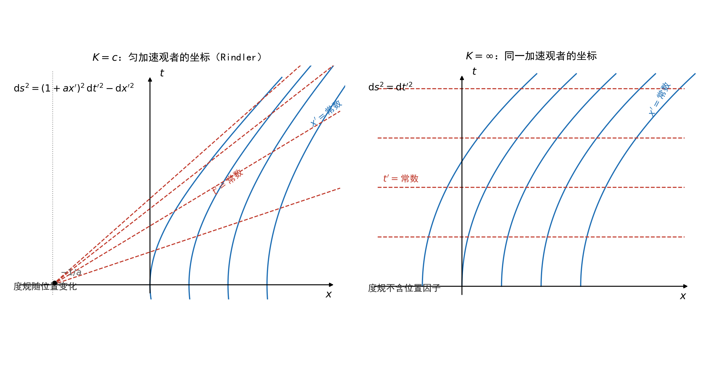
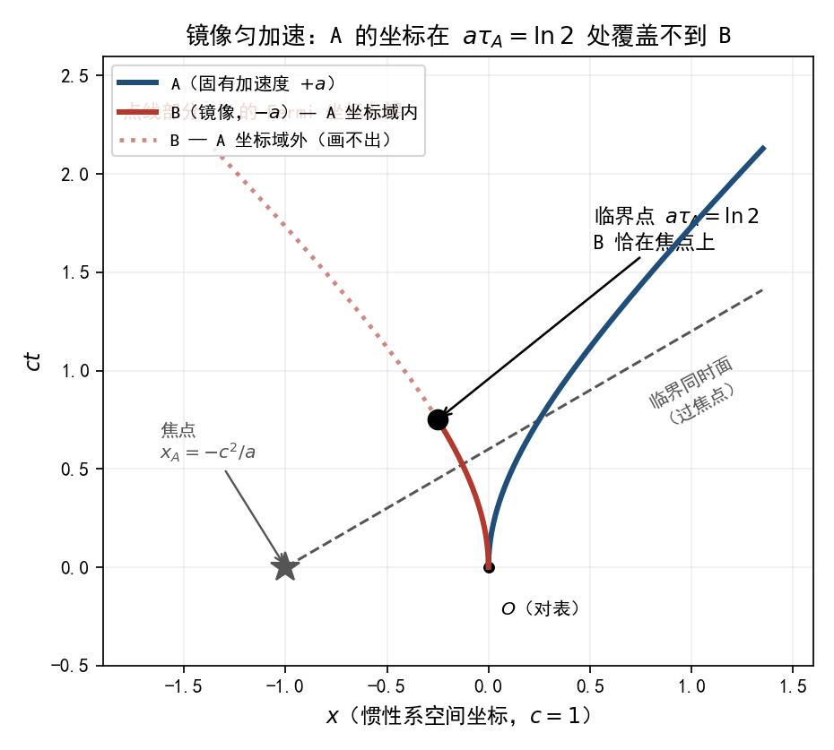
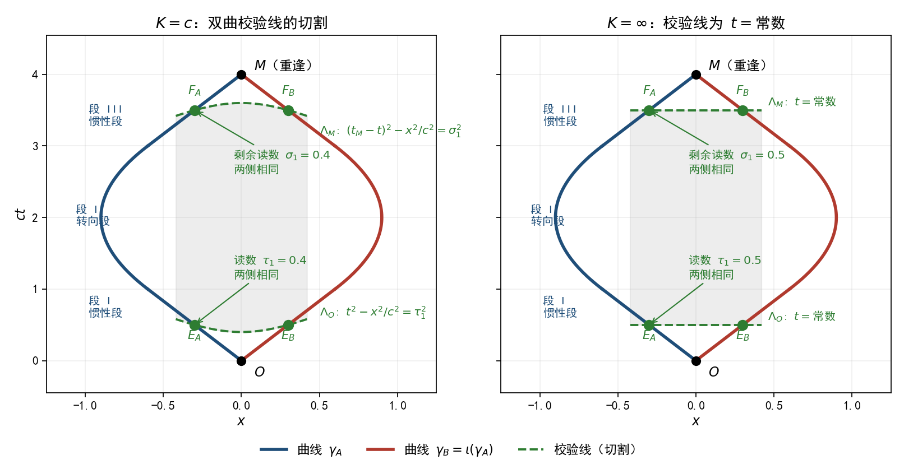
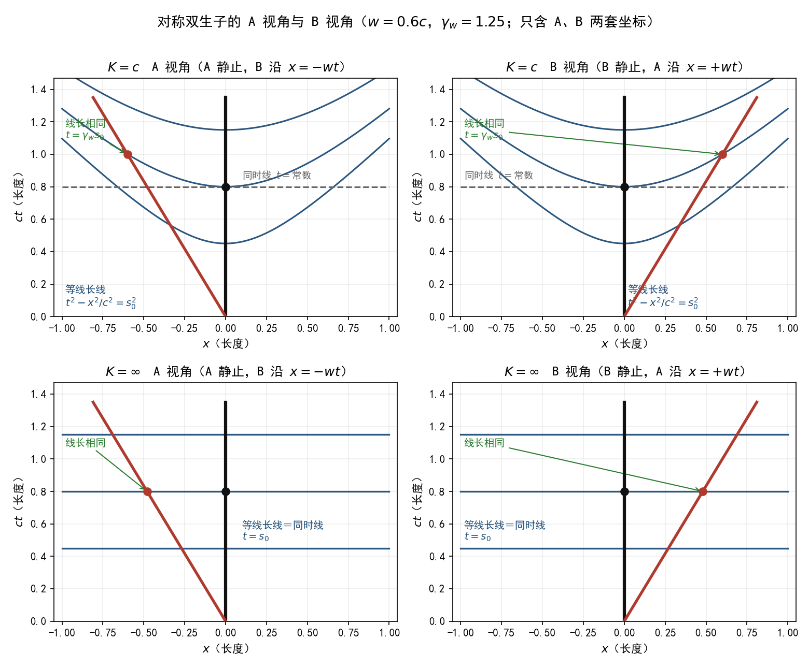

# 非惯性系下的对称双生子 {#sec-twins-noninertial}

## 本章的范围 {#sec-tn-scope}

第 @sec-twins-comparison 章的推导都在惯性坐标中进行。本章把坐标换成**沿曲线 A（或曲线 B）自身建立的坐标**——坐标非惯性——在 $K=c$ 与 $K=\infty$ 两支下分别画出 A 视角与 B 视角的时空图，并沿图上的像计算读数；最后沿三段结构（直线段—转向段—直线段）用校验线切割逐段比较两侧读数（@sec-tn-cut）。

**输入清单**（全部是数学对象）：

| 编号 | 对象 | 内容 |
|------|------|------|
| (M1) | 底空间与二次型 | $\mathrm{d}s^{2}_{K}=\mathrm{d}t^{2}-\mathrm{d}x^{2}/K^{2}$，$K=c$ 或 $K=\infty$ |
| (M2) | 两条曲线 | $\gamma_A$、$\gamma_B$：从 $O$ 到 $M$ 的分段光滑类时曲线，每段或为直线段（曲率恒为零）或为曲线段（曲率不恒为零）；记号沿用：第一段 $O\to P$、$O\to Q$，末段 $P\to M$、$Q\to M$；@sec-tn-cut 使用三段结构（直线段—转向段—直线段） |
| (M3) | 映射 $\iota$ | $\iota(t,x)=(t,-x)$；$\iota(\gamma_A)=\gamma_B$，$\iota(O)=O$，$\iota(M)=M$ |
| (M4) | 读数定义 | $s[\gamma]=\displaystyle\int_{\gamma}\sqrt{\mathrm{d}t^{2}-\mathrm{d}x^{2}/K^{2}}$ |

**两条纪律**：

1. **不引入第三个坐标系**。全程只出现 A 视角坐标与 B 视角坐标；$K=c$ 支中两系之间的变换是洛伦兹变换（它本身只连接两个坐标系）。
2. **$\iota$ 只作几何输入**。(M3) 定义了曲线对的镜像关系；本章不在任何计算步骤中用“因为镜像，所以读数相等”来替代或改动计算。所有读数都由积分算出；镜像能推出什么，由 @prp-tn-isometry 的证明给出。

**不使用的内容**：本章不引用任何实验、不引入任何物理机制、不使用任何物理直觉；所有结论由代数与积分给出。

## 数学准备 {#sec-tn-math}

### 镜像映射保持二次型

::: {#prp-tn-isometry}

## $\iota$ 保持 $\mathrm{d}s^{2}_{K}$

对 $K=c$ 与 $K=\infty$，$\iota(t,x)=(t,-x)$ 满足 $\iota^{*}\mathrm{d}s^{2}_{K}=\mathrm{d}s^{2}_{K}$。
:::

**证明**：$\iota^{*}\mathrm{d}t=\mathrm{d}t$，$\iota^{*}\mathrm{d}x=-\mathrm{d}x$，故 $\iota^{*}\mathrm{d}s^{2}_{K}=\mathrm{d}t^{2}-(-\mathrm{d}x)^{2}/K^{2}=\mathrm{d}s^{2}_{K}$。

::: {#cor-tn-length}

## 两条曲线的读数相等

$s[\gamma_B]=s[\gamma_A]$，对 $K=c$ 与 $K=\infty$ 都成立。
:::

**证明**：曲线在等距映射下的长度不变（换元 $y=\iota(x)$，被积式与积分域都被 $\iota$ 保形搬移，积分值不变）。$\gamma_B=\iota(\gamma_A)$，故 $s[\gamma_B]=s[\gamma_A]$。

@cor-tn-length 是 (M3) 与 (M4) 的直接推论，全程未使用任何变换公式。它给出**整段读数**（从 $O$ 到 $M$）的关系。本章其余部分把读数**分段、分视角**地算出来，并检查图上的像。

### 两支的变换与读数因子

$K=c$ 支中，相对速率 $w$ 的两个坐标系之间：

$$
t'=\gamma_w\Bigl(t-\frac{u\,x}{c^{2}}\Bigr),\qquad x'=\gamma_u(x-ut),\qquad
\gamma_u=\frac{1}{\sqrt{1-u^{2}/c^{2}}}
$$ {#eq-tn-lorentz}

$K=\infty$ 支中：

$$
t'=t,\qquad x'=x-ut
$$ {#eq-tn-galilei}

两支合起来可写为 $\gamma_u(K)=1/\sqrt{1-u^{2}/K^{2}}$：$K=c$ 时即洛伦兹因子，$K=\infty$ 时 $\gamma_u(\infty)=1$。

## A 视角坐标的构造 {#sec-tn-construct}

设曲线 $\gamma_A$ 以弧长参数（读数）$\tau$ 描写，其一维情形下由快度 $\theta(\tau)$ 给出（$\mathrm{d}\theta/\mathrm{d}\tau=a(\tau)$ 为曲率，直线上 $a=0$）。**A 视角坐标**定义为

$$
t=T(\tau)+x_A\sinh\theta(\tau),\qquad
x=X(\tau)+x_A\cosh\theta(\tau),
$$ {#eq-tn-fermi}

其中 $T(\tau)=\int_0^{\tau}\cosh\theta(u)\,\mathrm{d}u$，$X(\tau)=\int_0^{\tau}\sinh\theta(u)\,\mathrm{d}u$。几何意义：从 $\gamma_A$ 上参数为 $\tau$ 的点出发，沿该点的正交单位方向移动距离 $x_A$。$\gamma_A$ 在此坐标中是 $x_A=0$，且 $t_A=\tau_A$（纵轴即参数本身）。

::: {#prp-tn-metric}

## A 视角坐标中的线元（$K=c$）

$$
\mathrm{d}s^{2}=\bigl(1+a(\tau)\,x_A\bigr)^{2}\,\mathrm{d}\tau^{2}-\mathrm{d}x_A^{2}
$$ {#eq-tn-metric-c}
:::

**证明**：对 @eq-tn-fermi 求偏导：$\partial_\tau T=(1+a x_A)\cosh\theta$，$\partial_{x_A}T=\sinh\theta$，$\partial_\tau X=(1+a x_A)\sinh\theta$，$\partial_{x_A}X=\cosh\theta$。代入 $\mathrm{d}t^{2}-\mathrm{d}x^{2}$，用 $\cosh^{2}\theta-\sinh^{2}\theta=1$ 逐项化简即得。该式对任意 $a(\tau)$ **精确成立**，不是近似。

::: {#prp-tn-metric-inf}

## A 视角坐标中的线元（$K=\infty$）

$$
\mathrm{d}s^{2}=\mathrm{d}\tau^{2}
$$ {#eq-tn-metric-inf}
:::

**证明**：$K=\infty$ 支的变换 @eq-tn-galilei 中 $t$ 不变，取 A 视角坐标 $t_A=t$、$x_A=x-X(t)$（沿 $\gamma_A$ 的横移），代入 $\mathrm{d}s^{2}=\mathrm{d}t^{2}$ 得 $\mathrm{d}s^{2}=\mathrm{d}t_A^{2}$；加速轨迹 $X(t)$ 不出现在结果中。

两式并排：

| | $K=c$ | $K=\infty$ |
|------|------|------|
| A 视角线元 | $\bigl(1+a(\tau)x_A\bigr)^{2}\mathrm{d}\tau^{2}-\mathrm{d}x_A^{2}$ | $\mathrm{d}\tau^{2}$ |
| 线元是否含 $x_A$ | 含（$a\neq0$ 时） | 不含 |
| 曲率 $a(\tau)$ 是否进入线元 | 进入 | 不进入 |

: A 视角线元的两支对照 {#tbl-tn-metric}

{#fig-tn-compare width=100%}

## 坐标映射为单射的条件 {#sec-tn-injective}

一张视角图要能画，坐标映射 $(\tau,x_A)\mapsto(t,x)$ 须在该处一一对应。两支的条件不同。

::: {#prp-tn-domain}

## $K=c$ 支的单射条件

映射 @eq-tn-fermi 在点 $(\tau,x_A)$ 附近一一对应，当且仅当

$$
1+\frac{a(\tau)\,x_A}{c^{2}}>0 .
$$ {#eq-tn-condition-c}
:::

**证明**：$g_{\tau\tau}=(1+a x_A/c^{2})^{2}$ 在 $x_A=-c^{2}/a$ 处为零。几何上，$t_A=\text{常数}$ 的线在 $(t,x)$ 平面中是直线 $t=\bigl(x+c^{2}/a\bigr)\tanh(a t_A/c)$（$a$ 为常数时），它们**全部过点** $(-c^{2}/a,\,0)$。该点是这族直线的公共交点：越过它，不同的 $(\tau,x_A)$ 对应同一事件，映射不再一一对应。公共交点位于 $\gamma_A$ 的曲率反方向、距离 $c^{2}/a$ 处。

::: {#prp-tn-domain-inf}

## $K=\infty$ 支的单射条件

映射 $t_A=t$、$x_A=x-X(t)$ 的雅可比行列式为 $1$，处处非零；条件 @eq-tn-condition-c 在该支**没有对应的限制**，映射在全体 $(t,x)$ 上一一对应。
:::

**证明**：$\partial(t_A,x_A)/\partial(t,x)=\det\begin{pmatrix}1&0\\-X'(t)&1\end{pmatrix}=1$。

## $K=c$ 支：对称双生子的 A 视角与 B 视角 {#sec-tn-lorentz}

### 直线段：两视角的读数计算

直线段上 $a=0$，线元为 $\mathrm{d}s^{2}=\mathrm{d}t^{2}-\mathrm{d}x^{2}/c^{2}$，坐标映射处处单射。设 A、B 的相对速率为 $w$（两坐标系之间由 @eq-tn-lorentz 直接连接）。

**A 视角**。取直线段起点为原点。$\gamma_A$：$x_A=0$；$\gamma_B$：$x_A=-w\,t_A$。

沿 $\gamma_B$ 取读数增量为 $\mathrm{d}\tau_B$ 的两个相邻事件，用 @eq-tn-lorentz 换到 A 坐标（B 在自己的坐标中位置不变，$\mathrm{d}x_B=0$）：

$$
\mathrm{d}t_A=\gamma_w\,\mathrm{d}\tau_B
\qquad\Longrightarrow\qquad
\boxed{\ \mathrm{d}\tau_B=\frac{\mathrm{d}t_A}{\gamma_w}\ }
$$ {#eq-tn-ratio-A}

**B 视角**。同一计算，A 与 B 互换（$\gamma_B$：$x_B=0$；$\gamma_A$：$x_B=+w\,t_B$；换算时 $w\to-w$，$\gamma_w$ 不变）：

$$
\boxed{\ \mathrm{d}\tau_A=\frac{\mathrm{d}t_B}{\gamma_w}\ }
$$ {#eq-tn-ratio-B}

@eq-tn-ratio-A 与 @eq-tn-ratio-B 是**两个独立的计算**：前者把 $\gamma_B$ 上的事件对换到 A 坐标，后者把 $\gamma_A$ 上的事件对换到 B 坐标；两组事件对不同，两个关系式分别成立，二者之间没有矛盾。两个式子互为镜像（把 A、B 互换即得对方）——这一条由 @eq-tn-lorentz 在 $u\to-u$ 下的不变性给出，是计算的性质，不是外加的假设。

**图上的两条线**（@fig-tn-views 上行）：

- **等读数线**：从原点出发、以任意恒定速率运动的曲线，读数为 $\tau$ 的事件满足 $t^{2}-x^{2}/c^{2}=\tau^{2}$（把 $u=x/t$ 代入读数式即得）。$\gamma_A$ 上读 $\tau$ 的事件 $(\tau,0)$ 与 $\gamma_B$ 上读 $\tau$ 的事件 $(\gamma_w\tau,-w\gamma_w\tau)$ 在同一条曲线上。
- **本系同时线**：$t_A=\text{常数}$，水平线。过 $(\tau,0)$ 的水平线与 $\gamma_B$ 交于 $t_A=\tau$ 处，由 @eq-tn-ratio-A 该点的 B 读数为 $\tau/\gamma_w$。

### 弧线段：像的定义域

弧线段上 $a\neq0$，A 视角坐标的线元由 @eq-tn-metric-c 给出，单射条件由 @prp-tn-domain 给出。取解析可解的镜像曲线对——$\gamma_A$ 以固定曲率 $+a$ 弯曲、$\gamma_B$ 以 $-a$ 镜像弯曲（$c=1$）——求 $\gamma_B$ 在 A 视角坐标中的像。

$\gamma_B$ 上参数为 $u=a\tau_A$ 的事件在 A 视角坐标中满足（记 $\rho=1+x_A$）：

$$
\rho\sinh(a\tau')=\sinh u,\qquad \rho\cosh(a\tau')=2-\cosh u,
$$

两式平方相减消去 $\tau'$：

$$
\rho^{2}=5-4\cosh u .
$$ {#eq-tn-rho}

实像存在当且仅当 $\rho^{2}>0$：

$$
\cosh u<\frac54
\qquad\Longleftrightarrow\qquad
u<\operatorname{arccosh}\tfrac54=\ln 2 .
$$ {#eq-tn-ln2}

::: {#cor-tn-domain-ln2}

## 镜像弯曲曲线对的像区间

$K=c$ 支中，A 视角坐标里 $\gamma_B$ 的像存在的条件是

$$
a\,\tau_A<\ln 2\approx0.693 .
$$

临界处 $\rho=\sqrt{5-4\cosh(\ln 2)}=0$，即 $x_A=-c^{2}/a$：$\gamma_B$ 的像恰好到达 @eq-tn-condition-c 的边界。$a\tau_A\geq\ln2$ 时该处**没有实像**——图上该段无法表示 $\gamma_B$。
:::

{#fig-tn-domain width=82%}

**数值标度**（$c=1$ 时 $a\tau$ 无量纲；恢复 $c$ 后 $\tau_A<(c/a)\ln2$）：

| $a$ | $c^{2}/a$ | $\tau_A^{*}=(c/a)\ln2$ |
|------|------|------|
| $9.8\,\mathrm{m/s^{2}}$ | $0.97$ 光年 | $0.67$ 年 |
| $0.98\,\mathrm{m/s^{2}}$ | $9.7$ 光年 | $6.7$ 年 |
| $0.098\,\mathrm{m/s^{2}}$ | $97$ 光年 | $67$ 年 |

: $K=c$ 支像区间的数值标度 {#tbl-tn-scale}

### B 视角

B 视角坐标由同一个构造沿 $\gamma_B$ 建立。@prp-tn-isometry 的镜像映射把 $(\gamma_A,a,+x)$ 换为 $(\gamma_B,a,-x)$，故 @eq-tn-rho、@cor-tn-domain-ln2 与 @tbl-tn-scale 对 B 视角**逐字成立**（把 $x_A$ 换为 $x_B$、$\gamma_A$ 换为 $\gamma_B$）——这一条由 $\iota$ 保形搬移全部等式给出，是代数性质。

### 整段读数

由 @cor-tn-length：$s[\gamma_A]=s[\gamma_B]$。分段看：直线段上 A 视角与 B 视角各自的计算（@eq-tn-ratio-A、@eq-tn-ratio-B）给出的是**对方读数与本系坐标时的关系**，不是整段读数的比较；整段读数由积分 @eq-tn-rho 所属的同一套线元沿两条曲线分别积分，其相等由 @cor-tn-length 保证。

## $K=\infty$ 支：对称双生子的 A 视角与 B 视角 {#sec-tn-galilean}

### 线元与像

A 视角线元为 $\mathrm{d}s^{2}=\mathrm{d}\tau^{2}$（@prp-tn-metric-inf），坐标映射处处单射（@prp-tn-domain-inf）。$\gamma_B$ 在 A 视角坐标中的像：设 $\gamma_B$ 为 $x=\xi(t)$，则像为

$$
t_A=t,\qquad x_A=\xi(t)-X(t),
$$ {#eq-tn-image-inf}

对任意 $\xi$ 存在，无定义域限制。沿像的读数：

$$
\mathrm{d}\tau_B=\mathrm{d}t_A
\qquad\Longrightarrow\qquad
s[\gamma_B]=t_A(M)-t_A(O).
$$ {#eq-tn-read-inf}

右端只含端点的 $t_A$ 坐标，与 $\xi$ 的形状无关。$\gamma_A$ 同理：$s[\gamma_A]=t_A(M)-t_A(O)$。

### B 视角

同一构造沿 $\gamma_B$ 建立：$t_B=t$，$x_B=x-\Xi(t)$（$\Xi$ 为 $\gamma_B$ 的轨迹）。雅可比同样恒为 $1$，线元同样为 $\mathrm{d}s^{2}=\mathrm{d}t_B^{2}$，读数同样只由端点给出。A 视角与 B 视角的两个时间坐标相等（@eq-tn-galilei 的第一式），故两视角给出同一个数。

### 图（@fig-tn-views 下行）

$K=\infty$ 支的等读数线与同时线重合，都是水平直线 $t=\tau$；A 视角与 B 视角互为镜像，两条曲线上的等读数点落在同一条水平线上。

## 校验线切割：惯性段的读数贡献 {#sec-tn-cut}

前两节分别给出了每支里两视角各自的计算。本节回到 (M1)—(M4)，回答一个更细的问题：把两条曲线分成对应的段，逐段比较两侧读数，**差从哪些段来**。本节只使用 (M1)—(M4) 已有的坐标描述与映射 $\iota$，不引入新的坐标系。

### 三段结构

**结构假设 (S)**：$\gamma_A$、$\gamma_B$ 各由三段组成——段 I：从 $O$ 出发的直线段；段 II：曲率不恒为零的转向段；段 III：到达 $M$ 的直线段。

由 @prp-tn-isometry，$\iota$ 保持二次型，因而保持曲线的曲率。$\gamma_B=\iota(\gamma_A)$ 时，把 $\gamma_A$ 按曲率分段，$\gamma_B$ 的对应分段由 $\iota$ 直接给出：$\iota$ 把 $\gamma_A$ 的段 I、II、III 分别映为 $\gamma_B$ 的段 I、II、III。这不是附加假设，是 (M3) 的推论。

### 校验线

::: {#def-tn-calibration}

## 校验线

$K=c$ 支中，以 $O$ 为心、参数 $\tau$ 的校验线与以 $M$ 为心、参数 $\sigma$ 的校验线为

$$
\Lambda_O(\tau)=\bigl\{X:\ t^{2}-x^{2}/c^{2}=\tau^{2},\ t>0\bigr\},
$$ {#eq-tn-calibration}

$$
\Lambda_M(\sigma)=\bigl\{X:\ (t_M-t)^{2}-(x-x_M)^{2}/c^{2}=\sigma^{2},\ t<t_M\bigr\}.
$$ {#eq-tn-calibration-m}

$K=\infty$ 支中，校验线为 $t=t_O+\tau$ 与 $t=t_M-\sigma$。
:::

$K=c$ 支的校验线即 @fig-tn-views 中的等读数线（$t^{2}-x^{2}/c^{2}=\tau^{2}$），也就是第 @sec-twins-comparison 章的**校准双曲线**（@eq-tc-hyperbola）：落在 $\Lambda_O(\tau)$ 上当且仅当该事件由 $O$ 出发的读数为 $\tau$。本节把它用作切割工具。$K=\infty$ 支的校验线是水平线（等读数线与同时线重合，见 @sec-tn-galilean）。

::: {#prp-tn-calibration}

## 校准引理

$K=c$ 支中，设事件 $X$ 由 $O$ 出发沿直线段（任意恒定速率 $|u|<c$）到达，读数为 $s$，则 $s^{2}=t(X)^{2}-x(X)^{2}/c^{2}$，即 $X\in\Lambda_O(s)$，**与速率 $u$ 无关**。$K=\infty$ 支中，从 $O$ 出发到 $X$ 的读数为 $t(X)-t(O)$，与路径形状无关，同一校验线上每点的读数相同。
:::

**证明**：直线 $x=ut$ 上，$s=\displaystyle\int_{0}^{t(X)}\sqrt{1-u^{2}/c^{2}}\,\mathrm{d}t'=t(X)\sqrt{1-u^{2}/c^{2}}$，而 $t(X)^{2}-x(X)^{2}/c^{2}=t(X)^{2}\bigl(1-u^{2}/c^{2}\bigr)=s^{2}$。$K=\infty$ 支即 @eq-tn-read-inf 的直接读出。

引理的要点是**与速率无关**：两个以不同恒定速率从 $O$ 出发的人，跨过同一条 $\Lambda_O(\tau)$ 时读数同为 $\tau$（数值核验：$u=0.1,0.6,0.9,0.99$ 的直线跨 $\Lambda_O(0.4)$，读数均为 $0.4$）。

### 分段定理

沿每条曲线，段 I 上的读数从 $0$（在 $O$）起严格递增，段 III 上的读数到 $M$ 止严格递增。故当 $\tau_1$ 小于段 I 的读数、$\sigma_1$ 小于段 III 的读数时，$\Lambda_O(\tau_1)$ 与段 I 有唯一交点，$\Lambda_M(\sigma_1)$ 与段 III 有唯一交点——由校准引理，交点即读数为 $\tau_1$、$\sigma_1$ 的事件。称这样的 $\tau_1,\sigma_1$ 为**容许切割**。

::: {#thm-tn-cut}

## 分段定理

取容许切割 $\tau_1,\sigma_1$，记段 I 与 $\Lambda_O(\tau_1)$ 的交点为 $E_A,E_B$，段 III 与 $\Lambda_M(\sigma_1)$ 的交点为 $F_A,F_B$。则

1. $s[O\to E_A]=s[O\to E_B]=\tau_1$；
2. $s[F_A\to M]=s[F_B\to M]=\sigma_1$；
3. $s[E_A\to F_A]=s[E_B\to F_B]$；
4. $s[\gamma_A]=s[\gamma_B]=\tau_1+s[E_A\to F_A]+\sigma_1$；
5. 结论 1、2、4 对一切容许切割成立，与 $\tau_1,\sigma_1$ 的取值无关。
:::

**证明**：

1. 段 I 上读数为 $\tau_1$ 的事件由校准引理落在 $\Lambda_O(\tau_1)$ 上，读数严格递增给出唯一性；A、B 两侧同一论证。
2. 把校准引理用于以 $M$ 为心、时间反向的校验线，同一论证。
3. $\iota$ 保持 $t^{2}-x^{2}/c^{2}$ 与 $t$（@prp-tn-isometry 的计算），故 $\iota\bigl(\Lambda_O(\tau_1)\bigr)=\Lambda_O(\tau_1)$、$\iota\bigl(\Lambda_M(\sigma_1)\bigr)=\Lambda_M(\sigma_1)$，且 $\iota$ 把 $\gamma_A$ 的段 I、III 分别映为 $\gamma_B$ 的段 I、III。交点唯一给出 $\iota(E_A)=E_B$、$\iota(F_A)=F_B$；$\iota$ 保持线元，子段的读数不变（@cor-tn-length 的同一论证用于子段）。
4. 三段相加，用 1、2、3。
5. 1、2 的论证对每个容许 $\tau_1,\sigma_1$ 逐字重复；4 由 1、2、3 相加。

注：结论 1、2 只用了校准引理，没有用到镜像性——即使两条惯性段的速率不同，1、2 仍成立；镜像性只在结论 3（中间段）处进入。

::: {#cor-tn-legs}

## 惯性段的贡献

段 I 与段 III 对两侧总读数之差的贡献为 $0$；此贡献与切割位置无关（@thm-tn-cut 第 5 条），与两段上的速率取值无关（校准引理）。两侧读数的全部共同部分由中间段给出，而中间段两侧读数相等（@thm-tn-cut 第 3 条）。
:::

### 显式算例

取 $c=1$，$O=(0,0)$，$M=(4,0)$：

$$
\gamma_A:\quad
x(t)=\begin{cases}
-0.6\,t, & 0\le t\le 1,\\[2pt]
0.3\,t^{2}-1.2\,t+0.3, & 1\le t\le 3,\\[2pt]
0.6\,t-2.4, & 3\le t\le 4,
\end{cases}
$$ {#eq-tn-example}

其中 $\gamma_B:\ x(t)=-x_A(t)$。

逐项检查：三段在 $t=1,3$ 处位置连续（值 $-0.6$）且速率连续（从 $-0.6$ 变到 $+0.6$）；$|\mathrm{d}x/\mathrm{d}t|\le 0.6<1$，全程类时；段 II 的切线方向连续变化，曲率不恒为零，确为转向段。$\gamma_B$ 与 $\gamma_A$ 同起于 $O$、同终于 $M$，互为镜像。

| 段 | 读数（闭式） | 数值 |
|---|---|---|
| 段 I（惯性） | $0.8$ | $0.8$ |
| 段 II（转向） | $\sqrt{1-0.6^{2}}+\arcsin(0.6)/0.6$ | $1.8725018\ldots$ |
| 段 III（惯性） | $0.8$ | $0.8$ |
| 总读数 | | $3.4725018\ldots$ |

: 算例的三段读数 {#tbl-tn-example}

A、B 两侧逐段相同（镜像）。

切割：取 $\tau_1=\sigma_1=0.4$。$E_A=(0.5,-0.3)$、$E_B=(0.5,0.3)$：核对 $0.5^{2}-0.3^{2}=0.16=0.4^{2}$；$F_A=(3.5,-0.3)$、$F_B=(3.5,0.3)$：核对 $(4-3.5)^{2}-0.3^{2}=0.16$。中间段读数为 $3.4725-0.4-0.4=2.6725$，两侧相同。把 $\tau_1,\sigma_1$ 换为 $0.2,0.6,0.8$ 逐项重算，段 I、段 III 两侧之差在每种取法下均为 $0$。以上数值由符号计算与高精度积分逐项核验。

{#fig-tn-cut width=100%}

### 与同时面配对的关系

@eq-tn-ratio-A 与 @eq-tn-ratio-B 用的是**本系同时线**配出的事件对：把 $\gamma_B$ 上的事件与 $\gamma_A$ 坐标时相同的事件配对，读出因子 $1/\gamma_w$。本节的校验线用的是**另一种事件对**：把两条曲线上读数相同的事件配对（@thm-tn-cut 第 1、2 条），读出 $1$。

两套事件对不同，两个结论分别成立，不相互矛盾；它们都是关于**配对**的陈述。总读数不经任何配对：由 (M4) 沿曲线积分给出，@thm-tn-cut 第 4 条给出两侧相等、第 5 条给出与切割位置无关。

又：本节的切割只用到两条曲线上的事件与 $\iota$，不需要把 $\gamma_B$ 表示到 A 自己的视角坐标里，故 @cor-tn-domain-ln2 的像区间限制不涉及本节的结论。

### 物理诠释

以下诠释不引入新的数学对象，只复述已证结果在本章结构 (S) 中的含义。

**在对称双生子实验中，惯性运动部分不会造成任何实质性的时间变慢。** 依据是 @cor-tn-legs：两段惯性段对读数之差的贡献恒等于 $0$，与切割位置无关、与速率无关。

1. 两条互为镜像的曲线，重逢时读数相同（@cor-tn-length）；分段看，差只能来自中间段，而中间段两侧读数相等（@thm-tn-cut 第 3 条）。
2. “变慢”的因子随配对的出现而出现、随配对的更换而消失：用某一方自己的同时面配对，读出 $1/\gamma_w$（@eq-tn-ratio-A、@eq-tn-ratio-B）；用校验线配对，读出 $1$（@thm-tn-cut）。因子的取值是配对的属性；曲线的读数——(M4) 的积分——不是配对的属性，它不随配对改变。
3. 转向段在这一实验中也不构成两侧的差异：两侧读数相等由镜像等距给出（@thm-tn-cut 第 3 条）。

## 两支对照 {#sec-tn-compare}

| | $K=c$ | $K=\infty$ |
|------|------|------|
| A 视角线元 | $\bigl(1+a(\tau)x_A\bigr)^{2}\mathrm{d}\tau^{2}-\mathrm{d}x_A^{2}$ | $\mathrm{d}\tau^{2}$ |
| 直线段：对方读数与本系坐标时 | $\mathrm{d}\tau_B=\mathrm{d}t_A/\gamma_w$（A 视角）；$\mathrm{d}\tau_A=\mathrm{d}t_B/\gamma_w$（B 视角） | $\mathrm{d}\tau_B=\mathrm{d}t_A$；$\mathrm{d}\tau_A=\mathrm{d}t_B$ |
| 弧线段：坐标映射单射条件 | $1+a x_A/c^{2}>0$ | 恒成立（雅可比 $=1$） |
| 弧线段：$\gamma_B$ 在 A 视角中的像 | 存在当且仅当 $a\tau_A<\ln2$（镜像弯曲曲线对） | 处处存在 |
| 校验线切割后的惯性段读数 | 两侧相同（@thm-tn-cut） | 两侧相同（@thm-tn-cut） |
| 整段读数 | $s[\gamma_A]=s[\gamma_B]$ | $s[\gamma_A]=s[\gamma_B]$，且都等于端点 $t$ 之差 |

: 两支对照 {#tbl-tn-summary}

{#fig-tn-views width=100%}

## 结果 {#sec-tn-results}

本章推导得出的结果，逐条列出：

1. **镜像映射保持读数**（@prp-tn-isometry、@cor-tn-length）：$s[\gamma_A]=s[\gamma_B]$，两支都成立。依据是 $\iota$ 保二次型与曲线长度在等距映射下不变，未使用任何变换公式。
2. **$K=c$ 支，直线段**（@eq-tn-ratio-A、@eq-tn-ratio-B）：A 视角算得 $\mathrm{d}\tau_B=\mathrm{d}t_A/\gamma_w$；B 视角算得 $\mathrm{d}\tau_A=\mathrm{d}t_B/\gamma_w$。两式互为镜像，分别关于不同的事件对。
3. **$K=c$ 支，弧线段**（@prp-tn-metric、@prp-tn-domain、@cor-tn-domain-ln2）：A 视角线元为 $\bigl(1+a x_A/c^{2}\bigr)^{2}\mathrm{d}\tau^{2}-\mathrm{d}x_A^{2}$；坐标映射的单射条件为 $1+a x_A/c^{2}>0$；镜像弯曲曲线对中 $\gamma_B$ 的像存在当且仅当 $a\tau_A<\ln2$，临界处像到达 $x_A=-c^{2}/a$，其后没有实像。B 视角逐字相同。
4. **$K=\infty$ 支**（@prp-tn-metric-inf、@prp-tn-domain-inf、@eq-tn-read-inf）：A 视角线元为 $\mathrm{d}\tau^{2}$，加速轨迹不进入；坐标映射处处单射；$\gamma_B$ 的像处处存在；读数只由端点的 $t$ 坐标给出，与路径形状无关。B 视角相同。
5. **对比**（@tbl-tn-summary、@fig-tn-views）：两支的差别集中在弧线段——$K=c$ 支的 A 视角（及 B 视角）坐标对另一条曲线的像有区间限制，$K=\infty$ 支没有；直线段上，$K=c$ 支的两视角各给出一个 $1/\gamma_w$ 因子，$K=\infty$ 支给出 $1$。
6. **分段与配对**（@prp-tn-calibration、@thm-tn-cut、@cor-tn-legs）：以 $O$、$M$ 为心的校验线切割三段结构后，两段惯性段对读数之差的贡献恒为 $0$——与切割位置无关、与速率无关；中间段两侧读数相等；总读数 $s[\gamma_A]=s[\gamma_B]$ 与切割位置无关。$1/\gamma_w$ 因子与本节的 $1$ 是两套配对各自的结果（见 @sec-tn-cut “与同时面配对的关系”一节）。
